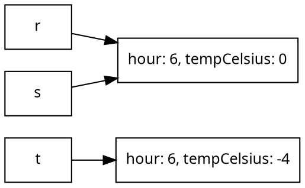

# Mutation and Side Effects

In [Chapter 5](./05_arrays#array-operations), you may have noticed that our arrays never changed. Every `map` and `filter` produced a new array, every `reduce` produced a new value, and `day` itself came through every example unchanged. That is also true of every program in this course so far, and of every program you wrote in CPSC 110: values were created, used, and combined into new values, but an existing value was never modified.

The ability to change an existing value is called **mutation**. The syntax that enables mutation is short (most of it is a single `=` sign) but this small syntax change has large consequences for how you think about software.

Mutation introduces the dimension of time into our programs: the answer to "what does this variable hold?" stops being something we can read directly from the source code and becomes a feature of a particular instant in time during the program's execution. No longer can you reason about functions by replacing variable names with values, as you did in mathematics courses. This requires a shift in how we view our programs: we will need to read the static text and simulate the effect of time on the code's behaviour.

## Reassignment

So far, every variable we have declared has used the `const` keyword. `const` guarantees that the name keeps referring to the same value for as long as the name exists. TypeScript provides a second way to declare a variable: `let`, which allows variables to be reassigned zero or more times as the program runs.

```typescript
const absZero: number = -273;
absZero = -273.15;              // error: Cannot assign to 'absZero' because it is a constant
let temperature: number = -4;   // temperature holds -4 after this line executes
temperature = 1;                // temperature now holds 1 after this line executes
temperature = temperature + 2;  // temperature now holds 3 after this line executes
```

<details class="tooltip ts-tips">
<summary>Declaring Variables with <code>let</code></summary>

The statement
```typescript
let x: T = e
```
declares a variable `x` of type `T` and initialises it to the value that expression `e` evaluates to. Variables declared with `let` can be reassigned to different values later. But as with `const`, you cannot use `let` to declare the same variable multiple times.

</details>
<details class="tooltip ts-tips">
<summary>Reassignment with <code>=</code></summary>

The statement
```typescript
x = <expression>
```
evaluates `<expression>`, then assigns that value to the variable named `x`. For this to pass the compiler, `x` must be a variable declared with `let`, or a parameter.

</details>

Every declaration you have written in this course uses `=` to store a first value into a brand-new name, an operation called **assignment**. The last two lines are different. There, `=` stores a value into a name that already exists, replacing the value `temperature` used to hold. This is **reassignment**. A `const` variable forbids it; a `let` variable and a function parameter allow it.

A reassignment is performed in two steps: first the right-hand side is evaluated, using the values the variables hold right now. Then the result is stored into the name on the left, replacing whatever it held. This makes the `=` operator very different from the equals sign of mathematics. The last line above, `temperature = temperature + 2;`, makes no sense as a math equation (no number equals itself plus two). But as an instruction it is clear: take the value `temperature` currently holds (`1`), add `2`, and store the result (`3`) back into `temperature`.

Reassignment is written as a statement of its own, like `if` and `return` from the first chapter, and is used for the action it performs. Because each reassignment replaces a value, the order of statements now matters in a way it never did before:

```typescript
let x: number = 1;
x = x * 2;
x = x + 3;
// x holds 5; if the two reassignments were swapped, x would hold 8
```

The **state** of a program is the value every variable holds at a particular instant during execution. Before mutation, a program had no state worth describing: a name meant one value, forever. With mutation, understanding a program means tracing its state over time: running the program in your head, statement by statement, the way we traced `temperature` above. When a program with mutation surprises you, the cause is almost always a difference between the state you thought the program was in and the state it was in fact in.

<details class="tooltip link-110">
<summary>There Was No Mutation in ISL</summary>

This is the first construct in the course with no counterpart in CPSC 110. In the teaching languages, `define` bound a name to a value once, and nothing could change it afterwards. That is what made the stepper possible: because a name meant one value forever, any name could be replaced by its value, anywhere, without changing what the program meant.

Mutation gives that property up. A name can no longer be replaced by "its value", because which value depends on where the program is in its execution. This is a significant difference between the two languages, and it is why this chapter moves slowly.

</details>

## State Gives Loops a Memory

Loops have a second strength that we could not use until now: values that change as the loop runs. Here is a problem that needs it.

> As a weather forecaster, I want to find the longest unbroken stretch of below-freezing hours in a day, so that I can report the severity of overnight cold snaps.

No single `map`, `filter`, or `find` computes this, because the answer depends on runs of consecutive elements: the computation has to remember how long the current cold streak is, and reset that memory every time the temperature rises above freezing.

Here's a solution that uses mutation to introduce state that keeps track of the current freezing streak, and the longest freezing streak seen:

```typescript
/**
 * Computes the length of the longest run of consecutive
 * below-freezing readings in a day.
 *
 * @param {Reading[]} day the readings to examine, in hour order.
 * @returns {number} the length of the longest freezing streak.
 */
function longestFreezingStreak(day: Reading[]): number {
    let current: number = 0; // consecutive freezing readings ending here
    let longest: number = 0; // best streak seen so far

    for (const reading of day) {
        if (reading.tempCelsius < 0) {
            current = current + 1;
            if (current > longest) {
                longest = current;
            }
        } else {
            current = 0; // the streak is broken
        }
    }
    return longest;
}
```

```typescript
test("longest freezing streak spans the early morning",
    checkExpect(() => longestFreezingStreak(day), 2)
);
```

The counters `current` and `longest` are the loop's state: values that survive from one element to the next and change as the loop runs. To see the state evolve, trace the loop over our `day` of readings, whose temperatures are `-4, -1, 3, 8, 2, -2`:

| Reading | Freezing? | `current` after | `longest` after |
|---|---|---|---|
| Hour 6, -4° | Yes | 1 | 1 |
| Hour 9, -1° | Yes | 2 | 2 |
| Hour 12, 3° | No | 0 | 2 |
| Hour 15, 8° | No | 0 | 2 |
| Hour 18, 2° | No | 0 | 2 |
| Hour 21, -2° | Yes | 1 | 2 |

The morning streak of two readings is recorded in `longest`, survives the warm afternoon, and is not beaten by the single freezing reading in the evening. A trace table like this one is a standard tool for understanding stateful code, when programs are small enough. Writing one out by hand is a reliable way to debug: it makes the program's state visible.

<details class="tooltip deep-dive">
<summary>Use the Debugger for Larger Programs</summary>

A trace table is something you fill in by hand, which is practical only for short programs. Your IDE includes a **debugger** that does the same work automatically and at any scale. You set a **breakpoint** on a line, run the program, and execution pauses when it reaches that line. While it is paused, a panel shows the current value of every variable in scope, so you can read the program's state directly instead of reconstructing it on paper.

From a breakpoint you can step through the code one statement at a time and watch the values change. This is the trace table built for you as the program runs. You can also modify a variable while execution is paused and then continue, which lets you test what would happen for a different value without editing the code and running it again.

The debugger should be the main tool you think of whenever a program runs to more than a screen of code and you need to understand how it is operating at runtime.

</details>

<details class="tooltip exercise">
<summary>Challenge Exercise: No-Mutation Longest Freezing Streak</summary>

We said above that "No single `map`, `filter`, or `find` computes this", but `reduce` can compute the longest freezing streak without mutation.

1. What makes `reduce` different from `map`, `filter`, or `find`? Why can this difference be used to simulate state?
2. Try writing `longestFreezingStreak` with `reduce`, with no mutation. If you're not sure where to start, try applying the design recipe from CPSC 110, then translate to TypeScript. Hint 1: <span class="hint">the trace table above shows how the simulated state should evolve.</span> Hint 2: <span class="hint"> Build your accumulator so it can store the same information as in the trace table, and build your reduce function argument so it updates the accumulator value as the trace table does.</span>
3. If you manage to do this, compare the `reduce` solution to the iteration-and-mutation solution above. While they may produce the same result, which one do you think would be easier for another developer to read? Why?

<!-- Potential unverified solution:

```typescript
/** The state of the scan so far: the streak ending at this reading, and the best streak seen. */
type Streaks = { current: number; longest: number };

/**
 * Computes the length of the longest run of consecutive below-freezing
 * readings in a day, without mutation. The accumulator carries the two
 * values the loop version kept in variables.
 *
 * @param {Reading[]} day the readings to examine, in hour order.
 * @returns {number} the length of the longest freezing streak.
 */
function longestFreezingStreak(day: Reading[]): number {
    const start: Streaks = { current: 0, longest: 0 };
    const end: Streaks = day.reduce((acc: Streaks, reading: Reading) => {
        if (reading.tempCelsius < 0) {
            const current: number = acc.current + 1;
            if (current > acc.longest) {
                return { current: current, longest: current };
            }
            return { current: current, longest: acc.longest };
        }
        return { current: 0, longest: acc.longest };
    }, start);
    return end.longest;
}

test("longest freezing streak spans the early morning",
    checkExpect(() => longestFreezingStreak(day), 2)
);

test("a streak at the end of the day is counted",
    checkExpect(() => longestFreezingStreak([
        { hour: 6, tempCelsius: 1 },
        { hour: 9, tempCelsius: -1 },
        { hour: 12, tempCelsius: -3 },
        { hour: 15, tempCelsius: -8 },
    ]), 3)
);
```

1. `map`, `filter` and `find` look at one element at a time and cannot carry anything from one element to the next. `reduce` threads an accumulator through the array: the value its function returns for one element is handed to the call for the next. That accumulator can hold whatever the loop kept in `current` and `longest`, so it simulates state without any variable being reassigned.
3. Both give 2 for `day`. Most readers find the loop easier to follow: the trace table maps directly onto `current` and `longest`, whereas the `reduce` version makes the reader work out that each returned object is "the state after this reading", and it builds a new object per element. The `reduce` version has the advantage that nothing is mutated, so it cannot be affected by, or affect, aliases.
-->

</details>

## Changing Objects and Arrays

Reassigning a variable is one kind of mutation. The second kind is changing the contents of an object or array, and it needs no `let` at all:

```typescript
const reading: Reading = { hour: 6, tempCelsius: -4 };

reading.tempCelsius = -3;                  // allowed: the object's contents changed
reading = { hour: 6, tempCelsius: -3 };    // compile error: Cannot assign to 'reading' because it is a constant
```

That this is allowed can feel surprising. `const` froze the variable (the name `reading` will refer to this object forever) but it says nothing about the object itself. In TypeScript, an object's properties remain assignable whether the name that refers to it was declared with `const` or `let`. The distinction between a name and the thing it refers to is the subject of the next section. For now, the point is that the two lines above do different things, and the compiler treats them differently.

Arrays are objects, and they mutate the same ways. Elements can be replaced through their index, and the classic array mutations are the pair that grow and shrink the array itself: `push` adds an element to the end, and `pop` removes the last element and returns it. Two more change the array at other positions: `unshift` adds an element to the front, and `splice(i, n)` removes `n` elements starting at index `i`, closing the gap they leave. The listing below works on a copy of the array, made with `slice`, which with no arguments copies the whole array, so the array changes land on `today` and leave `day` with its six readings:

```typescript
const today: Reading[] = day.slice();        // a copy of the whole array
today.push({ hour: 22, tempCelsius: -3 });   // adds a seventh reading to the end
const removed: Reading | undefined = today.pop();   // removes and returns that reading; today has six again
today.unshift({ hour: 3, tempCelsius: -5 }); // adds a reading to the front; the others each move up one index
today.splice(1, 1);                          // removes one reading at index 1; today has six again
today[0] = { hour: 5, tempCelsius: -6 };     // replaces the first element entirely
today[1].tempCelsius = -2;                   // reaches into the second element and changes it; day[1] is that same object, as the next section explains
```

The complexity mutation brings is justified by what it models: in the real world things change, and to model them effectively, programs need to be able to change too. Our weather station does not receive its day of readings all at once: a new reading arrives every hour, and `push` is how the day grows. Rebuilding the entire array to add one element would say something false about the problem, and at scale it is also wasteful: updating one reading in a year of data by copying the other thousands of readings does more measurable work than updating in place.

<details class="tooltip ts-tips">
<summary>Mutating and Non-Mutating Array Operations</summary>

Arrays have both _mutating_ and _non-mutating_ operations, and you must know which is which.

`map` and `filter` are non-mutating. They return a new array and leave the original array untouched, which is why the previous chapter could use them freely. That is a narrower promise than it first appears, as the next section explains.

`push`, `pop`, `unshift`, `splice`, and `sort` (unlike `toSorted` from the previous chapter) mutate the array in place. The names do not announce them as mutating, so when using an array operation for the first time, check its documentation to see whether it modifies the array or returns a new one. Many real bugs come from a `sort` that reordered an array another part of the program was still using.

</details>

## Copies and References

Programming languages sometimes make design decisions for the sake of performance. We try not to think much about performance while building our first systems, but one such decision is the reason for this section, and for much of the confusion around mutation.

To predict which changes are visible where, we need a precise picture of what a variable holds. There are two cases. In the first case, a variable holding a primitive value (such as a `number`, `string`, or `boolean`) holds the value itself. Assigning it to another variable copies the value, and from then on the two variables are entirely independent:

```typescript
let a: number = 5;
let b: number = a;          // b receives its own copy of 5
b = 6;

test("reassigning b leaves a unaffected", checkExpect(() => a, 5));
```

In the second case, a variable holding an object or array does not hold the object itself. It holds a **reference**: a value that says where the object is. (You can think of a reference as holding the address of the actual object value.)

Storing references is the performance decision mentioned at the top of this section. In a simpler world, assigning an object would copy it exactly the way assigning a number does, and every variable would be independent of every other. The language declines to do this because of what copying costs.

A primitive has a small, fixed size, so copying one is essentially free. An object has no size limit: a single `Reading` is small, but an array holding a year of readings, or an object whose properties are themselves objects, can occupy enormous amounts of memory, and the language cannot know at a given `=` sign whether the copy would be cheap or extremely expensive.

So, objects are never copied on assignment. What is copied instead is the reference, which stays the same small size no matter how large the object it leads to. This efficiency has a consequence: assigning an object to another variable copies the reference, not the object, so both variables now refer to the same object:

```typescript
test("s and r see the same change",
    checkExpect(() => {
        const r: Reading = { hour: 6, tempCelsius: -4 };
        const s: Reading = r;                     // s receives r's reference
        s.tempCelsius = 0;
        return r.tempCelsius;
    }, 0)
);

test("t, a separate object with the same contents, keeps its own value",
    checkExpect(() => {
        const r: Reading = { hour: 6, tempCelsius: -4 };
        const t: Reading = { hour: 6, tempCelsius: -4 };
        const s: Reading = r;
        s.tempCelsius = 0;
        return t.tempCelsius;
    }, -4)
);
```

These are the first checks we have written whose thunk has a body in braces. Every thunk so far has been a single expression, `() => <actual>`, which implicitly returns its value. Showing what a change through one name does to another takes several steps: create the objects, make the change, and read the result. A body in braces holds all of them, so each check builds its own objects and no other check can change them. The _Testing_ point in [Side Effects](#side-effects) explains why that matters.

An arrow function can also have a block as its body:

```typescript
(x: X, y: Y, z: Z) => {
    <statement-1>;
    <statement-2>;
}
```

The braces mark the difference: once a body is a block, nothing is returned implicitly, so the value the check compares must be returned explicitly. Written without the `return`:

```typescript
checkExpect(() => {
    const r: Reading = { hour: 6, tempCelsius: -4 };
    const s: Reading = r;
    s.tempCelsius = 0;
    r.tempCelsius; // read, then discarded
}, 0);
```

the thunk does the work but does not hand back the answer. The compiler rejects this call before the test can run: a thunk that returns nothing can only be compared with nothing, so the error points at `0`, saying that a `number` is not assignable to `void`. Whenever you use braces, check whether a `return` is needed. When a check fits in a single expression, prefer the form without braces.


<!-- caption="r and s refer to the same object, so the change made through s shows through r; t refers to a separate object with the same starting contents." -->

One way to think about this is with boxes. A variable is a labelled box. For a primitive, the box contains the value. For an object, the box contains an arrow pointing to the object, which lives elsewhere. `const s = r` copies the arrow. There is still exactly one `Reading`, with two arrows pointing at it, and a change made through either arrow is visible through both. Two variables referring to the same object are called **aliases**. Aliasing is a common source of surprises with mutation: code changes an object through one name, and the change appears under another name somewhere else.

Aliasing is also why `map` and `filter` are less protective than they look. Each builds a new array, so the original array is untouched. But that new array is filled with the references it found in the original array. When the elements are objects, both arrays lead to the same objects:

```typescript
test("the change reaches back into the original array",
    checkExpect(() => {
        const readings: Reading[] = [
            { hour: 6, tempCelsius: -4 },
            { hour: 12, tempCelsius: 3 }
        ];
        const frozen: Reading[] = readings.filter((r: Reading) => r.tempCelsius < 0);
        frozen[0].tempCelsius = 0;      // changed through frozen's reference
        return readings[0].tempCelsius;
    }, 0)
);
```

The array was copied, but the readings were not. A copy that duplicates only the top level and shares everything beneath it is called a _shallow copy_, and [Chapter 12](../part2/03_encapsulation#when-references-escape) returns to it when the question becomes how to hand data out safely.

<details class="tooltip deep-dive">
<summary>References Are Pointers (a Preview of CPSC 213)</summary>

Concretely, the box holds a **memory address**. Every object lives somewhere in the computer's memory, and a reference is the number of the location where that object begins. The "arrow" in our box picture is the runtime following the address to the object.

C, the language at the centre of CPSC 213, makes all of this explicit. Its references are called **pointers**, a pointer's numeric value can be printed, compared, and even used in arithmetic, and the language has dedicated operators for taking an address (`&x`) and for following one (`*p`). TypeScript runs on the same machinery but hides it completely: you cannot observe an address, manufacture one, or do arithmetic on one. Everything this chapter says about sharing and aliasing is the visible behaviour of that hidden machinery.

The other thing C makes explicit is memory management. In this course we never think about where objects live or when their memory is reclaimed. In C, the programmer asks for memory when creating an object (`malloc`) and must announce when the program is finished with it (`free`), because nothing else will. Both directions of mistake are serious: freeing too early leaves _dangling pointers_, aliases to memory that may already be reused for something unrelated, and forgetting to free _leaks_ memory that can never be recovered while the program runs. Many serious security vulnerabilities in widely used software come from these mistakes.

TypeScript spares you all of it by reclaiming unreachable objects automatically (the garbage collection deep-dive later in this chapter), trading away some performance and control to do so. When you reach CPSC 213 you will manage memory yourself, and see what the runtime has been doing for you here.

</details>

References explain the `const` surprise from the previous section: `const` locks the box, not the object the arrow points to. The arrow cannot be redirected, but the object at the end of it remains as mutable as ever.

`===` (strict equality, from [Chapter 2](./02_model-types#branching-on-the-case)) means different things for primitives and objects, and the difference is the one this section describes: whether a change made through one name is visible through another.

For primitives, `===` compares values. Two numbers that happen to be equal are `===`, whether or not they were declared together:

```typescript
const x: number = 5;
const y: number = 5;

test("separately declared numbers with equal values are ===",
    checkExpect(() => x === y, true)
);
```

For objects, `===` compares _identity_: it asks whether two variables refer to the same object in memory, not whether their contents are equal.

```typescript
const r: Reading = { hour: 6, tempCelsius: -4 };
const s: Reading = r;                              // s refers to r's object
const t: Reading = { hour: 6, tempCelsius: -4 };   // a separate object with equal contents

test("r and s are the same object", checkExpect(() => r === s, true));

test("r and t are different objects, despite identical contents",
    checkExpect(() => r === t, false)
);
```

This is the visibility rule restated as a comparison. Because `r` and `s` are the same object, a mutation through one is seen through the other, and because `t` is a different object, it keeps its own value, as the first two checks in this section showed. So `r === t` being `false` tells you that `r` and `t` are independent, and that changing one will never change the other.

### What a Function Can Change

Calling a function performs an assignment: each argument is assigned to its parameter. Everything about what a function can change in its caller follows from those parameter assignments.

We will walk through three cases. These rules differ between programming languages, so when you learn a new language, find out exactly how it passes parameters.

_1. Passing a primitive: the function gets a copy._ The parameter is a new box holding a copy of the value, so nothing the function does to it can affect the caller:

```typescript
/**
 * Adds one to the function's own copy of n, which has no effect on the caller.
 *
 * @param {number} n the number to increment.
 */
function bump(n: number): void {
    n = n + 1;          // changes only the function's own copy
}

test("bump leaves the caller's number unchanged",
    checkExpect(() => {
        let hour: number = 6;
        bump(hour);
        return hour;
    }, 6)
);
```

This behaviour is called **pass-by-value**. The function receives the value, not the variable. `bump` compiles and runs, but accomplishes nothing, because it reassigns only its own copy `n`, which is discarded when the function exits.

_2. Passing an object: the function gets a copy of the reference._ The parameter is a new box, but it holds a copy of the arrow, and the arrow points at the caller's object. Mutation through the parameter changes the one object both arrows share, and the caller sees it:

```typescript
/**
 * Corrects a reading from a sensor that is known to measure
 * offset degrees away from the true temperature.
 * Modifies the given reading in place.
 *
 * @param {Reading} reading the reading to correct; changed in place.
 * @param {number} offset the number of degrees to add to the reading.
 */
function calibrate(reading: Reading, offset: number): void {
    reading.tempCelsius = reading.tempCelsius + offset;
}

test("calibrate changes the caller's object",
    checkExpect(() => {
        const morning: Reading = { hour: 6, tempCelsius: -4 };
        calibrate(morning, 1);
        return morning.tempCelsius;
    }, -3)
);
```

This behaviour is commonly called **pass-by-reference**: the function is operating on the caller's object, not a private copy. The change `calibrate` makes is externally visible after the function has exited. Strictly, TypeScript passes the reference by value, which is why case 3 below behaves as it does; the deep dive explains the distinction.

<details class="tooltip ts-tips">
<summary>The <code>void</code> Return Type</summary>

The functions above are our first whose signatures declare a return type of `void`: they return nothing, so there is no value to declare or return. A `void` function is called purely for what it does rather than what it produces. Before this chapter, that would have made such a function useless. `bump` is useless and `calibrate` is not, and the difference between them is the subject of this chapter.

</details>

_3. Reassigning an object parameter: still invisible._ One tricky aspect of pass-by-reference comes up when we reassign a function's parameters. Parameters hold a copy of the arrow. Reassigning that arrow points the function's own box somewhere new, but leaves the original arrow unchanged. Make sure you understand this example, because many languages have similar rules:

```typescript
/**
 * Tries to reset a reading to zero degrees by reassigning the parameter,
 * which has no effect on the caller's reading.
 *
 * @param {Reading} reading the reading to reset.
 */
function reset(reading: Reading): void {
    reading = { hour: reading.hour, tempCelsius: 0 };
}

test("reset leaves the caller's object unchanged",
    checkExpect(() => {
        const evening: Reading = { hour: 21, tempCelsius: -2 };
        reset(evening); // reset redirected its local arrow only
        return evening.tempCelsius;
    }, -2)
);
```

Compare `calibrate` and `reset` carefully: one writes `reading.tempCelsius = ...`, the other writes `reading = ...`. Mutating through a reference (`reading.tempCelsius`) changes the shared object and is visible to the caller. Reassigning the reference itself (`reading`) just rebinds the function's local name and is invisible externally.

<details class="tooltip deep-dive">
<summary>What "Pass-by-Reference" Means in TypeScript</summary>

The terms used above are the ones you will hear in practice. But the way it is implemented might be surprising. TypeScript passes every argument by value. For objects, the value being copied is a reference. For primitives, the value being copied is the value itself. Some languages have true pass-by-reference (C++'s `int&`), where the parameter is the caller's variable under another name, and a reassignment like the one in `reset` would change the caller's variable. TypeScript has no such mechanism, which is why `reset` cannot work.

</details>

The three cases side by side:

| Argument passed               | The parameter receives  | Reassigning the parameter | Mutating the object it refers to   |
|-------------------------------|-------------------------|---------------------------|------------------------------------|
| `number`, `string`, `boolean` | A copy of the value     | Invisible to the caller   | N/A (primitives cannot be mutated) |
| Object or array               | A copy of the reference | Invisible to the caller   | Visible to the caller              |

Here is a visual representation of this distinction:

<!---- CL: ditaa interprets : as a contol character, using ∶ instead ---->
<!---- CL: unfortunately that replacement doesn't work within ditaa boxes
       because it is slightly different width. ꞉ might work, but doesn't
       render in vitepress. Fine, use ;        --->

```ditaa
 Primitive argument; the parameter is a separate copy.

    caller            function
    +------+          +------+
    |  6   |          |  6   |
    +------+          +------+
    (independent; changing one cannot affect the other)


 Object argument; the parameter copies the arrow, not the object.

    caller  ---+
               |
               v
          +----------+
          |  object  |
          +----------+
               ^
               |
    function---+
    (mutating through either arrow is seen by both)
```
<!-- caption="A primitive argument is copied; an object argument shares one object through a copied reference." -->

## Scope: Where Names Live

Mutation makes it newly important to know exactly where each variable exists, because every variable that can change is something a reader must keep track of. Where a variable exists is called its **scope**.

TypeScript scopes variables using **block scope**: a variable exists from its declaration to the end of the block (the `{ ... }`) that encloses it. The name is only visible inside that block. The compiler enforces this rule statically:

```typescript
function describeTemperature(reading: Reading): string {
    if (reading.tempCelsius < 0) {
        const label: string = "freezing";
        return label;        // fine: label is in scope here
    }
    return label;            // compile error: Cannot find name 'label'
}
```

Blocks nest, and the rule works one way: an inner block can use names declared in the blocks that enclose it, but never the reverse. `longestFreezingStreak` relies on this. Its loop body reads and reassigns `current` and `longest`, which are declared outside the loop in the function's own block. Declaring them there lets their values survive from one iteration to the next. To see why their position matters, consider what happens if `current` is declared inside the loop body instead:

```typescript
for (const reading of day) {
    let current: number = 0;      // a brand-new current for every element
    if (reading.tempCelsius < 0) {
        current = current + 1;   // always computes 0 + 1
    }
}                                // ...and current is gone again
```

Each pass through a loop body is a fresh copy of the block: this `current` is created holding `0`, exists for one iteration, and is discarded at the closing brace, along with its value. A variable declared inside a block cannot remember anything across runs of that block.

Where you declare a variable decides how long its state lives. The design rule of thumb is to declare each variable in the smallest block that still contains every use of it.

There are three ways a value can outlive the block that created it:

1. _The value is returned._ The name `longest` disappears when `longestFreezingStreak` ends, but its final value escapes through `return` into the caller's hands.
2. _The value is assigned to a variable declared outside._ The loop body's assignments to `current` and `longest` outlive each iteration because those variables live in the enclosing block.
3. _The block mutates an object that is visible outside._ This one is the easiest to miss. Consider calibrating an entire day:

```typescript
/**
 * Corrects every reading in a day by the same offset.
 * Modifies the given readings in place.
 *
 * @param {Reading[]} day the readings to correct; each is changed in place.
 * @param {number} offset the number of degrees to add to each reading.
 */
function calibrateDay(day: Reading[], offset: number): void {
    for (const reading of day) {
        reading.tempCelsius = reading.tempCelsius + offset;
    }
}
```

<!-- need to make this a div to keep the whole-para indentation and the MD formatting -->
<div style="padding-left: 20px;">

Every name in sight here is short-lived: `reading` is re-created each iteration, and the `day` parameter vanishes when the function returns. Yet every change survives, because the objects those names pointed at belong to the caller's array, which is still in scope outside the function.
</div>

Scope governs names, not objects. In TypeScript, an object lives as long as anything, anywhere, still refers to it. Mutations made to an object through a short-lived name are permanent. Block structure determines whether a variable name still exists, and the arrows determine whether a change persists.

<details class="tooltip deep-dive">
<summary>Object Lifetimes and Garbage Collection</summary>

An object's lifetime is determined by _reachability_, not scope. An object lives as long as some chain of references, starting from a live variable, leads to it. When the last reference is gone, the object can never be observed again, and the runtime reclaims its memory automatically, a mechanism called **garbage collection**. This is why TypeScript programs never explicitly destroy objects.

</details>

<details class="tooltip deep-dive">
<summary>Mutability, Immutability, and Program Complexity</summary>

A value that can never change after creation is called **immutable**, and much of this chapter's difficulty disappears when data is immutable. Aliasing causes problems only because some code can change the shared object: two arrows pointing at an object that nobody can change behave exactly like two private copies, so the copy-versus-reference distinction stops affecting what a program computes. A reader can treat every immutable value as a fact rather than a state: learn it once and rely on it anywhere, in any order. ISL had this property everywhere. With no mutation in the language, every value was a fact, which is part of why the substitution model worked and why no chapter before this one needed a trace table.

Mutability provides efficient updates and direct modelling of change, at the cost of requiring this reasoning. Every alias to a mutable object is a potential writer, so the effort of understanding a value grows with the number of places that can reach it, and the order of operations starts to matter. The complexity is real enough that much of professional practice is organised around limiting it: declaring everything `const`, preferring operations like `map` and `filter` that return new values, and designing types whose instances are never modified after construction. Some languages go further. In Rust, values are immutable unless explicitly marked otherwise, and the compiler restricts shared mutable data.

The working compromise in most systems, and in this course, is immutability by default with mutation where the problem demands it. A program in which the few mutable values are clearly marked, narrowly scoped, and changed in only a few places keeps most of the simplicity of immutable data while paying mutation's costs only where they are needed.

</details>

## Side Effects

We now have a name for what `calibrate` and `calibrateDay` do. A **side effect** is any observable change a function makes besides returning a value. This can include mutating an object its caller can see, reassigning a variable declared outside it, or interacting with the world outside the program entirely (writing a file, printing output, sending a network request). A function with no side effects, one that only computes a value from its inputs, is called a **pure function**. Every function we showed before this chapter was pure.

Side effects change what we must do as readers, as documenters, and as testers of code:

- _Reading._ A pure function can be understood from its signature: `Reading[]` in, `number` out. A signature like `calibrateDay`'s (with `void` out) says nothing about what the function is for, because its whole purpose is the effect. You must read the implementation, or trust the documentation.
- _Documenting._ Because the signature does not provide cues about side effects, the documentation has to say what the function changes. The line `Modifies the given reading in place` in `calibrate`'s comment provides this hint. A mutating function whose documentation does not mention the mutation is a trap for every caller who reasonably assumes their arguments come back unchanged.
- _Testing._ A pure function is tested by checking its return value. A mutating function is tested by checking state: call it, then assert on the object afterwards. Do both inside the check, as the tests in [What a Function Can Change](#what-a-function-can-change) did. The testing framework loads the whole file before it runs any check, so a change made at the top level of the file has already happened when every check runs, including the checks written above it. A value created inside a check cannot be changed by any other check.

```typescript
test("the first reading is shifted by the offset",
    checkExpect(() => {
        const readings: Reading[] = [
            { hour: 6, tempCelsius: -4 },
            { hour: 9, tempCelsius: -1 }
        ];
        calibrateDay(readings, 1);
        return readings[0].tempCelsius;
    }, -3)
);

test("the second reading is shifted by the offset",
    checkExpect(() => {
        const readings: Reading[] = [
            { hour: 6, tempCelsius: -4 },
            { hour: 9, tempCelsius: -1 }
        ];
        calibrateDay(readings, 1);
        return readings[1].tempCelsius;
    }, 0)
);
```

Each check builds its own readings, which repeats the setup. [Chapter 9](./09_validation#richer-test-cases) shows two ways to avoid this: one test can make several checks against the same values, and a test runner can build fresh values before each test.

There is one more consequence that we have been building towards in Part 1. The invariants chapters established a practice: validate a value when it is constructed, and rely on the invariant afterwards. Mutation breaks the "afterwards". `reading.hour = 99` is a legal statement that violates the `Reading` invariant long after construction, and aliasing means any part of the program holding a reference can do it, at any time. With mutation, an invariant is no longer established once. It must be preserved by every operation that touches the data.

Keeping that promise requires controlling who is allowed to mutate state at all. [Chapter 4](./04_maintaining-invariants#hiding-state-with-a-closure) already showed one way to do that: hold the invariant-relevant state inside a closure, where no other code can reach it, so there is no reference to alias in the first place. That technique protects data by never handing it out, but the readings in this chapter are passed from function to function because callers need them. [Chapter 12](../part2/03_encapsulation#hiding-the-representation) takes up the general version of the problem, replacing the closure pattern with language syntax that lets data be shared while still restricting who may change it.

Until then, we will continue to follow a discipline-based approach:

- Declare every variable with `const`. When a value turns out to need changing, change that one declaration to `let`, deliberately. Every `let` is a value your reader must trace through time.
- Prefer the non-mutating operations (`map`, `filter`) when they fit, remembering that they copy the array and not the objects inside it. Use mutation when the problem is about change, as the arriving readings and the streak counters were.
- Keep mutable state in the smallest scope that works: a counter local to one function is easy to reason about, while a mutable value visible to the whole program can be changed by the whole program.
- Clearly document mutation when it happens: in a function's name, its documentation, and its tests.

#### Mutating the World

Mutation is worth its drawbacks, because real programs model a changing world. Programs must now be understood by tracing values through time, and every reader needs to be able to answer new questions: whether a value is a copy or a reference, whether a change escapes its block, function or module, and who else holds an arrow to an object. The box-and-arrow model and the scope rules in this chapter are the tools for answering these questions.

Side effects are a necessary part of real software, because the point of a program is to do useful work for people.

<details class="tooltip exercise">
  <summary>Exercise: Moving a Robot</summary>

Here we practise in-place mutation, references and aliasing on a small moving object.

> As a game engine, I want a robot's position updated as it moves, so that the rest of the game can read its current location.

A robot is just a position:

```typescript
type Robot = { x: number; y: number };
```

In each part, create the robot inside the check that tests it, as the `calibrate` and `calibrateDay` tests did, so that no part can move a robot that another part is checking.

1. Write `step(robot: Robot, dx: number, dy: number): void` that moves the robot by adding `dx` to its `x` and `dy` to its `y`, changing the robot in place. Create a robot at `{ x: 0, y: 0 }`, call `step(robot, 1, 2)`, and write one test per coordinate, each with a single `checkExpect`, confirming the caller's robot now has an `x` of 1 and a `y` of 2.
2. Write `teleport(robot: Robot, x: number, y: number): void` that instead reassigns the parameter, with `robot = { x: x, y: y }`. Predict what the caller's robot looks like after `teleport(robot, 9, 9)`, then confirm it with `checkExpect`. Why does `step` change the caller's robot while `teleport` does not?
3. Give a robot a second name with `const other: Robot = robot`. Call `step(other, 3, 0)`, and use `checkExpect` to show that `robot` sees the move, because `other` is an alias for the same object. Then build a separate robot `twin` with the same coordinates, and use `===` to confirm that `robot === other` is `true` but `robot === twin` is `false`.
4. Write `walk(robot: Robot, steps: number[]): void` that uses a `for of` loop to apply each number in `steps` as an eastward move (one `step(robot, s, 0)` per element), so the position carries forward from one iteration to the next. Check the robot's final `x` against the sum of `steps`.

<!-- Potential unverified solution:

```typescript
type Robot = { x: number; y: number };

/**
 * Moves the robot by the given amounts. Modifies the robot in place.
 *
 * @param {Robot} robot the robot to move; changed in place.
 * @param {number} dx the distance to move along x.
 * @param {number} dy the distance to move along y.
 */
function step(robot: Robot, dx: number, dy: number): void {
    robot.x = robot.x + dx;
    robot.y = robot.y + dy;
}

/**
 * Tries to move the robot by reassigning the parameter, which has no
 * effect on the caller's robot.
 *
 * @param {Robot} robot the robot to move.
 * @param {number} x the new x position.
 * @param {number} y the new y position.
 */
function teleport(robot: Robot, x: number, y: number): void {
    robot = { x: x, y: y };
}

/**
 * Moves the robot east by each of the given distances in turn.
 * Modifies the robot in place.
 *
 * @param {Robot} robot the robot to move; changed in place.
 * @param {number[]} steps the eastward distances to apply, in order.
 */
function walk(robot: Robot, steps: number[]): void {
    for (const s of steps) {
        step(robot, s, 0);
    }
}

// 1. step changes the caller's robot
test("step moves x",
    checkExpect(() => {
        const robot: Robot = { x: 0, y: 0 };
        step(robot, 1, 2);
        return robot.x;
    }, 1)
);

test("step moves y",
    checkExpect(() => {
        const robot: Robot = { x: 0, y: 0 };
        step(robot, 1, 2);
        return robot.y;
    }, 2)
);

// 2. teleport reassigns only its own parameter, so the caller's robot stays put
test("teleport leaves the caller's robot unchanged",
    checkExpect(() => {
        const robot: Robot = { x: 0, y: 0 };
        teleport(robot, 9, 9);
        return robot;
    }, { x: 0, y: 0 })
);

// 3. aliases and identity
test("a move through an alias is seen through the original name",
    checkExpect(() => {
        const robot: Robot = { x: 0, y: 0 };
        const other: Robot = robot;
        step(other, 3, 0);
        return robot.x;
    }, 3)
);

test("an alias is the same object",
    checkExpect(() => {
        const robot: Robot = { x: 0, y: 0 };
        const other: Robot = robot;
        return robot === other;
    }, true)
);

test("a twin with the same coordinates is a different object",
    checkExpect(() => {
        const robot: Robot = { x: 0, y: 0 };
        const twin: Robot = { x: 0, y: 0 };
        return robot === twin;
    }, false)
);

// 4. walk carries the position from one iteration to the next
test("walk ends at the sum of its steps",
    checkExpect(() => {
        const robot: Robot = { x: 0, y: 0 };
        const steps: number[] = [1, 2, 3];
        walk(robot, steps);
        const total: number = steps.reduce((sum: number, s: number) => sum + s, 0);
        return robot.x === total;
    }, true)
);
```

Part 2: the caller's robot is still `{ x: 0, y: 0 }`. `step` mutates the object both arrows point at; `teleport` points its own parameter at a new object and leaves the caller's arrow untouched.
-->

</details>
