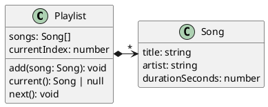
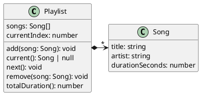
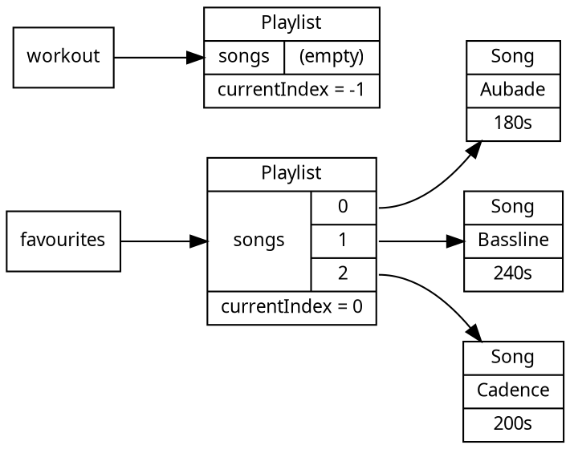

# Building Abstractions with Classes

[Part 1](../part1/index) ended with invariants maintained by hand. In [Chapter 4](../part1/04_maintaining-invariants#hiding-state-with-a-closure), we wrote a constructor function that established an invariant when a value was created, and hid the value's state inside a closure so that only a fixed set of operations could change it.

Object-oriented programming provides the same pattern as language syntax. Its mechanism is the **class**, a named unit that bundles state with the operations that maintain it.

#### A Playlist with a Current Song

Consider the running example for this chapter:

> As a listener, I want a playlist that always knows which song is current, so that pressing "next" moves through my music predictably as I add and remove songs.

A playlist holds a list of songs and remembers which one is current, so that the app's screen can show what is playing and advance to the next song. The current position is an index into the list of songs. Its type is `number`, but not every number is meaningful. Only an index that points at a real song makes sense, and when the playlist is empty there is no current song at all. This rule, that the current index is always a valid position in the list (or a sentinel when the list is empty), is an invariant. As in [Chapter 4](../part1/04_maintaining-invariants#valid-types-invalid-values), the type system cannot express it, because `number` permits `-4` and `9999` as readily as a valid index.

## Keeping State Consistent

An invariant like "the current position points to a real song in the playlist" is only useful if it is always true. In a small program it can be maintained through discipline, where every place that changes the song list also fixes the current index.

That discipline does not scale. Suppose the song list and the index are **global variables**, which any part of the system can read and write. Then any part of the program can leave the index pointing at a song that no longer exists, and splitting the program into more files does not help, because every file can still reach the variables. To maintain the invariant, we would have to audit the whole program, which is costly and error-prone.

What we want is a way to bundle the state (the songs and the index) with the operations that are allowed to change it (add, remove, advance). The invariant then becomes the responsibility of one small, named unit, a class, rather than of every caller.

## From Closures to Classes

The closure pattern from [Chapter 4](../part1/04_maintaining-invariants#hiding-state-with-a-closure) bundled state with operations using only what you knew from CPSC 110, but without support from the language. Here is a playlist built with closures, as a constructor function whose returned operations close over the hidden state:

<CollapsibleCode>

```typescript
type Playlist = {
    /**
     * Adds a song to the end; the first song added becomes current.
     *
     * @param {Song} song the song to add.
     */
    add(song: Song): void;
    /**
     * Returns the current song.
     *
     * @returns {Song | null} the current song, or null when the playlist is empty.
     */
    current(): Song | null;
    /** Advances to the next song, wrapping back to the start; does nothing when the playlist is empty. */
    next(): void;
};

/**
 * Creates an empty playlist.
 *
 * @returns {Playlist} a playlist with no songs.
 */
function makePlaylist(): Playlist {
    const songs: Song[] = [];   // hidden state
    let currentIndex: number = -1;  // hidden state; -1 means empty

    return {
        add(song: Song): void {
            songs.push(song);
            if (currentIndex === -1) {
                currentIndex = 0;
            }
        },
        current(): Song | null {
            return currentIndex === -1 ? null : songs[currentIndex];
        },
        next(): void {
            if (currentIndex !== -1) {
                currentIndex = (currentIndex + 1) % songs.length;
            }
        }
    };
}
```

</CollapsibleCode>

The state (`songs` and `currentIndex`) is reachable only through the three returned operations, so the invariant is safe. But the language gives no help: the connection between the state, the constructor function, and the operations exists only because we arranged it by hand.

A class expresses the same arrangement with support from the language. The same playlist, written as a class, looks like this:

<CollapsibleCode>

```typescript
class Playlist {
    /** The songs, in playing order. */
    songs: Song[] = [];
    /** The position of the current song: -1 when songs is empty, otherwise a valid index into songs. */
    currentIndex: number = -1;

    /**
     * Adds a song to the end; the first song added becomes current.
     *
     * @param {Song} song the song to add.
     */
    add(song: Song): void {
        this.songs.push(song);
        if (this.currentIndex === -1) {
            this.currentIndex = 0;
        }
    }

    /**
     * Returns the current song.
     *
     * @returns {Song | null} the current song, or null when the playlist is empty.
     */
    current(): Song | null {
        return this.currentIndex === -1 ? null : this.songs[this.currentIndex];
    }

    /** Advances to the next song, wrapping back to the start; does nothing when the playlist is empty. */
    next(): void {
        if (this.currentIndex !== -1) {
            this.currentIndex = (this.currentIndex + 1) % this.songs.length;
        }
    }
}
```

</CollapsibleCode>

Each piece of the closure maps onto a piece of the class:

| Closure version | Class version |
|---|---|
| Variables closed over (`songs`, `currentIndex`) | Fields |
| The `makePlaylist` function | The constructor |
| The returned operations | Methods |
| Reaching state by closure | Reaching state through `this` |

The behaviour is identical. The class adds what the hand-built version lacked: one declaration that holds the state, the constructor, and the operations together, and a standard way to construct instances with `new`. In one respect the class is weaker. The closure's variables were unreachable from outside, but these fields can be read and written by any code that holds a `Playlist`. [Chapter 12](./03_encapsulation#hiding-the-representation) fixes this, and the rest of this chapter develops the class itself.


<!-- caption="Playlist and its operations." -->

## Classes and Constructors

A class is the primary unit of **abstraction** in object-oriented programs: something a client can use by knowing what it does, without knowing how it does it. It can be read as a template for a kind of value, describing the state every value of that kind holds and the operations every such value provides. Most object-oriented languages, including C++, Java, Python, and TypeScript, provide classes.

<details class="tooltip deep-dive">
  <summary>Where Classes Are Stored</summary>

Classes are stored in files. In some languages, like Java, a file can contain at most one public class. TypeScript has no such restriction, and a file can contain several classes. In practice, code is easier to find when each file contains one class and the filename matches the class name.

As systems grow, these files are organised into folders with meaningful names that group related classes together.

</details>

Each class declares a type named for the class. As with `type` in Chapter 2, the name should be chosen carefully, because it is the shortest description of what the class is for.

<details class="tooltip ts-tips">
<summary>Class Declarations</summary>

The class declaration
```typescript
class X {
   // ...
}
```
is a statement that declares the name `X` as a type.

</details>

A class on its own describes its values but does no work. To use a class, we create an instance with the `new` operator:

```typescript
const favourites: Playlist = new Playlist();
```

<details class="tooltip ts-tips">
  <summary>The <code>new</code> Operator</summary>

The expression
```typescript
new T()
```
creates an object of class `T` and evaluates to the new instance.

</details>

`new` calls a special method on the class, its constructor, which runs before the object can be used. In TypeScript, the constructor is named `constructor`:

```typescript
class Playlist {
    constructor() {
        // set up the new object here
    }
}
```

The constructor is the single point where every object of the class comes into existence, which makes it the place to establish invariants, as the constructor function did in Chapter 4. Once the constructor has established an invariant, every method can assume it holds, and each method must preserve it, as in Part 1.

<details class="tooltip ts-tips">
<summary>Constructors</summary>

Within a class, the `constructor()` statement:
```typescript
class T {
   constructor() {
     // empty default constructor
   }
}
```
defines how objects of type `T` are created. Unlike other functions, a constructor has no return type annotation, because it always produces an instance of its class. If a class declares no constructor, TypeScript provides a default one that takes no arguments.

</details>

Creating an object from a class is called **instantiating** the class, and the object is an **instance** of it. Every instance is an object with its own state, independent of every other instance.

```typescript
const favourites: Playlist = new Playlist();
const workout: Playlist = new Playlist();
```

Adding a song to `favourites` does nothing to `workout`. This independence is one way classes help manage state: a program can hold many objects, each responsible for its own part of the world.

<!-- ## Class Bodies: Storing State and Functionality -->

A class combines state and functionality. We look at each in turn.

## Class State

State is held in **fields**, named and typed properties that each object stores independently. The `Playlist` class has two, the list of songs and the current index:

```typescript
class Playlist {
    songs: Song[] = [];
    currentIndex: number = -1;
    // ...
}
```

The `= []` and `= -1` give the fields default values, used when the constructor does not set them otherwise.

<details class="tooltip ts-tips">
  <summary>Fields and <code>this</code></summary>

The following defines a field named `myField` of type `X` within class `T`.

```typescript
class T {

    myField: X;

    constructor(theField: X) {
        this.myField = theField;
    }
}
```

The `this` keyword refers to the current instance of the class, and only makes sense inside a class body. In the constructor, `this.myField` refers to `myField` in the object being constructed.

</details>

<details class="tooltip ts-tips">
  <summary>Default Initialising Fields</summary>

When a field has a default initial value that the constructor does not need to customise, rather than writing:
```typescript
class T {
   myField: X;
   constructor() {
      this.myField = <default value>;
   }
}
```
we can write:
```typescript
class T {
    myField: X = <default value>;
}
```
This sets the default value of `myField` to `<default value>`, which can be any expression. Setting a default is equivalent to setting the field in the constructor.

</details>

Declaring a field is straightforward. Decide what state you need to track, give it a clear name and a type, and decide whether it has a default value or must be supplied through the constructor. The harder question is what should be state at all, as opposed to a local variable inside a method. As a rule of thumb, data belongs in a field if its value must survive after a method returns, or must be visible to other methods.

## Class Functionality

Functionality is provided by methods. A **method** is a function property that acts on the object's state. Most methods preserve or observe the class's invariants.

<details class="tooltip ts-tips">
<summary>Methods (and <code>this</code> Again)</summary>

The following defines a method `firstMethod` for class `T`:
```typescript
class T {
    firstMethod(x: X, y: Y): Z {
       // do something with x and y to return a value of type Z
    }
}
```
Given an instance `const t: T = new T()`, we call the method with `t.firstMethod(...)`, and inside the method, `this` refers to `t`. To call one method from another, use `this`:

```typescript
class T {
    firstMethod(x: X, y: Y): Z {
       if (this.secondMethod()) {
         // ...
       }
    }

    secondMethod(): boolean {
       // ...
    }
}
```

</details>

A method has a name, takes zero or more parameters, and either returns a value or is declared `void`. Declaring a return type of `void` tells a reader that the lack of a return value is intentional.

Declaring a method involves a few decisions:
- What the method is for, and a name that captures that intent.
- What parameters it takes, with their names and types.
- What it returns, and its type.

It can help to think about testing. If you know what you want to check about a method, its parameters are the data you would pass it and its return value is the result you would inspect. Unlike a free function, though, a method can also read and change the object's fields, so part of its input and part of its result may live in the object rather than in its parameters and return value.

Here is the `Playlist` class with its methods, including the `remove` operation that makes the invariant interesting:

<CollapsibleCode>

```typescript
class Playlist {
    /** The songs, in playing order. */
    songs: Song[] = [];
    /** The position of the current song: -1 when songs is empty, otherwise a valid index into songs. */
    currentIndex: number = -1;

    /**
     * Adds a song to the end; the first song added becomes current.
     *
     * @param {Song} song the song to add.
     */
    add(song: Song): void {
        this.songs.push(song);
        if (this.currentIndex === -1) {
            this.currentIndex = 0;
        }
    }

    /**
     * Returns the current song.
     *
     * @returns {Song | null} the current song, or null when the playlist is empty.
     */
    current(): Song | null {
        return this.currentIndex === -1 ? null : this.songs[this.currentIndex];
    }

    /** Advances to the next song, wrapping back to the start; does nothing when the playlist is empty. */
    next(): void {
        if (this.currentIndex !== -1) {
            this.currentIndex = (this.currentIndex + 1) % this.songs.length;
        }
    }

    /**
     * Removes the given song, keeping the current position valid. Does nothing
     * when the song is not in the playlist.
     *
     * @param {Song} song the song to remove; matched by identity.
     */
    remove(song: Song): void {
        const i: number = this.songs.indexOf(song);
        if (i === -1) {
            return;
        }
        this.songs.splice(i, 1);
        if (this.songs.length === 0) {
            this.currentIndex = -1;
        } else if (i < this.currentIndex) {
            this.currentIndex = this.currentIndex - 1;
        } else if (this.currentIndex >= this.songs.length) {
            this.currentIndex = this.songs.length - 1;
        }
    }

    /**
     * Returns the total playing time of the playlist.
     *
     * @returns {number} the sum of the songs' durations, in seconds; 0 when the playlist is empty.
     */
    totalDuration(): number {
        return this.songs.reduce((sum: number, song: Song) => sum + song.durationSeconds, 0);
    }
}
```

</CollapsibleCode>

Removing a song can invalidate the current index. If the removed song was before the current one, every later index shifts down by one, and if the removed song was the last one and it was current, the index now points past the end. Each branch repairs the index so that the invariant still holds when `remove` returns. The caller does not have to think about any of this, because the work of keeping the index valid lives with the data it constrains, inside the method, rather than in the calling code.

In `remove`, `indexOf` finds the song by identity, so `remove` removes the exact object it was given and ignores a separately built song with identical fields. Whether that is reasonable to expect of a caller is a design question that [Chapter 13](./04_flexibility#two-notions-of-sameness) takes up.


<!-- caption="The same Playlist after adding the remove and totalDuration operations." -->

## Programming Paradigms

The class is a third way of organising a program, alongside two paradigms from Part 1.

**Functional programming** builds values and transforms them with functions, without mutation. We saw this in Chapter 2 when we modelled data as types and processed it with pure functions. Summing the durations of a list of songs functionally looks like this, with no mutation:

```typescript
const total: number = songs.reduce((sum: number, song: Song) => sum + song.durationSeconds, 0);
```

**Imperative programming** is a sequence of statements (Chapter 1) that read and change state (Chapter 6) step by step. Recursion is the idiomatic functional way of handling variable-sized data, and loops (Chapter 5) are the idiomatic imperative way. Imperatively, the same sum looks like this:

```typescript
let total: number = 0;
for (const song of songs) {
    total = total + song.durationSeconds;
}
```

**Object-oriented programming** bundles state with the operations that maintain it. Written this way, the sum is a question we ask an object:

```typescript
const total: number = playlist.totalDuration();
```

The three styles are often mixed: a method body is usually imperative, a class can hold immutable values, and a functional pipeline can run inside a method.

<details class="tooltip link-110">
<summary>You Have Already Modelled a Playlist</summary>

[Chapter 2](../part1/02_model-types#playlists) modelled a playlist as a tagged union, `EmptyPlaylist | NonEmptyPlaylist`, with separate functions such as `countSongs` and `totalDuration` that each took a `Playlist`. This chapter's `Playlist` is a new design that reuses Chapter 2's `Song`: it keeps the songs in an array and joins the data and the operations that maintain it into one class.

</details>

## Classes Are Types

Declaring a class declares a type, and that type behaves like any other type from Chapter 2. `Playlist` can annotate a variable, type a parameter, be a return type, or be the element type of an array:

```typescript
function longest(playlists: Playlist[]): Playlist | null {
    let longestSoFar: Playlist | null = null;
    for (const playlist of playlists) {
        if (longestSoFar === null) {
            longestSoFar = playlist;
        } else if (playlist.totalDuration() > longestSoFar.totalDuration()) {
            longestSoFar = playlist;
        }
    }
    return longestSoFar;
}
```

The compiler checks these annotations as it did for the types in Part 1. A function that expects a `Playlist` cannot be given a `Song`, and the result of `longest` is known to be a `Playlist` or `null`, so a caller must handle the empty case.

### Objects and References

A field of one object can hold another object, and a variable that "holds" an object actually holds a reference to it, as in Chapter 6. This has two consequences:

1. Two objects are distinct even when their contents match. Each `new` produces a separate object with its own identity:

```typescript
const a: Playlist = new Playlist();
const b: Playlist = new Playlist();
// a === b is false: they are different objects
```

2. When an object is passed to a function or stored in a field, the reference is copied, not the object. The caller and the callee then share one object, so a change made through either is visible to both. This is the aliasing from [Chapter 6](../part1/06_state-mutation#copies-and-references), and as that chapter showed, primitives behave differently.

## Working with Objects

We call an object's methods with dot notation: in `playlist.next()`, the `.` separates the object from the method called on it.

The following program uses two independent playlists:

<CollapsibleCode>

```typescript
const favourites: Playlist = new Playlist();
const workout: Playlist = new Playlist();

const a: Song = { title: "Aubade", artist: "Dawn Quartet", durationSeconds: 180 };
const b: Song = { title: "Bassline", artist: "Low End", durationSeconds: 240 };
const c: Song = { title: "Cadence", artist: "The Meter", durationSeconds: 200 };

favourites.add(a);
favourites.add(b);
favourites.add(c);
expect(favourites.current()).to.deep.equal(a);   // first song added is current

favourites.next();
expect(favourites.current()).to.deep.equal(b);

favourites.remove(b);                            // removing the current song keeps the index valid
expect(favourites.current()).to.deep.equal(c);   // c shifted into b's old position

expect(workout.current()).to.equal(null);        // workout is untouched and still empty
```

</CollapsibleCode>

After the three `add` calls, the objects and the references between them look like this. Each variable holds a reference to its own `Playlist`, and the cells of `favourites`' `songs` hold references to three separate `Song` objects. `currentIndex`, by contrast, is an ordinary number, not a reference:


<!-- caption="favourites and workout are distinct objects; the songs cells reference separate Song objects, while currentIndex contains a primitive value." -->

## Testing Classes

In Chapter 9, we tested functions by passing them arguments and inspecting the result. Testing a class is different, because an object carries state between calls. A test usually constructs an object, performs a sequence of operations, and then checks the resulting state: the object's observable behaviour, not a single return value. This test adds two songs to a `Playlist`, moves to the second, and removes it:

```typescript
const songA: Song = { title: "Aubade", artist: "Dawn Quartet", durationSeconds: 180 };
const songB: Song = { title: "Bassline", artist: "Low End", durationSeconds: 240 };

test("removing the current song keeps the position valid", () => {
    const playlist: Playlist = new Playlist();
    playlist.add(songA);
    playlist.add(songB);
    playlist.next();                                  // current is now songB
    playlist.remove(songB);                           // remove the current song
    expect(playlist.current()).to.deep.equal(songA);  // the position stayed valid
});
```

The test-design ideas from Part 1 still apply. Equivalence classes and boundaries now describe sequences of method calls rather than single arguments: an empty playlist, a one-song playlist, and removing the current song versus another song.

Almost every test of a class starts by building a fresh object. Writing `new Playlist()` at the top of every test is repetitive, but sharing one object across tests is worse, because one test's changes would leak into the next. A `beforeEach` hook inside a `describe` block, as in [Chapter 9](../part1/09_validation#shared-setup), is the natural place to create a fresh object:

```typescript
describe("Playlist", () => {
    let playlist: Playlist;

    beforeEach(() => {
        playlist = new Playlist();   // a fresh, empty playlist before each test
    });

    test("a new playlist has no current song", () => {
        expect(playlist.current()).to.equal(null);
    });

    test("the first song added becomes current", () => {
        playlist.add(songA);
        expect(playlist.current()).to.deep.equal(songA);
    });
});
```

Each test now gets its own `playlist`, so the tests stay independent of one another.

#### The Value of Class Abstractions

A class is a unit of abstraction because it bundles state with the operations that maintain it. A client reasons about what a `Playlist` does, through its methods, without needing to know how it keeps the current index valid. Because those methods live alongside the state they protect, a client that uses only the methods cannot leave a `Playlist` in an inconsistent state, and the rest of the program no longer has to keep that state consistent.

To use a class, a client only needs to find one that models what they care about and call its methods. Class names therefore deserve care: a good name lets an engineer find the abstraction they need without reading the code that implements it.

<!--
So far this is the class _offering_ an interface that a client has no need to look past. It is not yet a guarantee. Nothing in this chapter stops a determined caller from reaching in and writing `favourites.currentIndex = 99` directly, breaking the invariant from outside. Guaranteeing that a client _cannot_ reach past the interface, so that an object's state is truly the class's own, is the role of [encapsulation](./03_encapsulation).
-->

<details class="tooltip exercise">
<summary>Exercise: Designing a Class</summary>

Design a class for the scenario below, following the same path this chapter used for `Playlist`.

> As a homeowner, I want a thermostat whose target temperature I can nudge up or down but never set outside a safe range, so that the house is never driven dangerously hot or cold.

For this task, design a class, name it, and determine its invariants. Decide what fields it should hold, and design the methods that update that state. There are many possible designs for a problem like this, so try to come up with more than one and compare their strengths and weaknesses.

<!-- Potential unverified solution:

```typescript
import { describe, test, expect, beforeEach } from "vitest";

/**
 * A thermostat whose target temperature can be nudged up or down but
 * never leaves a safe range.
 *
 * Class invariant: minTarget <= target <= maxTarget.
 */
class Thermostat {
    /** The lowest safe target, in degrees Celsius. */
    minTarget: number;
    /** The highest safe target, in degrees Celsius; never below minTarget. */
    maxTarget: number;
    /** The current target, in degrees Celsius; between minTarget and maxTarget. */
    target: number;

    /**
     * Creates a thermostat with the given safe range, starting at the
     * middle of that range.
     *
     * @param {number} minTarget the lowest safe target.
     * @param {number} maxTarget the highest safe target.
     * @throws {Error} "minTarget must not exceed maxTarget" when the range is empty.
     */
    constructor(minTarget: number, maxTarget: number) {
        if (minTarget > maxTarget) {
            throw new Error("minTarget must not exceed maxTarget");
        }
        this.minTarget = minTarget;
        this.maxTarget = maxTarget;
        this.target = (minTarget + maxTarget) / 2;
    }

    /**
     * Raises the target by one degree, stopping at the highest safe target.
     */
    nudgeUp(): void {
        if (this.target + 1 > this.maxTarget) {
            this.target = this.maxTarget;
        } else {
            this.target = this.target + 1;
        }
    }

    /**
     * Lowers the target by one degree, stopping at the lowest safe target.
     */
    nudgeDown(): void {
        if (this.target - 1 < this.minTarget) {
            this.target = this.minTarget;
        } else {
            this.target = this.target - 1;
        }
    }

    /**
     * Returns the current target temperature.
     *
     * @returns {number} the target, in degrees Celsius.
     */
    currentTarget(): number {
        return this.target;
    }
}

describe("Thermostat", () => {
    let thermostat: Thermostat;

    beforeEach(() => {
        thermostat = new Thermostat(15, 25);
    });

    test("starts in the middle of the safe range", () => {
        expect(thermostat.currentTarget()).to.equal(20);
    });

    test("nudging up raises the target by one degree", () => {
        thermostat.nudgeUp();
        expect(thermostat.currentTarget()).to.equal(21);
    });

    test("nudging up stops at the highest safe target", () => {
        thermostat.nudgeUp();
        thermostat.nudgeUp();
        thermostat.nudgeUp();
        thermostat.nudgeUp();
        thermostat.nudgeUp();
        thermostat.nudgeUp();                        // a sixth nudge would pass 25
        expect(thermostat.currentTarget()).to.equal(25);
    });

    test("nudging down stops at the lowest safe target", () => {
        thermostat.nudgeDown();
        thermostat.nudgeDown();
        thermostat.nudgeDown();
        thermostat.nudgeDown();
        thermostat.nudgeDown();
        thermostat.nudgeDown();                      // a sixth nudge would pass 15
        expect(thermostat.currentTarget()).to.equal(15);
    });

    test("an empty range is refused", () => {
        expect(() => new Thermostat(25, 15)).to.throw("minTarget must not exceed maxTarget");
    });
});
```

One design, with the trade-offs a second design would change:

1. Clamping versus refusing. The nudges above stop at the limit, as a physical dial does. The alternative refuses a nudge that would leave the range (a `Result`, as in Chapter 4, or an error) and so tells the caller the limit was hit; it costs every caller a check.
2. Limits per thermostat versus fixed. Constructor arguments let each house choose its safe range; fixed limits remove a constructor argument and the empty-range check.
3. Step size. `nudgeUp(amount)` is more flexible but adds a second rule to protect (the amount must be positive); a fixed one-degree step has none.

In every design the invariant is `minTarget <= target <= maxTarget`, established by the constructor and preserved by both nudges. Nothing yet stops a caller writing `thermostat.target = 100`; Chapter 12 closes that gap.
-->

</details>

