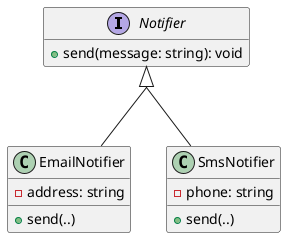
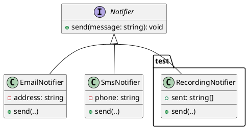
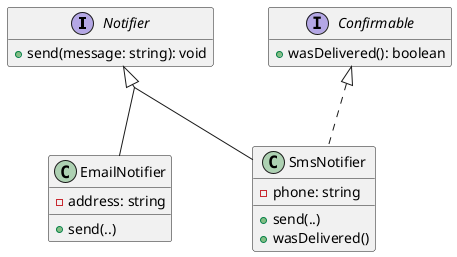
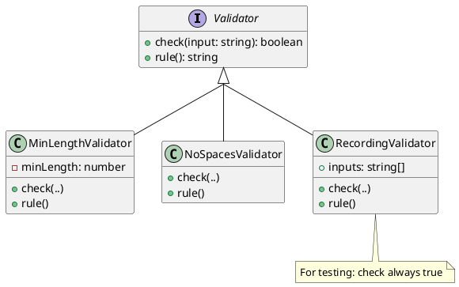

# Defining Boundaries with Interfaces

The last two chapters removed two commitments from a class: how it stores its data, and what type of members it holds. But every design we have written still commits to one thing: the class's name.

A variable is declared `GuestList`, a parameter is typed `GuestList`, and the code around it depends on that one class even though it uses only the public methods. The representation is hidden, but the class itself is not.

An **interface** lets the class name be hidden as well. An interface is a named type that lists a set of operations, but not their implementation. Code written against an interface depends only on the operations it names, so any class that provides those operations can be used, and the class can change without the calling code being modified.

This chapter is also the foundation for the next two chapters, on polymorphism and on extending a system without modifying it.

<details class="tooltip exercise">
<summary>Exercise: There's nothing new about separating types and implementations...</summary>

In [Chapter 4](../part1/04_maintaining-invariants#hiding-state-with-a-closure), we saw how to hide data from all but a few given operations, using a closure-based `makeX` constructor function. To do this, we separated the type declaration `X`, which specified those few operations, from the constructor function `makeX`, where those operations were defined.

For all the applications we saw up to Chapter 10, this separation of `type X` and `makeX` was mostly a nuisance. In [Chapter 10](./01_abstraction#from-closures-to-classes), we welcomed the use of `class` to reduce the duplication. But this separation allows us to provide some of the same abstraction we'll see in this and the next chapter.

Try the following exercise:
1. Specify a `Pet` type that provides the operations `getName(): string` and `say(): string`, for the pet's name and what it says.
2. Write a `makeCat` and `makeDog` (or whatever your favourite pet species is), that closes over the pet's name while providing a `getName(): string` getter and a `say(): string` appropriate for that species.
3. Write a function `petDialogue(p: Pet): string` that returns what the pet says with its name prepended.
4. Note how the same `petDialogue` function can be used for various types of pets, reducing code duplication!
5. (Extension) Do the same using `interface` after reading this chapter.

(If you came into this course knowing a bit about object orientation, you may find the analogy of interfaces useful for understanding Chapter 4.)

<details class="tooltip deep-dive">
<summary>Solution</summary>

Run in [Playground](https://www.typescriptlang.org/play/?#code/C4TwDgpgBAChxQLxQN4Cgqagc3gOQEMBbCACgEoAuKAZ2ACcBLAO2wG4MsaCQLq6mrDgF8OaAPQAqSRklQAwvQgFgEGlAJQAJgHtsUAO6NgACyino2RgDcIzKM2IQAdLNlQAAmAL1iqASzYwg5O5ibQutgA5OqOJO4eSsAArvTM6ihwwMGakAimKrQ86gBEBjo6AGYAhCWy4miVycwAxsCMOvZEBADWEAAieqRxEPwMgVSw8KicmC2ddNp61FlIM1gbOPhOfLTjrOubR0mp9iMcR5jCADSzm9y8kwEH6JebJ2lQZRU1JReXwjuojuH3skREaAk0ncimUqnUmhahSMpjClhsdhCJFcUBkuM83l8RH8+yCWOgFigSOAMXJCVBGSyOSgeTChQepRIOgMzjquIaTVa7U6UG6fXkKmGTjGgmwk1Wryw83SCGpK2myEVR1wwEIJF2z30WreUFB5P+Rxudw2DwNpMOJtN8FOXy5PL+1qwgI2wI2ZupEKheLkACUIGAdPRgOoDCZCrlphzriylJVGAAPCBaQzGMzGWJOHHBgk+PyZeDBMBolnwenOtIZQ3BSl5WkjZOInQAG06HeY2djhWMRRANHqjWabQ69jy-UYBB72GSZDA6uAT3txrNYGcOr1ZHIUAA1F9qCVjyznLbyIHlYs07o12sxQMhiUAGKMXQlG9oO8IMB6CqNQaEjABZCBuSfZAXwlYBSBKGAgMqEDIygCDuR-MR-xraM1wAbQAXTWfCHx0ZNAOAmhQPoDCDEIsRKjQ0gcKrKpcJoQ9jTvbsXEXUhZ3nRdlwE8hf0BIA):

<CollapsibleCode>

```typescript
type Pet = {
    getName(): string;
    say(): string;
};

/**
 * Creates a dog with the given name.
 *
 * @param {string} name the dog's name.
 * @returns {Pet} a pet that says "woof!".
 */
function makeDog(name: string): Pet {
    const dog: Pet = {
        getName(): string {
            return name;
        },
        say(): string {
            return "woof!";
        }
    };
    return dog;
}

/**
 * Creates a cat with the given name.
 *
 * @param {string} name the cat's name.
 * @returns {Pet} a pet that says "meow.".
 */
function makeCat(name: string): Pet {
    const cat: Pet = {
        getName(): string {
            return name;
        },
        say(): string {
            return "meow.";
        }
    };
    return cat;
}

/**
 * Reports what a pet says, prefixed with its name.
 *
 * @param {Pet} p the pet.
 * @returns {string} the pet's name, a colon, and what it says.
 */
function petDialogue(p: Pet): string {
    return p.getName() + ": " + p.say();
}

const fido: Pet = makeDog("Fido");
const professorMeow: Pet = makeCat("Professor Meow");

const pets: Pet[] = [fido, professorMeow];

for (const p of pets) {
    console.log(petDialogue(p));
}
```

</CollapsibleCode>

</details>

<!-- Potential unverified solution:

```typescript
import { test, expect } from "vitest";

interface Pet {
    /**
     * Returns the pet's name.
     *
     * @returns {string} the name.
     */
    getName(): string;

    /**
     * Returns what the pet says.
     *
     * @returns {string} the pet's sound.
     */
    say(): string;
}

class Dog implements Pet {
    /** The dog's name. */
    private readonly name: string;

    /**
     * Creates a dog with the given name.
     *
     * @param {string} name the dog's name.
     */
    public constructor(name: string) {
        this.name = name;
    }

    public getName(): string {
        return this.name;
    }

    public say(): string {
        return "woof!";
    }
}

class Cat implements Pet {
    /** The cat's name. */
    private readonly name: string;

    /**
     * Creates a cat with the given name.
     *
     * @param {string} name the cat's name.
     */
    public constructor(name: string) {
        this.name = name;
    }

    public getName(): string {
        return this.name;
    }

    public say(): string {
        return "meow.";
    }
}

/**
 * Reports what a pet says, prefixed with its name.
 *
 * @param {Pet} p the pet.
 * @returns {string} the pet's name, a colon, and what it says.
 */
function petDialogue(p: Pet): string {
    return p.getName() + ": " + p.say();
}

test("petDialogue works for every kind of Pet", () => {
    const pets: Pet[] = [new Dog("Fido"), new Cat("Professor Meow")];
    expect(pets.map((p: Pet) => petDialogue(p))).to.deep.equal(["Fido: woof!", "Professor Meow: meow."]);
});
```

Steps 1 to 4 are answered by the Solution deep dive above. Step 5 is the version above: `Pet` becomes an `interface`, each species a class that `implements` it, and `petDialogue` is unchanged between the two versions, which is the point.
-->

</details>


## A Channel as a Contract

We will use one running example for the rest of Part 2. We will consider a small system that delivers alert messages to people over different communication channels. Here's a user story:

> As a monitoring system, I want to deliver an alert over each configured channel, so that the code that raises an alert never changes when a new channel is added.

For example, email and SMS (two communication channels) differ in almost every respect. But they can both deliver a message, which is all that's important for raising an alert. The `interface` keyword lets us specify this shared capability to send a message precisely.

## Declaring an Interface

An interface declares a name and a list of method signatures. Each line in the body is a **method signature**: a method's name, parameters, and return type, with no body. All interface methods are public. The interface records what operations exist, not how they work.

<details class="tooltip ts-tips">
<summary>The <code>interface</code> Keyword</summary>

<!-- TS allows fields in interfaces, but we won't cover this in 210 -->

The following declares an interface with a name `<Name>` and method(s):

```typescript
interface <Name> {
    <methodName>(<parameters>): <ReturnType>;
}
```

The syntax is nearly identical to `class` except interfaces will not have method bodies. Just like a class, the name `<Name>` can be used as a type.

</details>

Here's an interface expressing the send capability for our channels:

```typescript
/**
 * Delivers short alert messages over a single channel to a fixed recipient.
 *
 * A channel is responsible only for delivery. The recipient is decided when
 * the channel is constructed; callers decide only what to send.
 */
interface Notifier {
    /**
     * Delivers an alert carrying `message` over this channel, formatted and
     * shortened as the channel requires, returning once delivery has been
     * attempted.
     *
     * @param {string} message the alert text; callers pass a non-empty string.
     */
    send(message: string): void;
}
```

`Notifier` contains a single method signature and no fields. This is intentional, because an interface describes the operations a caller may invoke, not the state or representation behind them. In [Chapter 12](./03_encapsulation#choosing-what-to-expose), we discussed which methods a class should expose. We can use interfaces to give that public surface a name of its own, separate from any class.

Because an interface is a contract that one body of code implements and another depends on, it should be documented carefully. Every member is part of a promise that callers rely on and implementers must keep. Documentation is valuable for any function, but for an interface it is close to essential, because there is no body a reader could consult instead.

<details class="tooltip ts-tips">
<summary><code>interface</code> Versus <code>type</code></summary>

You have used `type` since [Chapter 2](../part1/02_model-types#modelling-data) to name unions and the shapes of data, and TypeScript lets you describe an object's shape with either `type` or `interface`. This course uses an `interface` for a contract that classes implement and callers depend on, and `type` for unions (`"red" | "green" | "yellow"`) and for the shape of plain data. Use `interface` when several classes will commit to the same set of operations.

</details>

<details class="tooltip link-110">
<summary>Contracts Before Implementations</summary>

You relied on contracts without implementations in CPSC 110. When a function needed a helper you had not written yet, you recorded the helper's signature and purpose and called it right away, trusting that contract while its body was still on your wish list.

When we use interfaces, we rely on a similar abstraction. An interface records the signatures a caller may rely on, and the compiler guarantees that an implementation exists and matches.

</details>

## Implementing the Contract

A class states that it satisfies an interface with the `implements` keyword. The header:

```typescript
class <ClassName> implements <InterfaceName> {
    // ...
}
```

says that `<ClassName>` must implement every method declared by `<InterfaceName>`.

The compiler enforces this: a class that leaves out an operation, or provides one with an incompatible signature, does not compile. The compiler checks only that the signatures match. The documented behaviour, such as attempting to deliver every message it is given, is the rest of the contract, and only the implementer's care and the tests uphold it.

`implements` allows two classes to keep the `Notifier` promise in completely different ways:

<CollapsibleCode>

```typescript
class EmailNotifier implements Notifier {
    /** The recipient's email address. */
    private readonly address: string;

    /**
     * Creates a notifier that emails alerts to `address`.
     *
     * @param {string} address the recipient's email address.
     */
    public constructor(address: string) {
        this.address = address;
    }

    public send(message: string): void {
        assert(message.length > 0, "message must not be empty");
        const text: string = "[ALERT] " + message;
        // deliver `text` to this.address over email
    }
}

class SmsNotifier implements Notifier {
    /** The recipient's phone number. */
    private readonly phone: string;

    /**
     * Creates a notifier that texts alerts to `phone`.
     *
     * @param {string} phone the recipient's phone number.
     */
    public constructor(phone: string) {
        this.phone = phone;
    }

    public send(message: string): void {
        assert(message.length > 0, "message must not be empty");
        const text: string = "[ALERT] " + message;
        // deliver `text` to this.phone over SMS
    }
}
```

</CollapsibleCode>

Each class has its own private representation (an email address and a phone number) and its own way of delivering a message. Each class is encapsulated as per [Chapter 12](./03_encapsulation#hiding-the-representation). What is new is that both classes share a public type, `Notifier`, that neither of them owns.


<!-- caption="EmailNotifier and SmsNotifier both implement Notifier, each with its own private field." -->

<details class="tooltip deep-dive">
<summary>Structural Typing</summary>

Many languages, such as Java, are _nominal_: a class is a `Notifier` only if it explicitly says so.

TypeScript is unusual in that it checks types by _shape_ (the term we've been using throughout the book to describe the property names and types of an object), not by name. A value is acceptable wherever a type is expected if it has the required members, whatever it was declared as, so a class with a matching `send` method can be used as a `Notifier` even without writing `implements Notifier`. `implements` is still worth writing, because it declares intent and turns a silent mismatch into a clear error. With `implements Notifier`, forgetting or misspelling `send` fails at the class, where the mistake is, rather than later at some distant call site.

You can read more in the [Uncovered Language Features](../reference/language-features#structural-typing) reference page.

</details>

## Apparent and Actual Types

Once a class implements an interface, an object of that class can be held in a variable declared with the interface type:

```typescript
const alerts: Notifier = new EmailNotifier("ops@example.com");
```

Two different types are involved. The **apparent type** (static type) is the one written in the code, `Notifier`, and is what the compiler knows about the variable. The **actual type** (dynamic type) is the type of the object that exists at runtime, `EmailNotifier`. This is the static and dynamic distinction from [Chapter 1](../part1/01_new-language#static-and-dynamic-views): the apparent type belongs to the static view the compiler checks, and the actual type belongs to the dynamic view that exists only when the program runs.

The compiler restricts what you can do with a variable based on its apparent type. Through an apparent type of `Notifier` you may call `send`, because the contract promises it. But you can do nothing more than that:

```typescript
alerts.send("disk almost full"); // allowed: send is declared on Notifier
// alerts.address                // rejected: address is not part of Notifier
```

That restriction may look like a loss, but it is what we want in this scenario. The code relies only on what `Notifier` promises, so the object behind `alerts` can be of any type that implements `Notifier`. If we had declared the variable as an `EmailNotifier`, the code would have to be modified or duplicated to work with other kinds of notifier. The practice of declaring the most general type that still offers the operations the code needs is summarised as _program to an interface, not an implementation_: prefer the apparent type that names the contract over the one that names a specific class.

## Many Implementations

Suppose we want to send a notification to several channels at once. With the `Notifier` interface, a function can take a list of different `Notifier` objects and raise an alert on each of them:

```typescript
function alertAll(channels: Notifier[], message: string): void {
    for (const channel of channels) {
        channel.send(message);
    }
}
```

By contrast, here's a version that hard-codes two notifiers:

```typescript
function alertEmailSMS(echannel: EmailNotifier, schannel: SmsNotifier, message: string): void {
    echannel.send(message);
    schannel.send(message);
}
```

`alertAll` keeps working without any change to its code when channels are added or removed in the future. `alertEmailSMS` has to be rewritten every time.

The `Notifier` interface is a boundary, with the alerting logic (`alertAll`) on one side and the delivery mechanisms (the `send` methods of `EmailNotifier` and `SmsNotifier`) on the other. Each side can be read, changed, and tested with only the contract in view, without the other side's code.

## Test Doubles

This clear boundary is also useful for testing. The real channels have effects we do not want in a test suite, since a test of `alertAll` should not send actual email or text messages. But because `alertAll` depends only on `Notifier`, we can easily test it with a stand-in that records what it was asked to send instead of sending anything:

```typescript
class RecordingNotifier implements Notifier {
    /** Every message passed to send, in the order received. */
    public readonly sent: string[] = [];

    /**
     * Records `message` instead of delivering it.
     *
     * @param {string} message the alert text.
     */
    public send(message: string): void {
        this.sent.push(message);
    }
}

test("alertAll delivers the message over every channel", () => {
    const a: RecordingNotifier = new RecordingNotifier();
    const b: RecordingNotifier = new RecordingNotifier();

    alertAll([a, b], "deploy finished");

    expect(a.sent).to.deep.equal(["deploy finished"]);
    expect(b.sent).to.deep.equal(["deploy finished"]);
});
```

`RecordingNotifier` is a third implementation of `Notifier`, written only for tests. A stand-in like this is called a **test double**. A test double that only hands back fixed answers is often called a stub, and one that records how it was called, like `RecordingNotifier`, is often called a **mock object**. It satisfies the same contract as the real thing but is simpler and observable, so the code under test can be exercised in isolation. Interfaces make the specification-based testing from [Chapter 9](../part1/09_validation#specification-based-testing) easy: the test and the code under test both depend on the contract, and the real delivery mechanism is not involved at all. Designing against interfaces therefore makes code easier to test.


<!-- caption="RecordingNotifier, in the test package, implements Notifier alongside the two real channels." -->

## Keeping Interfaces Small

In building `Notifier`, we chose to have it declare only one method. Suppose some channels can also report whether the provider acknowledged a message, say `wasDelivered(): boolean`. It is tempting to add that capability to `Notifier`. But then every implementation of `Notifier` would have to provide a `wasDelivered`. If some notifiers cannot provide this operation, its presence, even as a no-op method, would be confusing. Instead we can put that capability in its own small interface:

```typescript
interface Confirmable {
    /**
     * Reports whether the provider acknowledged the last send.
     *
     * @returns {boolean} true once the provider has acknowledged the last send.
     */
    wasDelivered(): boolean;
}
```

A class can implement more than one interface by listing them both:

```typescript
class SmsNotifier implements Notifier, Confirmable {
    /** Whether the provider acknowledged the last send; false before any send. */
    private acknowledged: boolean = false;

    // phone, constructor and send are as above, except that send also
    // records the provider's acknowledgement in this.acknowledged

    /**
     * Reports whether the provider acknowledged the last send.
     *
     * @returns {boolean} true once the provider has acknowledged the last send.
     */
    public wasDelivered(): boolean {
        return this.acknowledged;
    }
}
```

A channel that cannot confirm anything stays a plain `Notifier` and is never forced to fake an operation it does not support.

By splitting these up, we also allow each caller to depend only on the contract that caller needs. Code that only sends takes a `Notifier`, and code that only checks receipts takes a `Confirmable`. In [Chapter 15](./06_extension#is-a-and-can-do), we'll see how to specify when code needs both.


<!-- caption="SmsNotifier implementing two interfaces." -->

Keeping interfaces small is the interface-level version of the cohesion principle from [Chapter 11](./02_decomposition#single-responsibility) that favours classes with a single responsibility. A small, focused interface describes one capability. A large interface that bundles several forces implementers to support unrelated operations, and forces callers to depend on more than they use. The guidance that many small interfaces are better than one large one is called the **Interface Segregation Principle**.

Small interfaces also preserve the implementation freedom described in [Chapter 13](./04_flexibility#what-makes-a-change-safe). Every operation a contract promises becomes behaviour callers may rely on, so a large interface exposes more of each implementation, while a small one keeps more of it hidden and free to change.

## Constraining Generics

Remember the problem we ended [Chapter 13](./04_flexibility#what-flexibility-costs) with, where `Roster<T>` was more generic than `GuestList`, but couldn't compare its members? The solution we offered was to pass in a comparison function, another use of higher-order functions. Higher-order functions are powerful, but a comparison passed in from outside is one more thing every caller has to get right.

Interfaces offer another solution. Instead of passing in a comparison function, we can first write an interface for types whose objects can report whether they denote the same thing. Like a class, an interface can take a type parameter, here the type that `equals` compares against:

```typescript
interface Equatable<T> {
    /**
     * Reports whether this object denotes the same thing as another.
     *
     * @param {T} other the object to compare against.
     * @returns {boolean} true when both denote the same thing.
     */
    equals(other: T): boolean;
}
```

And then use that type to constrain a generic type:

```typescript
class Roster<T extends Equatable<T>> {
    /** The most members the roster may hold; at least 1. */
    private readonly capacity: number;
    /** The members, no two of them equal by equals, and never more than capacity. */
    private readonly members: T[];

    // constructor, isFull, size, and add as before, with no comparison function

    /**
     * Reports whether `candidate` is on the roster.
     *
     * @param {T} candidate the member to look for.
     * @returns {boolean} true when some member equals `candidate`.
     */
    public isMember(candidate: T): boolean {
        for (const member of this.members) {
            if (member.equals(candidate)) {
                return true;
            }
        }
        return false;
    }
}
```

The constraint `T extends Equatable<T>` promises that every `T` supports `equals(candidate)`, so `member.equals(candidate)` compiles. This is the same reasoning as an apparent type. The compiler knows a variable's operations from the type written on it, and it knows a type variable's operations from the constraint written on it.

<details class="tooltip ts-tips">
<summary><code>extends</code> on Generic Types</summary>

A type variable can be restricted to types that satisfy an interface, written with `extends`:

```typescript
class <Name><T extends <Interface>> {
    // every T is guaranteed to provide the interface's operations
}
```

</details>

Constraining with an interface or passing in a function is a design decision; each has trade-offs. Constraining with `extends` gives the class knowledge but limits which types it accepts. `Roster<Seat>` compiles only if `Seat` has a matching `equals` method, which this book declares by writing `implements Equatable<Seat>`. The `Seat` from Chapter 13 already has one, so the `implements` clause is the only change it needs. `Roster<string>` no longer compiles at all, because a string has no `equals` method. Passing a function in keeps the class usable with every type, including ones you did not write and primitives you cannot change, but requires every caller to supply the comparison. As a rule of thumb, constrain when the operation is part of what the members are and you control those types. Pass the operation in when the members are types you do not control, or when different callers need different notions of sameness.

Either way, the constraint should name the smallest interface that supplies what the class needs. A constraint is a demand made of every type that wants to be a member, and demanding operations the class never calls restricts the class for no benefit.

#### Depending on the Contract

An interface is the public surface of a class, extracted into a named type that any class can implement and any caller can depend on. Depending on an interface instead of a concrete class is a stronger form of information hiding than hiding the representation alone. The previous two chapters let a class change its representation without affecting callers. An interface lets the entire class behind the contract change without affecting callers. Code follows its contracts directly when each contract is named as an interface, kept small and well documented, and the rest of the program is written against it.

Interfaces define a boundary with a contract on one side, and several classes implementing it on the other side. The same method call runs different code depending on the class of the object it is called on.

<details class="tooltip exercise">
  <summary>Exercise: Input Validation Rules</summary>

> As a developer building a registration form, I want to run each field through a set of independent rules, so that every violated constraint is reported to the user rather than only the first one found.

Here is the interface and a function that collects the descriptions of all failed rules:

```typescript
interface Validator {
    /**
     * Reports whether `input` satisfies this rule.
     *
     * @param {string} input the value to check.
     * @returns {boolean} true if the input satisfies this rule.
     */
    check(input: string): boolean;

    /**
     * Describes what this rule requires.
     *
     * @returns {string} a short description, suitable for an error message.
     */
    rule(): string;
}

/**
 * Returns the description of every rule that input fails.
 * Returns an empty array if all rules are satisfied.
 *
 * @param {Validator[]} validators the rules to apply, in order.
 * @param {string} input the value to check.
 * @returns {string[]} descriptions of every violated rule.
 */
function failedRules(validators: Validator[], input: string): string[] {
    return []; /* the descriptions of the violated rules */
}
```


<!-- caption="The classes to write for this exercise: two validators, and a RecordingValidator for testing." -->

Work through the following:

1. _Implementing `failedRules`._ The `Validator` contract says `check` returns `true` for a passing input, and `rule` returns the violation message. Write the body of `failedRules` <span class="hint">so that it collects the `rule()` of every validator whose `check` returns `false`</span>.
2. _Writing validators._ Implement two classes that satisfy `Validator`: a `MinLengthValidator` that fails when the input is shorter than a configurable minimum, and a `NoSpacesValidator` that fails when the input contains a space. <span class="hint">Neither should require any change to `failedRules`.</span>
3. _Testability._ Write a `RecordingValidator` that records every input passed to `check` and always returns `true`. Use it to confirm that <span class="hint">`failedRules` calls `check` on every validator, even after an earlier one has failed</span>.
4. _Interface size._ Suppose you need validators to carry a severity so that callers can display warnings differently from hard errors. What are the costs of adding a `severity(): string` method to `Validator`, compared with defining a separate `SeverityRated` interface that only some validators implement?

<!-- Potential unverified solution:

```typescript
import { test, expect } from "vitest";

interface Validator {
    /**
     * Reports whether `input` satisfies this rule.
     *
     * @param {string} input the value to check.
     * @returns {boolean} true if the input satisfies this rule.
     */
    check(input: string): boolean;

    /**
     * Describes what this rule requires.
     *
     * @returns {string} a short description, suitable for an error message.
     */
    rule(): string;
}

/**
 * Returns the description of every rule that input fails.
 * Returns an empty array if all rules are satisfied.
 *
 * @param {Validator[]} validators the rules to apply, in order.
 * @param {string} input the value to check.
 * @returns {string[]} descriptions of every violated rule.
 */
function failedRules(validators: Validator[], input: string): string[] {
    const failures: string[] = [];
    for (const validator of validators) {
        if (validator.check(input) === false) {
            failures.push(validator.rule());
        }
    }
    return failures;
}

class MinLengthValidator implements Validator {
    /** The shortest input that passes; at least 1. */
    private readonly minLength: number;

    /**
     * Creates a rule requiring at least `minLength` characters.
     *
     * @param {number} minLength the shortest input that passes.
     */
    public constructor(minLength: number) {
        this.minLength = minLength;
    }

    public check(input: string): boolean {
        return input.length >= this.minLength;
    }

    public rule(): string {
        return "must be at least " + this.minLength + " characters";
    }
}

class NoSpacesValidator implements Validator {
    public check(input: string): boolean {
        return input.includes(" ") === false;
    }

    public rule(): string {
        return "must not contain spaces";
    }
}

class RecordingValidator implements Validator {
    /** Every input passed to check, in the order received. */
    public readonly inputs: string[] = [];

    public check(input: string): boolean {
        this.inputs.push(input);
        return true;
    }

    public rule(): string {
        return "always satisfied";
    }
}

test("an input that breaks every rule reports every rule", () => {
    const rules: Validator[] = [new MinLengthValidator(5), new NoSpacesValidator()];
    expect(failedRules(rules, "a b")).to.deep.equal([
        "must be at least 5 characters",
        "must not contain spaces"
    ]);
});

test("a valid input reports nothing", () => {
    const rules: Validator[] = [new MinLengthValidator(5), new NoSpacesValidator()];
    expect(failedRules(rules, "alpha")).to.deep.equal([]);
});

test("every validator is checked, even after an earlier one has failed", () => {
    const recorder: RecordingValidator = new RecordingValidator();
    const rules: Validator[] = [new MinLengthValidator(5), recorder];
    failedRules(rules, "ab");
    expect(recorder.inputs).to.deep.equal(["ab"]);
});
```

4. Adding `severity(): string` to `Validator` forces every implementation, including `RecordingValidator`, to answer a question that means nothing for it, and every existing validator has to change before the code compiles again. A separate `SeverityRated` interface lets only the validators that have a severity declare it, at the cost of a second type and a check at the point of display to find out which validators carry it, as `Confirmable` did for `SmsNotifier`.
-->

</details>
