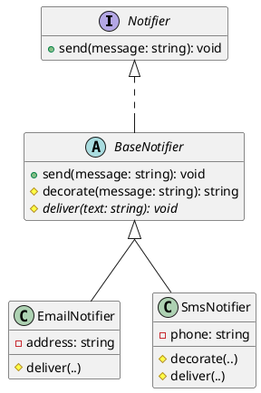
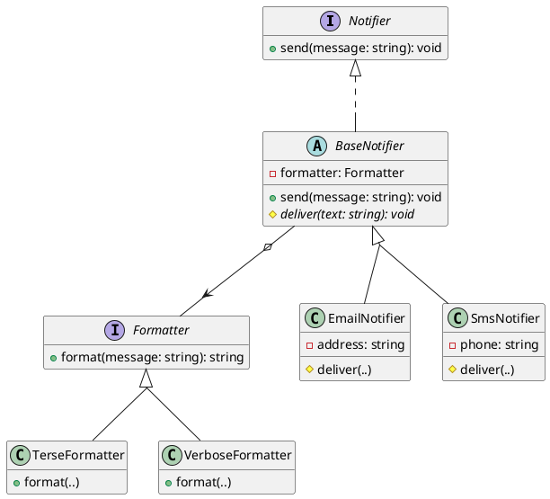

# Extending Behaviour Through Polymorphism

**Polymorphism** is the ability of one piece of code to do multiple things. In particular, it is used in object-oriented programming to describe how a piece of code using a particular *apparent* type can actually dispatch to implementations from multiple *actual* types. In [Chapter 14](./05_boundaries#many-implementations), we saw how interfaces lead to polymorphism. But classes have a second way to relate to each other that will also lead to polymorphism.

An interface lets unrelated classes commit to the same contract, but does not say that one class is a kind of another, or let a class reuse another's implementation: these are both the domain of class **extension**. A class can *extend* another, taking on its behaviour through **inheritance**. An instance of the extending class can be used wherever the original is expected. 

Both interfaces and extension reduce duplication: an interface lets one piece of calling code work with many types, and extension lets many types share one implementation. Both also make a system easier to change, since a new type can be added behind an existing contract without rewriting the code that uses it.

## Abstract Base Classes

In the previous chapter each notifier implemented `send(..)` itself. The bodies of `send(...)` looked like this:
```typescript
    // EmailNotifier
    public send(message: string): void {
        assert(message.length > 0, "message must not be empty");
        const text: string = "[ALERT] " + message;
        // deliver `text` to this.address over email
    }
```
and
like this:
```typescript
    // SMSNotifier
    public send(message: string): void {
        assert(message.length > 0, "message must not be empty");
        const text: string = "[ALERT] " + message;
        // deliver `text` to this.address over SMS
    }
```
Notice the two methods repeat the same opening steps before doing anything specific to the channel. Copying that logic into every channel is contrary to the **don't repeat yourself** (DRY) principle. If we ever need to change these opening steps, we need to change them in each copy. Copies  easily drift apart as some are updated and others are missed. 

An interface cannot hold this shared work, because it has no function bodies---but a *class* can.

Shared work goes in a **base class**, which holds the functionality common to a family of related classes so that each can build on it instead of repeating it. A class that builds on a base class is a **subclass** of it. 

<details class="tooltip ts-tips">
<summary> <code>extends</code></summary>

The following creates a new class `X` that extends `Y`:
```typescript
class X extends Y {
    /** class X's body **/
}
```

Any `public` method/field declared on Y can now be used directly on `X`, without writing any additional code. (`protected` methods/fields can be used within `X`---see the tooltip on `protected`).

Say `Y` is defined as follows:

```typescript
class Y {
   public foo(): number {
      return 5;
   }
}
```

Then we can write:
```typescript
class X extends Y {
}

const x: X = new X();
x.foo(); // runs, returns 5
```

</details>


<details class="tooltip ts-tips">
<summary> <code>protected</code></summary>

[Chapter 12](./03_encapsulation#hiding-the-representation) introduced `public` and `private`; `protected` is a third access modifier. `protected` means that the method/field is accessible by this class *and all its subclasses*. A `private` method/field in a base class will not be accessible by its subclasses. For example:

```typescript
class Y {
   private bar(): number {
      return 4;
   }
   protected baz(): number {
      return 5;
   }
}
```

Then we can write:
```typescript
class X extends Y {
   public foo(): number {
      // Property 'bar' is private and only accessible within class 'Y'.
      // this.bar(); // won't compile
      return this.baz(); // legal
   }
}

const x: X = new X();
x.foo(); // runs, returns 5
// x.baz(); // won't compile; protected members can't be accessed outside a class and its subclasses
```

</details>

A base class can be a regular class, or an **abstract** class. An **abstract** class cannot be created on its own and exists only to be built on.  An abstract class can have two kinds of member: concrete ones, with a body that the whole family shares, and abstract ones, declared without a body for each class in the family to fill in.

<details class="tooltip ts-tips">
<summary>Abstract Classes </summary>
Declare an abstract class with:

```typescript
abstract class X {
	// concrete members shared by every subclass
	<access-modifier> concreteMethod1(<parameters>): <ReturnType> {
	  /** Method Body Here**/
	}
	
   // abstract members that each subclass must provide:
	<access-modifier> abstract abstractMethod1(<parameters>): <ReturnType>;
}
```

`new X()` does not compile, because an abstract class exists only to be extended. A concrete subclass that does not provide a body for each inherited abstract method will not compile either, so every concrete subclass must in the abstract class's 'holes' (`abstractMethod1` above). 

An abstract class can use `extends` and `implements`, just like a regular class. 

</details>

<details class="tooltip deep-dive">
<summary>Should my base class be abstract or not?</summary>

Extending a regular class makes sense when both classes can exist (say, a `ShowDog` extends a `Dog` with dog-show-related functionality); extending an abstract class makes sense when the base class can hold some functionality but doesn't make sense on its own (say, a `Dog` extends a `Pet`, where we can never create an abstract `Pet` that's not some type of animal). 

An interface makes sense when only the method signatures matter, and there's no functionality to share.
</details>


For the notifiers, the shared `send(..)` and a default formatting step go in the base class, and the delivery step specific to each channel is left abstract:

```typescript
abstract class BaseNotifier implements Notifier {
    /**
     * Formats `message` and delivers it over this channel.
     *
     * @param {string} message the alert text; callers pass a non-empty string.
     */
    public send(message: string): void {
        assert(message.length > 0, "message must not be empty"); // the shared rule
        this.deliver(this.decorate(message));
    }

    /**
     * Formats `message` for delivery.
     *
     * @param {string} message the alert text; never empty.
     * @returns {string} the alert text, prefixed with "[ALERT] ".
     */
    protected decorate(message: string): string {
        return "[ALERT] " + message;
    }

    /**
     * Delivers already formatted text over this channel.
     *
     * @param {string} text the formatted alert text.
     */
    protected abstract deliver(text: string): void;
}
```

`BaseNotifier` provides `send(..)` and a default `decorate(..)`, and declares `deliver(..)` as abstract: it does not have a body, and every concrete subclass must supply its own. Only `send(..)` is `public`, because it is part of the `Notifier` contract. `decorate(..)` and `deliver(..)` are internal steps, so they are `protected`, reachable inside the class and its subclasses but not from outside.


### Extending the Base Class

A concrete channel extends `BaseNotifier` and only provides its own delivery:

```typescript
class EmailNotifier extends BaseNotifier {
    /** The recipient's email address. */
    private readonly address: string;

    /**
     * Creates a notifier that emails alerts to `address`.
     *
     * @param {string} address the recipient's email address.
     */
    public constructor(address: string) {
        super();
        this.address = address;
    }

    protected deliver(text: string): void {
        // deliver `text` to this.address over email
    }
}
```

`EmailNotifier` has no `send(..)` method of its own. It inherits `BaseNotifier`'s. The `super()` call in its constructor calls the base class constructor, which a subclass must do before using `this`.

<details class="tooltip ts-tips">
<summary> <code>super</code></summary>

`super` allows us to call the constructor or methods of a base class. 

`super(<superclass-constructor-args>)` call's the base class's construtor. For example:

```typescript
class Y {
   private readonly myData: number;
   
   public constructor(n: number) {
       this.myData = n;
   }

   public baz(): number {
      return 5 + this.myData;
   }
}

class AddsXToData extends Y {

   public constructor(n: number, x: number) {
       super(n + x);
   }

}

const axtd: AddsXToData = new AddsXToData(7, 11);
axtd.baz() // returns 23
```


`super.method(<superclass-method-args>)` call's the base class's method `method`. For example:

```typescript
class Y {
   private readonly myData: number;
   
   public constructor(n: number) {
       this.myData = n;
   }

   public baz(): number {
      return 5 + this.myData;
   }
}

class DoublesBaz extends Y {

   // no constructor declared; so inherits Y's constructor

   public doublebaz(): number {
       return 2 * super.baz();
   }

}

const db: DoublesBaz = new DoublesBaz(2);
db.doublebaz() // returns 14
```

</details>


### Overriding Methods

A subclass can **override** an inherited method, replacing it with its own version. SMS messages have a length limit, so `SmsNotifier` overrides `decorate(..)`, calling the base version through `super` and then shortening the result:

```typescript
class SmsNotifier extends BaseNotifier implements Confirmable {
    /** The recipient's phone number. */
    private readonly phone: string;

    // acknowledged and wasDelivered() are as in Chapter 14
    /** Whether the provider acknowledged the last send; false before any send. */
    private acknowledged: boolean = false;

    /**
     * Creates a notifier that texts alerts to `phone`.
     *
     * @param {string} phone the recipient's phone number.
     */
    public constructor(phone: string) {
        super();
        this.phone = phone;
    }

    /**
     * Formats `message` as the base class does, shortened to fit one SMS.
     *
     * @param {string} message the alert text; never empty.
     * @returns {string} the base formatting of `message`, at most 160 characters long.
     */
    protected decorate(message: string): string {
        return super.decorate(message).slice(0, 160); // SMS length limit: keep the first 160 characters, as slice does for arrays
    }

    protected deliver(text: string): void {
        // deliver `text` to this.phone over SMS, and record the
        // provider's acknowledgement in this.acknowledged
    }

    /**
     * Reports whether the provider acknowledged the last send.
     *
     * @returns {boolean} true once the provider has acknowledged the last send.
     */
    public wasDelivered(): boolean {
        return this.acknowledged;
    }
}
```

`super.decorate(message)` calls the base class's `decorate`. `SMSNotifier`'s `decorate` shortens its result, so the shared formatting is reused rather than copied. Overriding a method, and calling `super` to build on the inherited version, are the two basic ways to refine a base class.


<!-- caption="BaseNotifier implements Notifier and provides the shared send and a default decorate. Each channel supplies its own deliver, and SmsNotifier also overrides decorate." -->

## Dynamic Dispatch

The notifiers now share a `send(..)` method, but what runs when `send(..)` is called? We have already seen polymorphism: `alertAll(..)` calls `channel.send(message)`, and the right delivery happens whether the channel is email or SMS. The mechanism behind it is **dynamic dispatch**: when a method is called through a variable, the method body that runs is chosen at runtime from the variable's _actual_ type, not its _apparent_ type.

Consider a single channel held at the interface type:

```typescript
const channel: Notifier = new SmsNotifier("+1-555-0100");
channel.send("disk almost full");
```

The apparent type of `channel` is `Notifier`, so the compiler checks only that `Notifier` has a `send(..)`. At runtime the object is an `SmsNotifier`, and the call resolves as follows (you can see these steps in action by running the code through a debugger):

1. `send(..)` is not defined on `SmsNotifier`. It is inherited from `BaseNotifier`, so `BaseNotifier`'s `send(..)` runs.
2. That `send(..)` calls `this.decorate(message)`. `this` is the `SmsNotifier`, which overrides `decorate(..)`, so the _subclass's_ `decorate(..)` runs and truncates the formatted text.
3. That `send(..)` then passes the decorated text to `this.deliver(..)`. `deliver(..)` is abstract in the base, and `this` is the `SmsNotifier`, so the _subclass's_ `deliver(..)` runs and sends over SMS.

In steps 2 and 3, the calls to `decorate(..)` and `deliver(..)` are inside `BaseNotifier`'s code, but the versions that run are the ones written in `SMSNotifier`. When a method calls `this.something()`, dynamic dispatch finds the right `something` for whatever object `this` is. This lets a base class lay out a sequence of steps and leave the steps themselves to its subclasses.


Dynamic dispatch is what lets `alertAll(..)` work across a mixed list:

```typescript
const channels: Notifier[] = [
    new EmailNotifier("ops@example.com"),
    new SmsNotifier("+1-555-0100")
];
alertAll(channels, "deploy finished");
```

`alertAll(..)`'s loop body is the single line `channel.send(message)`. On the first pass it delivers an email and on the second an SMS, because each `send(..)` dispatches to the actual object behind it. Writing `channel: Notifier` decides which calls are legal, and the actual object decides which methods execute.

## Honouring the Contract

A class that extends another class or implements an interface is a **subtype** of it, and the class or interface it extends or implements is its **supertype**. Subtyping carries through a hierarchy, so `EmailNotifier` is a subtype of both `BaseNotifier` and `Notifier`. Because a subtype instance can stand in wherever its supertype is expected, `alertAll(..)` will give a message to whatever `Notifier` it receives and trust it to deliver. 

This means the subtype it must honour the supertype's method contracts, or code written against the supertype will be wrong even though it compiles. `SMSNotifier` does this correctly: the `Notifier` contract for `send(..)` is that it "Formats `message` and delivers it over this channel.". `SMSNotifier`'s send shortens the text with `decorate(..)`, but still delivers the message. 

By contrast, a `DropSMSNotifier` that silently _dropped_ messages longer than 160 characters would break the contract. Callers of `alertAll(..)` assume every channel they call send on will be alerted, and `DropSMSNotifier` would fail to alert its channel. The signatures would still match, so the compiler would say nothing. The violation would be in behaviour, not types. A subtype may specialise _how_ it does a job, but it must still do the job the supertype describes.

<details class="tooltip deep-dive">
<summary>Demanding No More, Promising No Less</summary>

What does it mean to honour contracts? We can make this precise using invariants, preconditions and postconditions from [Chapter 3](../part1/03_checking-invariants#identifying-invariants). 

First, a subclass must preserve any invariant the base maintains. 

A method's precondition is what it demands of callers. A subtype honours the supertype's precondition when it demands no more. If a subclass's `send(..)` rejected messages the base accepted, for example by also forbidding whitespace, it would _strengthen_ the precondition, and a caller relying on the base's looser rule would break. 

A method's postcondition is what it guarantees to callers. A subtype honours the supertype's postcondition when it guarantees no less. If a subclass's `send(..)` does not deliver messages as the base promised, it would _weaken_ the postcondition. A `send(..)` that delivers messages and does some logging, by contrast, does not weaken the postcondition.


In summary, substituting a subtype for its supertype is safe if:
- subclass preserves any invariant the base maintains;
- for every method a subclass overrides, it demands no more than the supertype's precondition
- for every method a subclass overrides, it guarantees no less than the supertype's postcondition

 
This rule is known as the **Liskov Substitution Principle**, after the computer scientist Barbara Liskov, who stated it.

</details>

## Is-a and Can-do

There are now two ways for a class to take on a type, and the difference guides which to use. `EmailNotifier` _extends_ `BaseNotifier`: it is a kind of notifier, and it inherits the base's implementation along with its type. `RecordingNotifier` from the previous chapter _implements_ `Notifier` directly: it can do what a notifier does, committing to the contract while sharing none of the base's code. Both can be used as a `Notifier`, but they relate to the hierarchy differently.

`extends` is usually used when one class is a more specific kind of another and can reuse its implementation. `implements` is more appropriate when a class only needs to satisfy a contract, with an implementation of its own. A test double like `RecordingNotifier` needs the type and none of the implementation, which is why it implements rather than extends.

A test double can also extend a base class, when the test needs the inherited behaviour. This one records what the inherited pipeline delivers, so the pipeline can be checked without sending anything:

```typescript
class CapturingNotifier extends BaseNotifier {
    /** The last text passed to deliver(..); empty until the first delivery. */
    public delivered: string = "";

    /**
     * Records `text` instead of sending it.
     *
     * @param {string} text the formatted alert text.
     */
    protected deliver(text: string): void {
        this.delivered = text;
    }
}

test("a subclass inherits the send pipeline and supplies only delivery", () => {
    const channel: CapturingNotifier = new CapturingNotifier();
    channel.send("disk full");
    expect(channel.delivered).to.equal("[ALERT] disk full");
});
```

`CapturingNotifier` has no `send(..)` of its own, yet calling `send(..)` formats the message with the base's `decorate(..)` and then dispatches to the subclass's `deliver(..)`. Extending the abstract class lets the test confirm that the prefix added by `decorate(..)` arrives in what `deliver(..)` receives.

A class may extend at most one class, but it may implement any number of interfaces. Interfaces themselves can extend other interfaces, composing a larger contract from smaller ones:

```typescript
interface ConfirmingNotifier extends Notifier, Confirmable {
    // ...
}
```

A class implementing `ConfirmingNotifier` must satisfy both `Notifier` and `Confirmable`. Code that needs both capabilities can ask for a `ConfirmingNotifier`, while code that needs only one still asks for `Notifier` or `Confirmable`.

## Replacing Branches

Without polymorphism, sending over a channel chosen at runtime means branching on a tag:

```typescript
function notify(channel: string, target: string, message: string): void {
    if (channel === "email") {
        // format and deliver by email to target
    } else if (channel === "sms") {
        // format and deliver by SMS to target
    }
}
```

Every channel is a branch in one function, and `notify(..)` has to be modified each time a new channel is added.

Instead, the caller holds a `Notifier`, already constructed as the right kind of channel, and asks it to act:

```typescript
function notify(channel: Notifier, message: string): void {
    channel.send(message);
}
```

`notify(..)` no longer names a channel or lists the kinds. It works through the `Notifier` contract, and dynamic dispatch routes `send(..)` to whatever channel it was given. Adding a channel adds a class, and this function does not change.

<details class="tooltip link-110">
<summary>Branching on a Variant</summary>

In CPSC 110 you handled a data type with several variants by branching on which variant you had, usually with a `cond` that asked what kind of value this was and what to do for it. That branch is the functional version of the `notify(..)` above: one place that lists every case. An interface with several implementations reverses this. Instead of one function that branches over the variants, each variant becomes a type that carries its own behaviour, and dispatch replaces the branch. The information is the same. What changes is whether adding a case means editing a shared branch or adding a new type.

</details>

## Composition Over Inheritance

Class extension has dedicated syntax, but it is used more often than it should be. Most relationships between classes are better expressed by holding a collaborator, through composition or aggregation, and delegating to it, as described in [Chapter 11](./02_decomposition#delegation-through-composition-and-aggregation). The guideline's name uses "composition" in a broad sense that covers both, and so does the rest of this section. Classes more often have a has-a relationship with each other than an is-a one.

To see when composition fits better, suppose the alert text needs more than one format, such as terse and verbose, and any channel should be able to use any format. Building formatting into the class hierarchy through `decorate(..)` ties each format to a class. Holding a formatter keeps the two concerns separate. The revised base class below still owns the shared steps, including the empty-message rule, and delegates formatting to whichever `Formatter` the channel was built with:

<CollapsibleCode>

```typescript
/** Turns alert text into the text a channel delivers. */
interface Formatter {
    /**
     * Formats `message` for delivery.
     *
     * @param {string} message the alert text; never empty.
     * @returns {string} the text to deliver.
     */
    format(message: string): string;
}

abstract class BaseNotifier implements Notifier {
    /** Formats every message this notifier delivers. */
    private readonly formatter: Formatter;

    /**
     * Creates a notifier that formats alerts with `formatter`.
     *
     * @param {Formatter} formatter the formatting to apply before delivery.
     */
    public constructor(formatter: Formatter) {
        this.formatter = formatter;
    }

    /**
     * Formats `message` and delivers it over this channel.
     *
     * @param {string} message the alert text; callers pass a non-empty string.
     */
    public send(message: string): void {
        assert(message.length > 0, "message must not be empty"); // the shared rule stays in one place
        this.deliver(this.formatter.format(message));
    }

    /**
     * Delivers already formatted text over this channel.
     *
     * @param {string} text the formatted alert text.
     */
    protected abstract deliver(text: string): void;
}

class EmailNotifier extends BaseNotifier {
    /** The recipient's email address. */
    private readonly address: string;

    /**
     * Creates a notifier that emails alerts to `address`.
     *
     * @param {string} address the recipient's email address.
     * @param {Formatter} formatter the formatting to apply before delivery.
     */
    public constructor(address: string, formatter: Formatter) {
        super(formatter);
        this.address = address;
    }

    protected deliver(text: string): void {
        // deliver `text` to this.address over email
    }
}
```

</CollapsibleCode>

Any formatter can now be paired with any channel by passing a different `Formatter` when the notifier is built, and a new format is a new `Formatter` class that no channel needs to know about. Inheritance cannot offer this, because a class's base is fixed when the class is written, while a held collaborator can be chosen when the object is created and, unless the field is `readonly`, even swapped while the program runs. The design uses both mechanisms: inheritance shares the steps every channel performs, and composition supplies the part that varies independently of the channel. The rest of this part keeps the simpler `BaseNotifier` from the start of the chapter, since its notifiers need only one format.


<!-- caption="The base class holds a Formatter and delegates formatting to it, while each channel still inherits the shared steps." -->

The gap widens as the system grows. Suppose it must support _c_ channels in _f_ formats. Building formatting into the hierarchy needs a class for each combination, _c_ times _f_ of them, and every new channel or format multiplies the count again. Holding the formatter as a collaborator needs only _c_ channel classes and _f_ formatter classes, _c_ plus _f_ in all, and a new format is a single class that works with every existing channel without changing any of them.

Composition is the more flexible default for other reasons too. A class may extend only one base, but it can hold as many collaborators as it needs, so capabilities that could never share one inheritance line can sit side by side.

Composition also ties classes together less tightly, which extends the implementation freedom of [Chapter 13](./04_flexibility#what-makes-a-change-safe) to collaborators. A subclass depends on its base class's _implementation_, not only its contract, so it is affected by changes in how the base works. A collaborator is used only through its public contract, the boundary [Chapter 14](./05_boundaries#many-implementations) argued for. For these reasons, use inheritance only when one class is a kind of another and shares a stable core of behaviour, and prefer composition everywhere else.

<details class="tooltip deep-dive">
<summary>Fragile Base Classes</summary>

Because a subclass builds on its base class's implementation, a change inside the base that looks harmless can break a subclass without any change to the subclass itself. Suppose a base method is rewritten to call another of the base's methods that a subclass has overridden. The override now runs at a moment it never did before, and behaviour the subclass relied on changes silently. The more subclasses a base has, and the deeper the hierarchy, the more places such a change can reach, and the harder the base becomes to modify safely. This is the **fragile base class problem**. A collaborator held by composition does not have it, because it is used only through its public methods, so its internals can change freely as long as the contract holds.

</details>

#### Sharing and Varying Behaviour

This chapter added a new way for classes to relate. Class extension lets one class be a more specific kind of another, inheriting a base's implementation and refining it through overriding and `super`, while an abstract base defines a shared sequence of steps and leaves the varying ones to its subclasses. Polymorphism and dynamic dispatch let a single call do different work for different actual types, so code written against a supertype works with every subtype, present and future, as long as each honours the contract. Because inheritance ties classes together more tightly, it is reserved for true is-a relationships, and composition remains the default way for classes to work together.

<details class="tooltip exercise">
  <summary>Exercise: Quiz Scoring Schemes</summary>

> As a quiz platform developer, I want to score quiz submissions under different rules, so that the platform can offer standard and competitive formats without duplicating the logic for recording answers and tallying totals.

Here is the abstract base class:

<CollapsibleCode>

```typescript
abstract class QuizScorer {
    /** The sum of the points awarded for every submitted answer. */
    private points: number = 0;
    /** The number of answers submitted so far; never negative. */
    private total: number = 0;

    /**
     * Records the result of one answer.
     *
     * @param {boolean} correct whether the answer was correct.
     */
    public submit(correct: boolean): void {
        this.total = this.total + 1;
        if (correct) {
            this.points = this.points + this.correctPoints();
        } else {
            this.points = this.points + this.incorrectPoints();
        }
    }

    /**
     * Returns the accumulated score.
     *
     * @returns {number} the sum of the points awarded for every submitted answer.
     */
    public score(): number {
        return this.points;
    }

    /**
     * Returns the number of answers submitted so far.
     *
     * @returns {number} the number of calls to submit(..) so far.
     */
    public count(): number {
        return this.total;
    }

    /**
     * Returns the points awarded for a correct answer.
     *
     * @returns {number} the points for one correct answer.
     */
    protected abstract correctPoints(): number;

    /**
     * Returns the adjustment applied for an incorrect answer.
     *
     * @returns {number} the points for one incorrect answer; typically zero or negative.
     */
    protected abstract incorrectPoints(): number;
}
```

</CollapsibleCode>

Two scoring schemes extend `QuizScorer`:

- `StandardScorer`: a simple pass-or-fail scheme. A correct answer scores 1 point and an incorrect answer scores 0.
- `NegativeMarkingScorer`: a competitive scheme. A correct answer scores 1 point and an incorrect answer deducts 1, discouraging guessing.

Work through the following:

1. _Implementing the scorers._ Each scorer supplies only `correctPoints()` and `incorrectPoints()`. Implement both classes. How many methods does each require, and which parts of `QuizScorer` does each inherit unchanged?
2. _Abstract vs concrete._ `submit` is concrete while the two point methods are abstract. What would break if `submit` were abstract instead, and why is having it concrete beneficial?
3. _Adding a scorer._ Write a `WeightedScorer` that awards 3 points per correct answer and 0 for incorrect ones. How many methods must you write, and how many existing lines must you change?
4. _Testing._ Write tests for `NegativeMarkingScorer` covering three sequences: all correct, all incorrect, and one correct followed by one incorrect. Assert both `score()` and `count()` after each. What is the minimum number of sequences that exercises every branch in `submit`?

<!-- Potential unverified solution:

```typescript
import { test, expect } from "vitest";

abstract class QuizScorer {
    /** The sum of the points awarded for every submitted answer. */
    private points: number = 0;
    /** The number of answers submitted so far; never negative. */
    private total: number = 0;

    public submit(correct: boolean): void {
        this.total = this.total + 1;
        if (correct) {
            this.points = this.points + this.correctPoints();
        } else {
            this.points = this.points + this.incorrectPoints();
        }
    }

    public score(): number {
        return this.points;
    }

    public count(): number {
        return this.total;
    }

    protected abstract correctPoints(): number;

    protected abstract incorrectPoints(): number;
}

class StandardScorer extends QuizScorer {
    protected correctPoints(): number {
        return 1;
    }

    protected incorrectPoints(): number {
        return 0;
    }
}

class NegativeMarkingScorer extends QuizScorer {
    protected correctPoints(): number {
        return 1;
    }

    protected incorrectPoints(): number {
        return -1;
    }
}

class WeightedScorer extends QuizScorer {
    protected correctPoints(): number {
        return 3;
    }

    protected incorrectPoints(): number {
        return 0;
    }
}

test("negative marking: all correct", () => {
    const scorer: NegativeMarkingScorer = new NegativeMarkingScorer();
    scorer.submit(true);
    expect(scorer.score()).to.equal(1);
    expect(scorer.count()).to.equal(1);
    scorer.submit(true);
    expect(scorer.score()).to.equal(2);
    expect(scorer.count()).to.equal(2);
});

test("negative marking: all incorrect", () => {
    const scorer: NegativeMarkingScorer = new NegativeMarkingScorer();
    scorer.submit(false);
    expect(scorer.score()).to.equal(-1);
    expect(scorer.count()).to.equal(1);
    scorer.submit(false);
    expect(scorer.score()).to.equal(-2);
    expect(scorer.count()).to.equal(2);
});

test("negative marking: one correct then one incorrect", () => {
    const scorer: NegativeMarkingScorer = new NegativeMarkingScorer();
    scorer.submit(true);
    expect(scorer.score()).to.equal(1);
    expect(scorer.count()).to.equal(1);
    scorer.submit(false);
    expect(scorer.score()).to.equal(0);
    expect(scorer.count()).to.equal(2);
});

test("standard and weighted scorers reuse submit unchanged", () => {
    const standard: StandardScorer = new StandardScorer();
    const weighted: WeightedScorer = new WeightedScorer();
    standard.submit(true);
    standard.submit(false);
    weighted.submit(true);
    weighted.submit(false);
    expect(standard.score()).to.equal(1);
    expect(weighted.score()).to.equal(3);
    expect(weighted.count()).to.equal(2);
});
```

1. Each scorer writes two methods, `correctPoints()` and `incorrectPoints()`, and inherits `submit`, `score`, `count` and both fields unchanged.
2. With `submit` abstract, every scorer would re-implement the tally and the correct/incorrect branch, and one could forget to count an answer. Concrete `submit` fixes the shared steps in one place, so a scheme can only vary the points.
3. `WeightedScorer` is two methods and changes zero existing lines.
4. One sequence, a correct answer followed by an incorrect one, exercises both branches of `submit`; the three sequences asked for also pin down the accumulated totals.
-->

</details>
