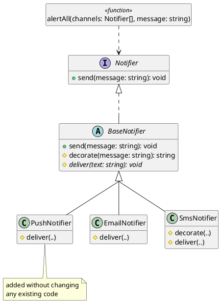

# Growing Systems with the Open/Closed Principle

Successful software systems keep changing. We've seen allusions to these changes over the past few chapters, and in the lecture demo code: new delivery channels, new pricing methods. Each addition risks breaking what already works unless the design was built with change in mind. 

## Open and Closed

A unit of code is **open for extension** when new behaviour can be added to it, and **closed for modification** when adding that behaviour does not require existing code to change. 
Polymorphism, whether through interfaces or class extension, allows for both.

In particular, when code depends on an abstraction rather than on concrete types, we can add new behaviour by writing a new implementation of that abstraction, and leave any code already written against the abstraction unchanged.

<details class="tooltip link-110">
<summary>Abstraction</summary>

In very broad terms, abstraction means removing details so that one piece of code can do many things.

CPSC 110 defined abstraction as follows: 

> Abstraction means taking two or more expressions or functions that are very similar, and turning those differences into parameters of a more general-purpose abstract function. The Abstraction From Examples and Abstraction From Type Comments recipes cover the design of abstract functions. It is also possible to design abstract types, but we do not do that in this course.

We've now seen abstract types via interfaces, class extension, and generics. 

The word abstraction is used very broadly in computer science; 
[Wikipedia](https://en.wikipedia.org/wiki/Abstraction_(computer_science)) has more examples. 
</details>

#### Adding a Channel

Suppose alerts must now also go out as push notifications:

> As a DevOps engineer, I want to add push notification delivery to the alert system, so that on-call engineers are reached on their mobile devices even when they are not monitoring email.


Say `alertAll` followed the tag-switching approach we mentioned in [Chapter 15](./06_extension.html#replacing-branches):

```typescript
function alertAll(channels: string, message: string): void {
    for (const channel of channels) {
        notify(channel, message);
    }
}

function notify(channel: string, message: string): void {
    if (channel === "email") {
        // format and deliver by email
    } else if (channel === "sms") {
        // format and deliver by SMS 
    }
}
```

We would have to add a new `else if` branch to `notify` to support push notifications. In a real system the channel tag checking would probably occur in multiple places (formatting, validation, logging...), and we'd have to change all those too. This design is not closed for modification. 
  But we were able to add a new type of notification, so the design *is* open for extension. 

Contrast this with the polymorphic `Notifier`-based design we've been building. To add push notifications, we'd make a new extension of `BaseNotifier`:

```typescript
class PushNotifier extends BaseNotifier {
    /** The identifier of the recipient's device. */
    private readonly deviceId: string;

    /**
     * Creates a notifier that pushes alerts to the device `deviceId`.
     *
     * @param {string} deviceId the identifier of the recipient's device.
     */
    public constructor(deviceId: string) {
        super();
        this.deviceId = deviceId;
    }

    protected deliver(text: string): void {
        // deliver `text` to this.deviceId as a push notification
    }
}
```

Then we'd add this new channel at the one relevant place we call `alertAll`:

```typescript
alertAll([
    new EmailNotifier("ops@example.com"),
    new SmsNotifier("+1-555-0100"),
    new PushNotifier("device-42")
], "deploy finished");
```


Notice we didn't need to change  `Notifier`, `BaseNotifier`, `EmailNotifier`, `SmsNotifier`, or `alertAll(..)`. This design is both open for extension _and_ closed for modification. 

<details class="tooltip deep-dive">
<summary>But is it really closed?</summary>

You may have noticed our "closed" system has a change beyond `PushNotifier`. Wherever the list of channels is assembled, some code must still name `EmailNotifier`, `SmsNotifier`, and now `PushNotifier` to create them. In [Part 3](../part3/index), we'll discuss which code should construct concrete objects, and where, so that only one place in the program names them. 
</details>


<!-- caption="Adding PushNotifier requires no change to Notifier, alertAll, or the existing channels." -->

## Why Add Instead of Edit

Why do we favour designs where we can add new features via addition, without direct editing? [Chapter 9](../part1/09_validation#regression-testing) already motivated this. Think of all the effort it takes you to test a system. Code that has been well-tested works. Every edit we make risks breaking something that worked before---what we call a regression. 

When we added a new branch to `notify(...)` in our tag-based design, we introduced a risk to the email and SMS branches. Perhaps we had to change some function-wide variables before setting up the push branch; if this disturbed the existing code, we'd have to reconsider our tests for it. You might better understand how severe a disturbance this would be if you consider just how many changes we'd have to make if our system had this tag-based design in all its other parts too: logging, formatting, delivery checking...

By contrast, when we added a `PushNotifier`, we only added code. We touched no existing code, so with high probability, the tests will continue passing with no issue. We only need to add  new tests are for `PushNotifier`.


Note that "closed for modification" doesn't mean the code will _never_ change. We might still have to fix bugs or refine contracts. But a "closed for modification" system  can grow safely as it gets larger, because a new feature's impact is contained in the new code rather than spread through previously tested code.

<details class="tooltip deep-dive">
<summary>Many Clients, One Change</summary>

In the notifier system, `alertAll(..)` is the only caller of `send`. In a real codebase, a widely used abstraction can have dozens or hundreds of callers spread across many files and modules, written by different teams at different times. If meeting a new requirement means editing every concrete type those callers name, the change has to be made in as many places as there are callers, each of which must be found, read, understood, retested, and redeployed. The closed-for-modification property removes that cost.

The **plugin architecture** pattern takes this idea further. The core of the application depends only on an abstraction, and concrete implementations are supplied separately and connected at startup, without the core naming them at all:

```typescript
// core: depends only on the abstraction, names no concrete channel
function alertAll(channels: Notifier[], message: string): void {
    for (const channel of channels) {
        channel.send(message);
    }
}

// startup, outside the core: loadConfiguredChannels is the one place
// that names concrete channel types, reading them from configuration
const channels: Notifier[] = loadConfiguredChannels();
alertAll(channels, "system ready");
```

Adding a new channel means writing one new class and adding it to the configuration, and the core and every other caller are left untouched. This is how text editors accept plugins, IDEs accept extensions, and operating systems accept drivers. The core was closed for modification before the extensions existed, and each extension adds behaviour by conforming to the abstraction the core already depends on.

</details>

## The Axis of Change

Openness has a cost. Depending on an abstraction adds cost through _indirection_. For the performance of the system, we have mildly slower function calls, as the runtime needs to find out which exact method to call (this will be insignificant for all the software we write in this class, but can effect certain performance-critical systems). The cost for our human readers is more important: they (maybe us in the future) may now have to wade through multiple class files to find what notifier code we're acually wokring with. 

So, we need to choose where to add this flexibilty-through-abstraction carefully. For the notifier system, the axis of the system most likely to change was quite clear. We might not always want to alert via email **and** SMS, and we might want to alert over new channels. So, we wrote up the `Notifier` interface to allow for change along that axis.

It will take practice, and most likely, painful experiences with refactoring, to get a good sense of when it's useful to add abstraction, and where the indirection cost is too much. 

But you can get started by following the advice from [Chapter 12](./03_encapsulation#choosing-what-to-expose). Hide what is most likely to change, including not just a background representation, but whole behaviours. Put the abstraction boundary where new variants are likely to appear. We call a boundary placed this way an **extension point**: a place where behaviour can be varied by adding code rather than by editing code that already works. 

<details class="tooltip deep-dive">
<summary>Speculative Generality</summary>

The opposite of a rigid design is an over-flexible one. Adding interfaces, base classes, and extension points for variation you only imagine you might need is a recognised design mistake, usually called _speculative generality_: the indirection adds real cost while the flexibility gives only hypothetical benefits.

</details>

No design is open to every change. The notifier system is open along the axis of new channels. If the new requirement were to deliver a single alert to a whole group, or to schedule one for later, `Notifier` alone would not help. That's alright. When we accept that we can't build software to support change on every axis, we can better focus on which of its axes we should keep following the open/closed principle.

## The Principles Together

There's a named principle we've been hinting at in this chapter: the **Dependency Inversion Principle**. This principle states that high-level policy should depend on an abstraction, and so should  the low-level classes that implement it. This inverts the usual arrangement in which high-level code depends directly on the low-level code it calls.  For instance, `alertAll(..)` depends on `Notifier`, never on `EmailNotifier` or `SmsNotifier`, so the policy of "alert all channels" is separate from how any one channel delivers. 

We got to our open/closed design by following this principle, along with the other we've seen in Part 2:
- **Cohesion** ([Chapter 11](./02_decomposition#single-responsibility)): each class, and each interface, is responsible for one thing.
- **Encapsulation** ([Chapter 12](./03_encapsulation#hiding-the-representation)): a class hides its representation behind a contract, so its internals can change without its callers changing.
- **Implementation freedom** ([Chapter 13](./04_flexibility#what-makes-a-change-safe)): what a class means is kept separate from how it is built, so the implementation stays free to change, and each commitment a class avoids is one more thing that can vary.
- **Small contracts** ([Chapter 14](./05_boundaries#keeping-interfaces-small)): callers depend on a narrow, named abstraction rather than on a concrete class.
- **Substitutability** ([Chapter 15](./06_extension#honouring-the-contract)): many implementations stand behind one contract, each honouring it, so one can stand in for another. This is the Liskov Substitution Principle.
- **Dependency inversion** (this chapter): high-level code depends on abstractions rather than on concrete classes.
- **Open and closed** (this chapter): together, the principles above let a system grow by adding implementations rather than by editing existing code.


### One Addition, Taken Apart

To add a `PushNotifier` earlier in this chapter, we needed only add one class and one line where the channels are assembled. Let's look at how the principles above led to an open/closed design that kept this change small and self-contained.

Because our design was *cohesive*, we could  _keep the change to only one class_. Delivering an alert over a channel is a single responsibility, held by a single kind of unit. Had delivery been spread across several classes, or bundled with a formatting and retry policy, a new channel would have needed changes in several places.

Because our notifiers' representations were *encapsulated*, and we hid the details of how notifiers deliver to the target to preserve _implementation freedom_, `PushNotifer` could easily _store a `deviceId`_. If Notifiers' target details were public, it might be tricky to change the email/phone representation to support a deviceId. Luckily, because we kept the representations of all our notifiers hidden, it can store this different target representation with no issue! 

Because we kept notifier to supporting only a _small contract_, together with the shared base from [Chapter 15](./06_extension#abstract-base-classes), we only had to _write `deliver(..)`_. `Notifier` requires one operation (`send`), so conforming to it is cheap. `BaseNotifier` already holds the steps of `send` every channel performs identically, so the new class onlt needs to supply the step that differs.

Because of _substitutability_, _`alertAll(..)` accepted our new notifier_ with no changes. `PushNotifier` demands no more of its callers than `Notifier` does and promises no less, so code written against the interface is correct for an implementation that did not exist when the code was written.

Because `alertAll(..)` was written against the abstraction rather than against any channel (_dependency inversion_),  _`alertAll(..)` did not have to change_.

### Removing a Principle

We can gain a clearer perspective on how everything in Part 2 has built up to the open/closed principle, by considering how the `PushNotifier` change would have looked if we removed one design principle at a time.

_Without cohesion._ Suppose `EmailNotifier` had also owned message formatting and the system's retry policy, because those were added to it when email was the only channel. Adding push now means adding push delivery, push formatting, and push retry, wherever those responsibilities ended up. The interface is still there and still polymorphic, but the change, and its potential to affect existing code, is now spread across three places.

_Without encapsulation._ Suppose `address` had been public, and an audit log had come to read `channel.address` to record who was notified. `PushNotifier` has no address, only a device id, so the audit log cannot accept it, and auditing push alerts means changing existing code, because a caller depended on a field rather than on behaviour.

_Without implementation freedom._ Suppose `send(..)` had been declared to return the provider's raw response object, so that callers could inspect delivery details. The response object differs between providers, so either `PushNotifier` cannot conform to the contract, or it fabricates a response in a shape that does not fit its provider. The interface exposed a representation, and representations are not interchangeable even when the behaviour is.

_Without small contracts._ Suppose `Notifier` had grown to nine methods over time, such as `send`, `confirmDelivery`, `formatAsHtml`, `setPriority`, and `remainingQuota`. Push supports some of these and not others, so the new class must throw errors from the operations that make no sense for it. Now no caller can rely on any method being available, and the interface no longer works as a contract.

_Without substitutability._ Suppose `PushNotifier.deliver(..)` silently discarded messages longer than the push service accepts. It compiles, it implements the interface, and every existing test still passes. But callers of `alertAll(..)` rely on every channel being told, and that is now false, broken by a class the system did not have to be modified to accept.

_Without dependency inversion._ Suppose `alertAll(..)` had been written to check what kind of channel it was holding before deciding how to send. Adding push means editing existing code, and the design is back to the tag-switching approach this chapter started by rejecting.

The addition was easy only because every one of these principles held in the existing design.

### When Principles Conflict

The principles do not always agree. Applied without judgement, several of them pull against each other.

Cohesion says to split a class that owns two invariants, but [Chapter 11](./02_decomposition#judgement-calls) also warned that every split adds a name to learn and a file to navigate, and that extracting a class for a rule that will never grow fragments a design without clarifying it. Small contracts says to prefer many small interfaces, but a system with twenty single-method interfaces can be harder to learn than one with five coherent ones. This chapter says to put an extension point where change is expected, but the speculative generality tooltip says that building an abstraction where change never comes is a mistake.

Usually, when the principles conflict, it is because there is a disagreement in the answer  to the question _what is likely to change?_ All our design decision are made following this question. We split a class where its reasons to change differ. We draw an interface where new variants are likely to appear. We hide what will vary and expose what will not. When we have a confident answer to the question _what is likely to change?_, the principles tend to agree, because they all follow from it. 

But answering "_what is likely to change?_" means predicting the future, and predicting the future is hard. There are two directions to get it wrong, and over a career you will make "mistakes" in both direction. You will build an abstraction for a kind of change that never comes, leaving unnecessary indirection in the design.  An unnecessary abstraction adds indirection, a small cost that every reader pays for as long as it exists.  You will also leave code concrete in the one place a change eventually lands, and the new requirement will have to work around the missing abstraction. A missing abstraction forces a modification to working code, a larger cost that is paid once.

There are some signals we can use to answer the question more accurately. For one, parts of a system that have changed before tend to change again. For another, some variation is inherent in the domain: there will be another payment provider, another export format, another delivery channel. People who work in the domain can usually point these out, regardless of their knowledge of software design. Finally, some variation may be visible in the requirements, in a request that says "for now" or names one case out of an obvious family. 

You'll get better at reading these signals as you gain more experience. Experienced engineers often seem to predict well not because they've memorized a checklist, but because they have seen similar systems before, and remember where the last design turned out to be rigid.

We introduced the principles to you not so you could apply them as a checklist to your system, but to give you _language_ to describe systems. Humans create knowledge by giving names to things, so we can talk about them more precisely. When you find yourself making a tricky change or regretting an abstraction---perhaps in your project---having the language of these principles will allow you to link this tricky experience to all the other similar tricky experiences you have had and will have. 

#### Toward Evolution and Scale

A system organised around contracts and polymorphic implementations grows by addition: a new requirement of an anticipated kind is a new class, and the working system around it is left alone. This is how software can keep changing over a long life, which is the subject of the next part of the course.


<details class="tooltip exercise">
  <summary>Exercise: A Text Transformation Pipeline</summary>

> As a content pipeline developer, I want to apply a configurable sequence of text transformations, so that new processing steps can be added without changing the pipeline itself.

Design and implement a text transformation pipeline from scratch.

A _text transformer_ is any object that can take a string and return a transformed version of it. Design a `TextTransformer` interface with a single `transform(text: string): string` method.

A _pipeline_ applies a sequence of transformers in order: the output of one becomes the input of the next. Implement an `applyAll` function that takes a list of `TextTransformer` objects and a starting string, applies each in sequence, and returns the final result.

Implement two initial transformers: a `TrimTransformer` that strips leading and trailing whitespace, and an `UpperCaseTransformer` that converts its input to uppercase.

Work through the following:

1. _Extension._ Add a `PrefixTransformer` that takes a fixed string in its constructor and prepends it to its input. List every class or function outside `PrefixTransformer` itself that needed to change.
2. _Order matters._ Write a test showing that applying trim then uppercase to `"  hello  "` produces `"HELLO"`. Then use the `PrefixTransformer` from step 1: applying `PrefixTransformer("note: ")` and then `UpperCaseTransformer` to `"hello"` produces `"NOTE: HELLO"`, while the reverse order produces `"note: HELLO"`. Write a test for each order. What does this say about what `applyAll` guarantees?
3. _Validation._ Write a `CapturingTransformer` that records the input it receives and returns it unchanged. Use it to confirm that `applyAll` passes the correct accumulated text to each transformer in sequence.
4. _The axis._ Your pipeline is open for new transformers. Suppose the requirement is to skip a transformation when its input is shorter than a given length. What would need to change, and why does `TextTransformer` not help with this?

<!-- Potential unverified solution:

```typescript
import { test, expect } from "vitest";

interface TextTransformer {
    /**
     * Returns a transformed version of `text`.
     *
     * @param {string} text the input.
     * @returns {string} the transformed text.
     */
    transform(text: string): string;
}

/**
 * Applies each transformer in order, feeding the output of one into the next.
 *
 * @param {TextTransformer[]} transformers the steps, in order.
 * @param {string} text the starting text.
 * @returns {string} the text after every transformer has been applied.
 */
function applyAll(transformers: TextTransformer[], text: string): string {
    let result: string = text;
    for (const transformer of transformers) {
        result = transformer.transform(result);
    }
    return result;
}

class TrimTransformer implements TextTransformer {
    public transform(text: string): string {
        return text.trim();
    }
}

class UpperCaseTransformer implements TextTransformer {
    public transform(text: string): string {
        return text.toUpperCase();
    }
}

class PrefixTransformer implements TextTransformer {
    /** The text to put in front of every input. */
    private readonly prefix: string;

    /**
     * Creates a transformer that prepends `prefix`.
     *
     * @param {string} prefix the text to prepend.
     */
    public constructor(prefix: string) {
        this.prefix = prefix;
    }

    public transform(text: string): string {
        return this.prefix + text;
    }
}

class CapturingTransformer implements TextTransformer {
    /** Every input passed to transform, in the order received. */
    public readonly inputs: string[] = [];

    public transform(text: string): string {
        this.inputs.push(text);
        return text;
    }
}

test("trim then uppercase", () => {
    expect(applyAll([new TrimTransformer(), new UpperCaseTransformer()], "  hello  ")).to.equal("HELLO");
});

test("prefix then uppercase", () => {
    expect(applyAll([new PrefixTransformer("note: "), new UpperCaseTransformer()], "hello")).to.equal("NOTE: HELLO");
});

test("uppercase then prefix", () => {
    expect(applyAll([new UpperCaseTransformer(), new PrefixTransformer("note: ")], "hello")).to.equal("note: HELLO");
});

test("each transformer receives the accumulated text", () => {
    const afterTrim: CapturingTransformer = new CapturingTransformer();
    const afterUpper: CapturingTransformer = new CapturingTransformer();
    const steps: TextTransformer[] = [new TrimTransformer(), afterTrim, new UpperCaseTransformer(), afterUpper];
    expect(applyAll(steps, "  hello  ")).to.equal("HELLO");
    expect(afterTrim.inputs).to.deep.equal(["hello"]);
    expect(afterUpper.inputs).to.deep.equal(["HELLO"]);
});
```

1. Nothing outside `PrefixTransformer` changes: `applyAll` and the other transformers are untouched.
2. `applyAll` guarantees that the transformers run in list order, so a pipeline is defined by its order and not just by its members.
3. The `CapturingTransformer` test above shows each step receiving the accumulated text, not the original input.
4. Skipping short inputs is a rule about when a step applies, not about what a step does, and `TextTransformer` varies only the transformation. Either `applyAll` changes to know about lengths, and the pipeline is no longer closed, or the rule becomes a transformer itself: a wrapper that holds another `TextTransformer` and a minimum length, and returns the input unchanged when it is too short. The wrapper keeps `applyAll` closed by putting the new variation behind the existing interface.
-->

</details>
