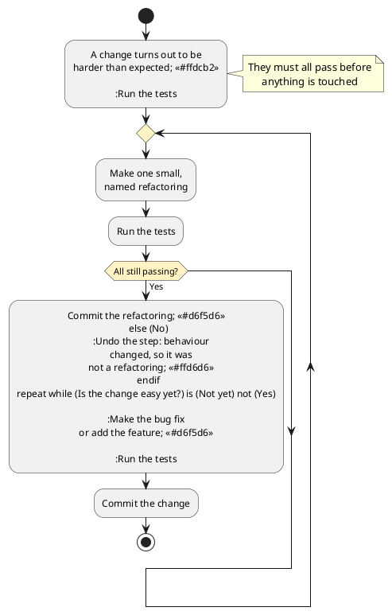

# Code Quality and Refactoring

Types help us ensure our programs are not malformed. Tests demonstrate that behaviour matches its contract. In the previous two chapters, we examined whether a published contract serves the people who depend on it. All of these things judge a program's _behaviour_ (in short, the outputs observed for given inputs). 

But two codebases that have the same behaviour, can differ in their capacity to evolve. Unlike behaviour, there is no direct check to validate the evolvability of a system. A program can pass every test in its suite and honour every contract it publishes, and still be resistant to change. The resistance to change is never visible at the time it is introduced: it appears over time as subsequent changes get harder and harder to make.

_Refactoring_ is the process of changing a software system without altering its behaviour, usually to improve the evolvability of a software system. It is most often performed to prepare for [fixing a bug](./05_debugging.html) or [adding a new feature](./06_new_features.html), to  help reduce the cost of that change.

#### A Tracker That Grew

Months pass, and we continue to work our package tracking system from the previuos chapters:

> As the team maintaining the tracker, we want adding a carrier to only take a day (like it originally did), so that we can take on the integrations our customers are asking for. The last two took a week each.

The design from the earlier chapters was sound. Each carrier had an adapter, the adapters implemented `CarrierClient`, and the tracker depended on the interface and knew nothing about any particular carrier. Adding a carrier was supposed to require a new class, plus one line where the carriers are assembled.

Three carriers later, adding a carrier requires much more. Each carrier introduced a small complication, which we handled where it appeared, but together the complications have moved carrier-specific knowledge out of the adapters and into the middle of the system. 

Recall from [Chapter 18](./02_consuming_data.html) we had a `ShipmentStatus` type:
```typescript
type ShipmentStatus = "in-transit" | "delivered" | "exception";
```

We built this type because Carrier A returned these exact statuc codeswhen we first wrote the tracker. But somewhere over the past few months, it changed and sends different codes, e.g. `DEL` for delivered. To deal with this, we used `as ShipmentStatus` to copy each carrier's status words into `Shipment.status`, then added a method to `ParcelTracker` to normalize this to actual `ShipmentStatus`es later:

```typescript
// in ParcelTracker.ts: applied to the status of every shipment the built-in adapters return
function normaliseStatus(carrierId: string, raw: string): ShipmentStatus {
    if (carrierId === "carrier-a") {
        if (raw === "DEL") {
            return "delivered";
        }
        if (raw === "RTS") {
            return "exception";
        }
        return "in-transit";
    }
    if (carrierId === "carrier-b") {
        if (raw === "Delivered") {
            return "delivered";
        }
        if (raw === "Delivery failed") {
            return "exception";
        }
        return "in-transit";
    }
    // three more carriers, each with its own status words
    return "in-transit";
}
```

These changes have ruined some of our earlier design decisions. The adapters' `as ShipmentStatus` makes it so before `normaliseStatus` is called, a `Shipment` can hold `"DEL"` (a status its type does not allow!). The extension point the adapters provided has also stopped working, because a new carrier now needs an edit in the middle of the system.

Yet, every test passes. The tracker is correct, the carriers all work. The trouble is in the structure: a function in the middle of the system now knows the status vocabulary of every carrier, so adding a sixth carrier means editing this function, and editing it means re-reading the five branches that already work. (If adding a new carrier takes two weeks of work, this is surely not the only place where we have such patchy structure, but for the purpose of the chapter, we'll stick to this one issue.)

Thus the goal of the user story: refactor until adding the sixth carrier is a small addition rather than a sprawling change.

## Two Kinds of Quality

The tracker illustrates a distinction between two kinds of quality.

**External quality** is whether the software does what it should. This is what users notice. Part 1 was mostly about establishing external quality, and we could measure it with a test suite.

**Internal quality** is whether a person can read the code, reason about it, and change it safely. Users can't evaluate it and tests do not report on it. It has no effect until somebody needs to make a change, and then it determines what that change costs. We spent a lot of time in Part 2 on this.  

The tracker has high external quality and declining internal quality. The two are relatively independent, meaing you can have correct and unreadable code, or well-organised and wrong code. 


In fact, you'll notice that properties that influence internal quality are distinct from the logic encoded in the program (which influences external quality):

- _Names:_ A reader learns a system mostly by reading its names. A misleading name costs more than an unhelpful one.
- _Length of functions/files/classes:_ A function that fits on one screen can be understood as a whole. A function that runs for three hundred lines has to be understood in pieces, which is hard when the pieces interact (which in most functions, they do).
- _Nesting depth:_ Each level of nesting (i.e. through another if statement) adds another condition the reader has to keep in mind while reading the code inside it.
- _"Why" Comments:_ It can be tempted to comment every line of code to explain what it does. But, an experienced reader can find out _what_ the code does by reading it. _Why_ the code does it, and what would break if it stopped, is often not recorded anywhere else. Without _why_ comments, it's easy for future maintainers to delete something a past maintainer realized was important. 

<details class="tooltip deep-dive">
<summary> "Why" Comments Provide Context. </summary>

Comments, in particular function-level documentation, are the best place to communicate information that is necessary to understand the purpose of a piece of code, when it is not obvious

Consider the `findSubVariable` [function](https://github.com/apache/hadoop/blob/765078ecf561f039112e072c33718d37557f867f/hadoop-common-project/hadoop-common/src/main/java/org/apache/hadoop/conf/Configuration.java#L1048) in Apache [Hadoop](https://hadoop.apache.org/). While it documents the parameters and return values, you'll notice it mostly details that this function exists because it's more performant than the first thing you'd think to do. Without this context, a future maintainer could look at the extra complication and decide to simplify the software system and get rid of this.  

</details>


## Technical Debt

While users can suffer from poor external quality, it's maintainers of the code that pay the cost of poor internal quality. 

A common way to think about internal quality is in terms of **technical debt**. Any time a shortcut is taken, some debt is incurred on the system or its design. This debt must be repaid later, when future changes are harder than they would otherwise have been. The metaphor is useful because it captures that debt is a cost that must be paid, that it is a cost that can be avoided, but also that debt is sometimes an intentional choice at the time it is incurred.

Sometimes we deliberately accrue debt. Shipping a simpler design to meet a deadline, while knowing what has been deferred and why, can be a rational decision. Realizing a year later that the design conflicted with the rest of the system is different: the team has simply learned about the difference as time passed. Most debt in a long-lived system is of this second, inadvertent kind. For example, in our tracker, the debt is inadvertent: nobody decided to move carrier knowledge into `ParcelTracker`, and that decision seemed reasonable when it was made.

Debt taken deliberately and prudently means the trade-off was considered and the reasoning was written down. Deliberate and reckless debt means the shortcut was taken without considering its cost. Inadvertent and reckless debt means there was no real design to begin with. Inadvertent and prudent debt is the learning case described above.

<details class="tooltip deep-dive">
<summary>Debt That Is Never Repaid</summary>

The metaphor of technical debt has a limit. Financial debt has a schedule: the payments are known in advance, and somebody notices when they stop. Technical debt has no schedule: the build does not fail because a design is poor, and no report says that the interest is rising. The cost appears only as changes taking longer than they should, which is easy to blame on the changes rather than on shortcomings of a degraded design.

This invisibility makes technical debt dangerous. Debt taken on deliberately should be recorded where a future maintainer will look: a comment in the code, an entry in the issue tracker, or a note in the documentation that says what was deferred and when it should be revisited. Six months later, debt that was never written down looks the same as a design somebody intended.

</details>

## Reading the Symptoms

A **code smell** is a visible sign of possible technical debt. A code smell does not always indicate a problem and does not require you to change anything; it is a hint that the design of a piece of code deserves a second look. (It's called a *smell* rather than something more precise because it's really just a hint)

You've seen many common code smells in this class. A _divergent change_ when you try to make an edit indicates [tangling](./01_coupling.html#cohesion-and-coupling), and _shotgun surgery_ when you try to make an edit indicates [scattering](./01_coupling.html#cohesion-and-coupling). These are two ways a design can fail to separate concerns, and most of the other smells derive from these top two:

| Smell | Where discussed |
|---|---|
| Shotgun surgery: one change, many files | Scattering ([Chapter 17](./01_coupling#cohesion-and-coupling)). |
| Divergent change: one file, many unrelated reasons to change | Tangling ([Chapter 17](./01_coupling#cohesion-and-coupling)). |
| Large class | The god class ([Chapter 11](../part2/02_decomposition#how-classes-lose-cohesion)). |
| Duplicated code | Don't repeat yourself ([Chapter 15](../part2/06_extension#abstract-base-classes)). |
| Long parameter list | The options object ([Chapter 19](./03_api_design#easy-to-use-hard-to-misuse)). |
| Feature envy: a method more interested in another object's data than its own | Tell, Don't Ask ([Chapter 17](./01_coupling#reaching-past-a-neighbour)). |
| Message chains: `a.b().c().d()` | The Law of Demeter ([Chapter 17](./01_coupling#reaching-past-a-neighbour)). |
| Primitive obsession: strings and numbers where a type belongs | Value objects ([Chapter 13](../part2/04_flexibility#immutable-values)). |
| Conditional on a type tag | Polymorphism instead of tag switching ([Chapter 15](../part2/06_extension#replacing-branches)). |

For instance, a _large class_ and a _conditional on a type tag_ are both tangled.  On the other hand, _duplicated code_ and _primitive obsession_ are scattered.

Tangling and scattering are fixed in opposite ways. Tangling is fixed by splitting: extracting a function, extracting a class, or replacing a conditional with polymorphism, so that each concern is better isolated. Scattering is fixed by consolidating: moving a method to the data it works on, introducing a parameter object, or replacing a primitive with a type, so that something spread across the code is gathered into one place. 

So, before you plan for a refactor, you must diagnose which problem you are trying to address. Splitting code that is already scattered leaves more fragments to keep consistent, and consolidating code that is already tangled can result in an even bigger mess.

For instance, the `normaliseStatus` function is tangled (because five carriers' status vocabularies share one function, _and_ scattered (because each carrier's knowledge is now split between its adapter and that function). The fix therefore has two parts: split the function by carrier (to address the tangling), and consolidate each piece in the adapter that already holds the rest of that carrier's knowledge (to address the scattering). 
<!--- CL: not sure what the point is
We have previously argued against conditionals that branch on a tag, and one has reappeared in a system that was designed to avoid them. --->

Smells should just be considered heuristics or rules of thumb. A long function that reads from top to bottom as a sequence of clearly named steps may be easier to follow than the six small functions it could be split into. The goal of smells is to tell you there's a few suspicious things to look at, not to say you _must_ operate on these things. 

## What Refactoring Is

**Refactoring** is changing the structure of code _without_ changing its behaviour. The second half of the definition distinguishes refactoring from other kinds of code editing.

Three kinds of change are commonly intertwined. Most of the discipline of refactoring is to keep the three kind sof change separate:

- _Refactoring_ changes structure without changing behaviour.
- _Adding a feature_ changes behaviour and should not change structure at the same time.
- _Fixing a bug_ changes behaviour to what it should have been.

Doing two of these in one change is how refactoring gained a reputation for being risky. If a single change reorganises three files and also changes what the code does, a failing test afterwards does not tell you whether the problem is due to the reorganisation or the new feature.

<details class="tooltip link-110">
<summary>Why This Did Not Come Up in CPSC 110</summary>

CPSC 110 never asked you to improve code that already worked. The design recipe produced code in a standard shape. The data definition determined the template, the template determined the function's structure, and following the recipe meant the result was already organised. There was nothing to clean up, because the recipe did the organising.

The recipe also assumed that the problem did not change. Real systems constantly change after they are written, and the recipes do not tell you where each change belongs. Code drifts out of shape because the structure that fitted the original problem no longer fits the problem the system now solves, even when nobody has been careless. Refactoring restores a design to a shape that fits what the system now has to do.

</details>

### Risk Now, Benefit Later

A feature gives users something they did not have. A bug fix restores behaviour that was supposed to exist. Each change carries risk, and each has a benefit to weigh against that risk.

Refactoring has no immediate benefit. You take working code and restructure it, and if everything goes to plan, the result behaves _exactly as it did before_. So what? No user or client notices, and it's not even better for you (yet). You have taken on the full risk of modifying a working system in exchange for a benefit that does not yet exist (i.e., hoping the refactor will make your next bug fix or feature  easier). 

Because the benefit is deferred and the risk is immediate, the risk has to be actively managed. Regression suites from [Chapter 9](../part1/09_validation#regression-testing) reduces this risk, when it is used in a specific workflow:

1. _Run the suite first, before touching anything._ Confirm the tests pass. This step is easy to skip, but is always the wrong choice. If a test was already failing when you started, a failure afterwards doesn't tell you whether your change is at fault.
2. _Make the change._
3. _Run the suite again._ It must pass exactly as it did before. If any result changed, you altered the behaviour, which means either the refactoring was wrong (or it was not a pure refactor).

This sequence gives you confidence in a change that would otherwise be impossible to verify. Without a test suite, "the behaviour is unchanged" is only a belief. With a test suite, the claim has been checked, and a mistake appears immediately, rather than weeks later as a defect report that nobody connects to the cleanup. 

But, there's an obvious issue with Step 1: the code that most needs refactoring is often the code least likely to have tests! Advice to "write tests first" does not help when the code is hard to test because of the structure you are trying to fix.

The solution is a **characterisation test**: a test that records what the code does now, rather than what it should do. You call the existing code, observe the result, and write that result into the test as the expected value, even when it looks wrong. The goal of testing in the workflow above is to detect changes in behaviour, so that a refactoring that alters behaviour is caught.

If the observed behaviour is a bug, the characterisation test documents it. We can then fix the bug  separately, after the refactoring, as its own change with its own new test(s). Anyone looking at the changes later can then clearly distinguish the bug fix from the refactor.

## Common Refactorings

Most refactoring is made up of a small number of standard program transformations. The names are used across the industry, and many of these changes are built into IDEs.

- _Rename_ something (e.g., a class, interface, field, method, parameter, variable) to describe what it is. Renaming carries little risk, especially with editor support, and a better name helps every later reader.
- _Extract function_ from a fragment that has a describable job, giving the fragment a name.
- _Extract class_ when a group of fields and the methods that use them form a responsibility of their own.
- _Inline_ a function or variable whose indirection no longer helps.
- _Remove dead code_ that nothing calls any more.
- _Move method_ to the class that owns the data it operates on. This is the fix for feature envy.
- _Replace a magic number with a named constant_, so the value's meaning is stated once.
- _Introduce a parameter object_ when the same group of arguments is always passed together.
- _Replace a primitive with a value object_, giving an invariant a home.
- _Replace conditional with polymorphism_ when a conditional is choosing between different kinds of thing.

It's useful to know these names, because the names tell a reader what to expect, including what should not have changed. A reviewer who reads "extract class" and finds an altered comparison operator has found a defect, but they wouldn't have noticed it if the change was called "cleaned up the tracker". Names also let a plan be discussed before any code is written. 


Further, each of these names describes its own sequence of program transformation steps. Adhering to this sequence keeps the program working while the change is half done. For example, for the _extract function_ refactoring, the steps are:

1. Create an empty function, and name it for what it does rather than how it does it.
2. Copy the fragment into the new function's body.
3. Work out what the fragment uses. Turn each variable read from the (original) surrounding code into a parameter. Turn  a variable that it writes into the return value. If it writes to more than one variable, stop, because the fragment is not ready to be extracted.
4. Replace the original fragment with a call to the new function.
5. Run the tests.

Apart from choosing the name, no step in that sequence requires understanding how the fragment computes its result. This is intentional. A refactoring you can perform mechanically is one you can perform on code you do not yet understand, and most of the code you work on will be code you did not write. Further, because of this mechnical nature, most IDEs can perform these steps for you automatically: select a block of code, choose 'refactor' and then 'extract function'. 


## Working in Small Steps

When a refactoring fails, the reason is rarely that the intended structure was a bad idea. It usually fails because the restructuring was attempted in one large change across many files, with the system broken partway through and no way to tell which part of the edit caused a failure.

The way to avoid this is a simple, repeated process:

1. Make one small change with a name, of the kind listed above.
2. Run the suite.
3. Commit while the tests all pass.
4. Repeat.

Each step leaves the system working. The work can be interrupted at any point without leaving a mess, a failure can only have been caused by the last small step, and any step can be reverted on its own. 

Here is that process applied to the tracker, with one named refactoring per step and the test suite passing at every commit:

1. _Move method, first half._ Add a private `toStatus` to `CarrierAClient`, holding a copy of carrier A's branches from `normaliseStatus`. Nothing calls it yet, so no behaviour can have changed.
2. _Move method, second half._ Have `CarrierAClient` convert its own status before returning, and have `ParcelTracker` skip `normaliseStatus` for carrier A's shipments. The skip is needed because `normaliseStatus` expects carrier A's own words: given an already converted `"delivered"`, carrier A's branch returns `"in-transit"`. That branch is now unused, so delete it. The skip stays, because without it the final `return "in-transit"` would do the same.
3. Repeat those two steps for each remaining carrier. This takes four more pairs of commits, each covering one carrier.
4. _Remove dead code._ `ParcelTracker` now skips `normaliseStatus` for every carrier, so nothing calls it. Delete it, along with the skip and the `carrierId` argument that existed only to feed it.

Note that we are effectively _replacing conditional with polymorphism_, but since `normaliseStatus` was deleted, we don't explicitly do this change. 

The result restores the structure the tracker was supposed to have. The `CarrierClient` interface, which the library publishes, has not changed, but each adapter has stopped passing raw status strings through it with a claim, and converts them itself:

```typescript
class CarrierAClient implements CarrierClient {
    // ... fetching as before ...

    /**
     * Converts one of carrier A's status words into a ShipmentStatus.
     *
     * @param {string} raw the status word from carrier A's response.
     * @returns {ShipmentStatus} the matching status; "in-transit" for any other word.
     */
    private toStatus(raw: string): ShipmentStatus {
        if (raw === "DEL") {
            return "delivered";
        }
        if (raw === "RTS") {
            return "exception";
        }
        return "in-transit";
    }
}
```

Each adapter still ends with `return "in-transit"`, so a status a carrier has never sent is reported as in transit. That is a guess, and the converter in [Chapter 18](./02_consuming_data#converting-not-claiming) rejected unknown statuses instead. But removing the guess would change behaviour, so it is not part of this refactoring. It is a fix, to be made separately with its own test.

Adding the sixth carrier now means writing a class that implements an interface and listing it where the carriers are assembled, which is what the design promised in the first place, and no existing adapter changes. In the vocabulary of [Chapter 16](../part2/07_ocp#the-axis-of-change), the refactoring restored an extension point that had always been there but had stopped working.

The refactoring added no feature, fixed no bug, and changed no behaviour. Every shipment that resolved to `delivered` before still resolves to `delivered`, and the existing suite confirms this. The only change is where the knowledge lives, and therefore what the next change will cost. No exported signature changed, so no client of `@parcel/tracking` can tell that this happened. This was possible because we published a small surface, keeping the implementation freedom we sought in [Chapter 19](./03_api_design#choosing-the-surface) .

## Refactoring Process

The process of refactoring looks like this:


<!-- caption="Refactoring as preparation: the test-refactor-test loop runs until the change that prompted it becomes easy. Orange marks the change that prompted the refactoring, green marks steps that move the work forward, and red marks a step that is undone." -->

The diagram adds one point to the process described above: the loop stops for a reason outside the refactoring itself, when the change you originally came to make has become easy. 

Two habits support this process. First, keep each diff (what is changed in a commit) focused, so that a refactoring commit contains the restructuring and nothing else. Leave out incidental reformatting and unrelated tidying, so that a reviewer does not have to search for the actual change. Second, read your own diff before anyone else does. It is easier to ask "would a stranger understand why this changed?" while your reasoning is still fresh.

<details class="tooltip ts-tips">
<summary>Let the Editor Do It</summary>

Editors with TypeScript support can perform several of these refactorings automatically. The automated version is safer than a manual edit, because the tool works with the structure of the program rather than with its text.

Renaming a symbol updates every reference to it across the project, and leaves alone anything that merely has the same spelling. Rename in particular is so common it is typically not hidden in a refactoring menu, you will often see it called 'rename symbol', 'rename identifier', or just simply 'rename'. A find-and-replace cannot make this distinction. Extracting a function works out which variables the fragment uses, turns them into parameters, and returns what the surrounding code needs. Both are standard editor commands.

Look for an automated version before making a structural edit by hand. Hand edits are where missed call sites come from, and a missed call site is one way a refactoring can change behaviour.

</details>

## When Not to Refactor

Refactoring is not always the answer.

_Do not refactor code you have no reason to change._ Leaving working code alone costs nothing, however unpleasant it is to read. Internal quality is worth paying for where change is expected.

_Do not refactor without a way to detect behaviour change._ Without an effective test suite, or characterisation tests written first, you are only hoping that the behaviour is preserved.

_Do not refactor past the point where the upcoming change becomes easy._ The goal is the change you came to make, not a design you find satisfying. 

_Do not refactor and change behaviour in the same commit._ This is the most commonly-violated guideline around the refactoring process.

#### Refactoring as Preparation

Internal quality is invisible until somebody needs to change something, and then it matters a great deal. The tools that measure correctness cannot measure it, which is why it degrades unnoticed in systems whose tests all pass.

Internal quality is best maintained by improving the structure when you have a specific reason to, rather than through scheduled cleanups or a uniform standard of tidiness. The reason is usually a bug to fix or a feature to add, in a part of the system that is currently awkward to work in. At that point, the upcoming change shows you which improvements you need, and you know you have done enough when the change becomes easy.

The main lesson of this chapter, as [Kent Beck](https://en.wikipedia.org/wiki/Kent_Beck) once said, is: "make the change easy, then make the easy change". 

<details class="tooltip exercise">
  <summary>Exercise: A Report That Grew</summary>

> As a shift supervisor, I want a daily summary of what happened in the warehouse, so that I can see problems without reading the raw logs.

The summary started as a count of orders. Over a year, it gained totals, exceptions, staff hours, and two output formats. Nobody has been careless, and every test passes.

```typescript
type WarehouseEvent = { kind: string; id: string; amount: number };

function buildSummary(events: WarehouseEvent[], format: string, includeStaff: boolean,
                      includeExceptions: boolean, currency: string): string {
    let out: string = "";
    let orders: number = 0;
    let total: number = 0;
    for (const e of events) {
        if (e.kind === "order") {
            orders = orders + 1;
            total = total + e.amount * 1.05;   // tax
            if (format === "html") {
                out = out + "<li>" + e.id + "</li>";
            } else {
                out = out + e.id + "\n";
            }
        }
        if (e.kind === "exception") {
            if (includeExceptions) {
                if (format === "html") {
                    out = out + "<li class='err'>" + e.id + "</li>";
                } else {
                    out = out + "! " + e.id + "\n";
                }
            }
        }
    }
    // staff hours, in the same shape again
    return out;
}
```

A request has arrived to add a third output format.

Work through the following:

1. _Name the smells._ Identify at least four smells in this function, using the vocabulary from this chapter, and for each say which earlier chapter argued against it.
2. _Establish a safety net._ You have no tests. Describe the characterisation tests you would write first, and explain what makes them adequate for this particular refactoring. What would you do about the `1.05` if you suspected it was wrong?
3. _Sequence the work._ List the individual refactorings you would make, in order. Each should be named, and each should be small enough to leave the suite passing. State what you would run after each one.
4. _Do the central one._ The formats are what make the change hard. Restructure the code so that adding a third format is an addition rather than an edit, and show the resulting design.
5. _Judge the boundary._ Which parts of this function would you leave alone, and why? Name one improvement you can see but would not make as part of this task, and say what would have to change for it to become worth making.
6. _Check the finish line._ After your refactoring, describe what adding the third format now involves, and how you would know whether the restructuring preserved behaviour.

<!-- Potential unverified solution:

```typescript
import { describe, test, expect } from "vitest";

// Chapter 20 exercise: A Report That Grew (question 4, with the characterisation tests from question 2)

type WarehouseEvent = { kind: string; id: string; amount: number };

// The original, kept while refactoring so the characterisation tests can compare against it.
function buildSummaryOriginal(events: WarehouseEvent[], format: string, includeStaff: boolean,
                              includeExceptions: boolean, currency: string): string {
    let out: string = "";
    let orders: number = 0;
    let total: number = 0;
    for (const e of events) {
        if (e.kind === "order") {
            orders = orders + 1;
            total = total + e.amount * 1.05;   // tax
            if (format === "html") {
                out = out + "<li>" + e.id + "</li>";
            } else {
                out = out + e.id + "\n";
            }
        }
        if (e.kind === "exception") {
            if (includeExceptions) {
                if (format === "html") {
                    out = out + "<li class='err'>" + e.id + "</li>";
                } else {
                    out = out + "! " + e.id + "\n";
                }
            }
        }
    }
    // staff hours, in the same shape again
    return out;
}

// After the central refactoring: each output format is a class, and adding a third is an addition.

/**
 * Renders the lines of a summary in one output format.
 */
interface SummaryFormat {
    /**
     * Renders one order.
     *
     * @param {string} id the order's identifier.
     * @returns {string} the text for that order, including any line ending.
     */
    orderLine(id: string): string;

    /**
     * Renders one exception.
     *
     * @param {string} id the exception's identifier.
     * @returns {string} the text for that exception, including any line ending.
     */
    exceptionLine(id: string): string;
}

class TextFormat implements SummaryFormat {
    public orderLine(id: string): string {
        return id + "\n";
    }

    public exceptionLine(id: string): string {
        return "! " + id + "\n";
    }
}

class HtmlFormat implements SummaryFormat {
    public orderLine(id: string): string {
        return "<li>" + id + "</li>";
    }

    public exceptionLine(id: string): string {
        return "<li class='err'>" + id + "</li>";
    }
}

/**
 * Builds the daily summary.
 *
 * @param {WarehouseEvent[]} events the day's events, in order.
 * @param {SummaryFormat} format how each line is rendered.
 * @param {boolean} includeExceptions whether exception events appear.
 * @returns {string} the rendered summary.
 */
function buildSummary(events: WarehouseEvent[], format: SummaryFormat, includeExceptions: boolean): string {
    let out: string = "";
    for (const e of events) {
        if (e.kind === "order") {
            out = out + format.orderLine(e.id);
        }
        if (e.kind === "exception") {
            if (includeExceptions) {
                out = out + format.exceptionLine(e.id);
            }
        }
    }
    return out;
}

// The third format is a new class; buildSummary does not change.
class CsvFormat implements SummaryFormat {
    public orderLine(id: string): string {
        return "order," + id + "\n";
    }

    public exceptionLine(id: string): string {
        return "exception," + id + "\n";
    }
}

const events: WarehouseEvent[] = [
    { kind: "order", id: "o1", amount: 10 },
    { kind: "exception", id: "x1", amount: 0 },
    { kind: "order", id: "o2", amount: 20 },
    { kind: "staff", id: "s1", amount: 8 }
];

describe("characterisation of the original", () => {
    test("text with exceptions", () => {
        expect(buildSummaryOriginal(events, "text", false, true, "CAD")).to.equal("o1\n! x1\no2\n");
    });
    test("text without exceptions", () => {
        expect(buildSummaryOriginal(events, "text", false, false, "CAD")).to.equal("o1\no2\n");
    });
    test("html with exceptions", () => {
        expect(buildSummaryOriginal(events, "html", false, true, "CAD")).to.equal("<li>o1</li><li class='err'>x1</li><li>o2</li>");
    });
    test("html without exceptions", () => {
        expect(buildSummaryOriginal(events, "html", false, false, "CAD")).to.equal("<li>o1</li><li>o2</li>");
    });
    test("includeStaff and currency change nothing", () => {
        expect(buildSummaryOriginal(events, "text", true, true, "EUR")).to.equal(buildSummaryOriginal(events, "text", false, true, "CAD"));
    });
});

describe("the refactored summary preserves behaviour", () => {
    test("matches the original for every format and flag", () => {
        expect(buildSummary(events, new TextFormat(), true)).to.equal(buildSummaryOriginal(events, "text", false, true, "CAD"));
        expect(buildSummary(events, new TextFormat(), false)).to.equal(buildSummaryOriginal(events, "text", false, false, "CAD"));
        expect(buildSummary(events, new HtmlFormat(), true)).to.equal(buildSummaryOriginal(events, "html", false, true, "CAD"));
        expect(buildSummary(events, new HtmlFormat(), false)).to.equal(buildSummaryOriginal(events, "html", false, false, "CAD"));
    });
    test("a third format is a new class", () => {
        expect(buildSummary(events, new CsvFormat(), true)).to.equal("order,o1\nexception,x1\norder,o2\n");
    });
});
```

Model answers for the discussion parts.

1. _Name the smells._ Long parameter list, two of them booleans (control coupling, Chapter 17; the options object, Chapter 19). Conditional on a type tag, `format === "html"`, repeated (replacing branches with polymorphism, Chapter 15). Duplicated code: the html/text pair appears once per event kind and the comment promises a third copy (Don't repeat yourself, Chapter 15). Magic number `1.05` (a documented constraint with a name, Chapter 3). Primitive obsession: `kind` and `format` are strings where a union or a type belongs (unions, Chapter 2; value objects, Chapter 13). Divergent change: a new format and a new event kind both edit this one function (tangling, Chapter 17). Dead code: `orders` and `total` are computed and never used, and `includeStaff` and `currency` are never read.
2. _Establish a safety net._ Call the function as it is on a fixed list holding an order, an exception and an event of another kind, for each format (`"html"`, `"text"`, and one unexpected value), with `includeExceptions` true and false, and record the exact strings as expected values; add one test showing that `includeStaff` and `currency` change nothing. That is adequate because the only observable output is the returned string, and those inputs take every branch the formats have. The `1.05` affects nothing observable, since `total` is never returned, so no characterisation test can see it: write the suspicion down as a separate issue, leave it alone during the refactoring, and when `total` goes as dead code the suite confirms the output is unchanged. If totals are ever added to the output, the rate gets its own test then.
3. _Sequence the work._ (1) Write the characterisation tests and run them. (2) Remove dead code: `orders`, `total` and the `1.05`; run. (3) Extract function: `orderLine(id, format)` and `exceptionLine(id, format)`, each holding one html/text conditional; run. (4) Replace conditional with polymorphism: introduce `SummaryFormat` with `TextFormat` and `HtmlFormat`, and have the two functions delegate; run. (5) Change the signature to take a `SummaryFormat` and drop `includeStaff` and `currency`; this changes callers, so adapt them in the same commit or keep a thin wrapper that maps the string to a class at the edge; run. (6) Inline the two one-line functions; run. Commit after each green run.
4. See the code above: a third format is `CsvFormat`, a new class, and `buildSummary` does not change.
5. _Judge the boundary._ Leave the event loop and the `kind` checks: event kinds are a second axis of change, and this request is about formats. Leave `includeExceptions`: it is control coupling, but it has two modes and nothing about a third format needs it gone. Leave the staff-hours comment. An improvement seen but not made: give each event kind its own class with a `render(format)` method, so a new kind is an addition too. It becomes worth making when a request for a new event kind arrives.
6. _Check the finish line._ Adding the third format is one new class and one line where the format is chosen. Behaviour was preserved if the characterisation suite passed unchanged after every step, and the refactored function agrees with the original on the same inputs, which the last test above checks directly.
-->

</details>
