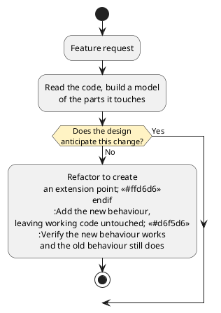

# Adding New Features

The previous chapter dealt with behaviour that was supposed to work but did not. This chapter deals with behaviour that does not exist yet. Requests for new behaviour keep arriving for as long as people use a system, and that is a sign of success.

Adding a feature draws on everything in Part 3. Most of the work is reasoning: working out what is actually being asked, building a model of the system, deciding where and how the design can accommodate the change, making the change without damaging the system in some unexpected way, and knowing when you are finished.

#### Two Requests

The tracker has been in production for a year, and two requests arrive in the same week.

> As a shopper, I want parcels from a sixth carrier to appear alongside the others, so that I still have one place to look.

> As a shopper, I want to be told when a parcel is delayed, so that I can act before it becomes a problem.

As requirements, these look similar. Each is one sentence, each is clearly worth doing, and a plan that estimated both at a couple of days would seem reasonable in a meeting. In practice, one of them will take a couple of hours, and the other will take much longer. Most of the difference comes from the design the two requests meet, not from notifications being harder to build than carriers.

## Feature Requests

A request states a need. It is neither a specification nor a design, and treating it as either is the first way this work goes wrong.

People who make requests usually cannot judge what they will cost, and the reason is structural rather than a failure of communication. Software has no physical form that shows its structure. If someone asks to move a wall in a building, everyone in the room understands that this is a bigger request than moving a desk, because the difference is visible. Code gives no such cue. As text, every line looks equally easy to edit, and nothing on the page distinguishes a line that forty other places depend on from a line that nothing calls. A request that cuts across the structure of a design looks exactly like one that follows it.

Software can be changed in ways a building cannot, and that is its main advantage. But being able to edit any line is not the same as being able to change any behaviour cheaply, and the difference is invisible from outside the code. Fred Brooks, whose distinction between essential and accidental complexity appeared in the [introduction](../why-this-course), counted both of these properties among the essential difficulties of building software. He called them _changeability_, because software is always under pressure to change, and _invisibility_, because its structure cannot be seen. Better tools will not remove either one, because both come from software having no physical form.

In practice, part of receiving a request is making its cost visible to the person who asked, as early as possible. Only someone who knows the code can tell them that one request fits what the system was built to accommodate and another does not.

"Tell me when a parcel is delayed" leaves several decisions open:

- What counts as delayed: later than the carrier's estimate, no movement for two days, or an explicit exception status.
- How the shopper is told: email, push notification, or a badge in the app.
- How often they are told if the parcel stays delayed for a week.
- Which parcels are included: every parcel, or only the ones the shopper has asked to watch.

None of these are implementation details. Each is a decision about what the feature does. If the requester does not make these decisions, a developer will end up guessing at them while writing the code.

Many chapters of this textbook have used a user story, which states a role, a goal, and a benefit. Turning a request into something buildable means writing a story like those, and adding acceptance criteria that are concrete enough to tell you when you are done. The questions to resolve before writing any code are the ones whose answers change the design:

- Who is this for, and what will they do differently once they have it?
- What does success look like, stated as something observable?
- What is explicitly not included?

The last question is easy to skip, but without an answer the feature has no stated boundary, and a feature with no stated boundary grows while it is being built, because every related improvement looks small from inside the work.

For the delay request, suppose the conversation settles the open decisions this way: a parcel counts as delayed when its carrier reports an `exception` status, the shopper is told once each time a parcel becomes delayed, through the existing notification channel, and other ways of being late are not included for now. That gives an acceptance criterion a test can check: the first lookup that finds a parcel delayed sends exactly one message, and later lookups of the same delayed parcel send none.

"This should not be built here" is also a legitimate answer. A request that would add a payment provider to a parcel tracker, or that duplicates something another team already publishes, is better answered with a conversation than with code.

## Reading Unfamiliar Code

Assume you did not write the system. It is the normal case, and the one to practise. The goal is narrower than it might seem: you need a model of the parts the change touches, not an understanding of the whole program. On a system of any size, waiting until you understand everything means never starting.

The following approaches are listed roughly in order of how much they return for the time spent:

_Follow one real path from start to finish._ Pick one operation a user performs, start at the entry point, and trace it through to where it produces a result. One complete path teaches you more about how a system is organised than an hour of reading files in whatever order the editor lists them.

_Read the tests._ A test suite is an executable description of what the code promises, written by somebody who had to be specific. Tests also show the intended way to construct objects and use the system, which is often easier to learn from than the implementation.

_Read the types and the data first._ The shapes of the data constrain what the logic can do. A `Shipment` with three fields tells you a lot about what the tracker can and cannot report before you read a single function.

_Follow the dependency graph, not the file listing._ The dependency arrows from Chapter 17 show what depends on what, and that is the structure to learn.

_Run it in the debugger._ Watching one path execute with real values corrects a mental model faster than reading does.

Here is the first approach applied to the tracker. The screen calls `tracker.locate({ trackingNumber: "Z2200417" })`. The request names no carrier, so `locate` asks each `CarrierClient` in its list in turn. Each of those is an adapter for one carrier's web service. The one that recognises this number, `CarrierCClient`, builds a URL, calls `fetch`, and converts the response, mapping the carrier's own status words to the `ShipmentStatus` values the rest of the system uses. The adapter returns a `Result<Shipment, TrackingError>`, and `locate` returns the first successful result, or one of the `TrackingError` cases documented in Chapter 19 when no carrier has the parcel.

After four files, there is already enough to work with. A carrier is named in exactly two places: its adapter, and the list of carriers in `createTracker`. A raw status is converted to a `ShipmentStatus` in one place for each carrier, inside its adapter. A shipment first exists as a value this system understands when an adapter returns it, which is the earliest point where anything about it could be noticed. The first request will only need the first of these facts. The second request needs the third.

Two habits help. First, when a test and a comment disagree, trust the test, because a comment can be years out of date but a passing test describes what the code does today. Second, when you notice the code disagreeing with its documentation, write the disagreement down. It is either a defect or a place where the documentation misled you, and both matter to the next reader.

<details class="tooltip link-110">
<summary>The Wish List, Again</summary>

CPSC 110 gave you a technique for working on something you cannot finish yet. When a function needed a helper that did not exist, you wrote the helper's signature and purpose on a wish list, called it as though it were finished, and continued with the function you had set out to write.

Reading an unfamiliar system needs a similar discipline. You will often encounter things you do not understand, and investigating each one immediately turns a two-hour orientation into a two-day one that ends nowhere near the change you came to make. Keep a list instead. Note what the thing appears to do, note that you have not checked it, and continue along the path you were following. Most entries turn out not to matter for this change, and you can investigate the few that do once you know why you need them.

</details>

## Extension Points

Once you have a model of the relevant parts, the design question is where the change belongs. A useful way to ask it is: where did the existing design anticipate a change of this kind?

Such a place is an extension point, the term [Chapter 16](../part2/07_ocp#the-axis-of-change) used for a place where behaviour can be varied by adding code rather than editing existing code. That chapter looked at extension points from the point of view of the person creating one, who chooses an axis of change and decides whether the indirection is justified. This chapter looks at them from the point of view of someone who has inherited a design and needs to know what changes it will accept. Much of the industry literature uses a closely related term, _seam_, for a place where behaviour can be changed without editing the code around it.

The last two parts of the textbook have built several kinds of extension point, and they are easy to recognise:

- An interface with more than one implementation. New behaviour is added as a new implementation.
- An abstract class with subclasses, where the base class defines a sequence of steps and leaves some of them for subclasses to fill in.
- A collaborator passed in through a constructor rather than created internally, which can be replaced with a different one.
- A composition root, the one place where concrete classes are chosen and connected, from [Chapter 18](./02_consuming_data#supplying-the-dependency). This is where a new choice is registered.

All four rely on separation of concerns, from [Chapter 17](./01_coupling#cohesion-and-coupling). An extension point exists wherever a concern has been given its own place behind a contract, such as delivery over a channel, retrieval from a carrier, or formatting a message. A concern with its own boundary can be replaced through that boundary. A concern tangled into a class that does three other things cannot be changed without changing the other three.

When a request fits an extension point, the work is small. The sixth carrier is such a request, and the change is one new class:

```typescript
class CarrierFClient implements CarrierClient {
    /** The name a TrackingRequest uses for this carrier. */
    public readonly id: string = "carrier-f";
    /** The root URL of this carrier's web service. */
    private readonly baseUrl: string;

    /**
     * Creates a client for the carrier's web service at `baseUrl`.
     *
     * @param {string} baseUrl the root URL of the carrier's web service.
     */
    public constructor(baseUrl: string) {
        this.baseUrl = baseUrl;
    }

    public async track(trackingNumber: string): Promise<Result<Shipment, TrackingError>> {
        // this carrier's URL scheme, its JSON, its status vocabulary
    }
}
```

and one line where the system is assembled:

```typescript
// in createTracker, the library's composition root
const tracker: ParcelTracker = new ParcelTracker([
    new CarrierAClient("https://api.carrier-a.example"),
    // ... four more ...
    new CarrierFClient("https://api.carrier-f.example")
]);
```

As a diff, the change is one new file, one line added where the list of carriers is assembled, and one new test file. `ParcelTracker`, the existing adapters and the existing tests are all unchanged, and the existing suite still passes. The Open/Closed Principle from Chapter 16 promised this benefit. The system grew by addition alone, and the only new tests are the ones for the new carrier.

The work that made this change cheap was done earlier, when somebody defined `CarrierClient` instead of calling carriers directly, and when Chapter 20's refactoring moved the status vocabulary back out of the middle of the system.

## No Extension Point

The notification request has no such extension point, and this is the usual case. No design anticipates everything, and a design that tried would be buried in indirection.

### Forcing the Change In

The tracker has no concept of a shipment being watched over time, no point at which "something happened to this parcel" is treated as an event, and no place from which a message could be sent. One obvious way to force the feature in is:

```typescript
class ParcelTracker {
    public async locate(request: TrackingRequest, notifier?: Notifier): Promise<Result<Shipment, TrackingError>> {
        // ... find the shipment as before ...
        if (notifier !== undefined) {
            if (found.ok === true) {
                if (found.value.status === "exception") {
                    notifier.send("Your parcel is delayed");
                }
            }
        }
        return found;
    }
}
```

This works, but it contains three separate mistakes.

First, it gives `locate` a side effect. **Command-query separation** is the guideline that a method should either return a value or change something, but not both: a query answers a question and changes nothing, and a command changes something and returns nothing. `locate` was a query, so it could be called twice, from a test, in a loop, or not at all, and nothing visible changed. Now any caller that passes a `Notifier` sends a message every time it looks up a delayed parcel. If the screen that refreshes every thirty seconds passes one, the shopper is told about the same delay every thirty seconds.

Second, it passes a parameter through code that does not need it. Any code that wants notifications has to get a `Notifier` to every place that calls `locate`, so code between the screen and the tracker has to carry a `Notifier` it never uses. This is how the scattering from Chapter 17 is created, one parameter at a time.

Third, it puts the delay rule in the wrong place. What counts as delayed is a policy, and it now lives inside the tracker's lookup method, where the next policy question will be added beside it as another conditional. When a feature seems to require a query to start changing things, that change usually belongs somewhere else.

### Refactoring First

The alternative is the sequence [Chapter 20](./04_refactoring#refactoring-as-preparation) recommended: make the change easy, then make the easy change. That means two pieces of work in a deliberate order, and the first one adds no feature at all.

_First, create the extension point._ The tracker needs a place where it announces each shipment it observes, and anything interested in those observations needs a contract to implement. This is the `PlayObserver` design from [Chapter 17](./01_coupling#dependency-cycles), used here so that the tracker does not need to know what anyone does with the information:

```typescript
/**
 * Notified whenever the current state of a shipment has been retrieved.
 */
interface ShipmentObserver {
    /**
     * Called after a shipment has been successfully looked up.
     *
     * @param {Shipment} shipment the state the carrier reported.
     */
    shipmentObserved(shipment: Shipment): void;
}
```

```typescript
class ParcelTracker {
    /** The carriers to ask, in the order they are asked. */
    private readonly carriers: CarrierClient[];
    /** Told about every shipment this tracker successfully looks up. */
    private readonly observers: ShipmentObserver[];

    /**
     * Creates a tracker that asks the given carriers and reports each shipment it finds to the observers.
     *
     * @param {CarrierClient[]} carriers the carriers to ask.
     * @param {ShipmentObserver[]} observers the observers to notify; none by default.
     */
    public constructor(carriers: CarrierClient[], observers: ShipmentObserver[] = []) {
        this.carriers = carriers;
        this.observers = observers;
    }

    public async locate(request: TrackingRequest): Promise<Result<Shipment, TrackingError>> {
        // ... find the shipment exactly as before ...
        if (found.ok === true) {
            for (const observer of this.observers) {
                observer.shipmentObserved(found.value);
            }
        }
        return found;
    }
}
```

With no observers supplied, the loop runs zero times, and the system behaves exactly as it did before. The existing suite confirms this by passing unchanged, which is the evidence that this commit was a refactoring. For every current caller, `locate` is still a query.

_Then, make the easy change._ The feature is now a class that implements the contract. It holds whatever state the delay rule needs, and it sends messages through the `Notifier` channel from [Chapter 14](../part2/05_boundaries#declaring-an-interface):

```typescript
class DelayAlerter implements ShipmentObserver {
    /** Where delay messages are sent. */
    private readonly channel: Notifier;
    /** For each tracking number observed so far, the status it was last observed with. */
    private readonly lastSeen: Map<string, ShipmentStatus>;

    /**
     * Creates an alerter that sends delay messages over `channel`.
     *
     * @param {Notifier} channel the channel to send delay messages over.
     */
    public constructor(channel: Notifier) {
        this.channel = channel;
        this.lastSeen = new Map<string, ShipmentStatus>();
    }

    /**
     * Sends one message when a shipment becomes delayed, and nothing while it stays delayed.
     *
     * @param {Shipment} shipment the state the carrier reported.
     */
    public shipmentObserved(shipment: Shipment): void {
        const previous: ShipmentStatus | undefined = this.lastSeen.get(shipment.trackingNumber);
        this.lastSeen.set(shipment.trackingNumber, shipment.status);

        if (previous === "exception") {
            return; // already told them
        }
        if (shipment.status === "exception") {
            this.channel.send("Your parcel " + shipment.trackingNumber + " is delayed.");
        }
    }
}
```

The only other change is one line at the composition root, where the `DelayAlerter` is passed in alongside the carriers.

Compare this result with the version that was forced in. `locate` no longer decides whether to send anything. It announces what it observed, and a repeated lookup of a delayed parcel does not produce repeated messages, because `DelayAlerter` remembers what it has already reported. No caller carries a `Notifier` it does not use. The delay policy lives in one class named for it, so changing what counts as delayed means editing that class and nothing else. The tracker knows nothing about notifications, so the next observer, such as an analytics recorder or an audit log, is another new class, registered at the composition root.

This design leaves two things to settle. First, a delay is noticed only when something looks the parcel up. If only the shopper's screen calls `locate`, the shopper learns of a delay while already looking at it, so the composition root also needs a scheduled job that looks up each tracked parcel, for example every hour. Second, once a `DelayAlerter` is registered, a lookup can send a message, so `locate` is no longer a pure query. What the observer design changes is who owns that effect and how often it happens: no caller asks for a message, and looking up a delayed parcel once or a hundred times sends one message.

`RecordingNotifier` from [Chapter 14](../part2/05_boundaries#test-doubles) and `StubCarrier` from [Chapter 18](./02_consuming_data#testing-without-the-network) let the feature be tested without a network or a real channel:

```typescript
describe("DelayAlerter", () => {
    test("a delayed parcel is reported once, however often it is looked up", async () => {
        const delayed: Shipment = { trackingNumber: "Z2200417", status: "exception", lastSeenAt: 1000 };
        const channel: RecordingNotifier = new RecordingNotifier();
        const tracker: ParcelTracker = new ParcelTracker(
            [new StubCarrier({ ok: true, value: delayed })],
            [new DelayAlerter(channel)]
        );

        await tracker.locate({ trackingNumber: "Z2200417" });
        await tracker.locate({ trackingNumber: "Z2200417" });

        expect(channel.sent).to.deep.equal(["Your parcel Z2200417 is delayed."]);
    });
});
```

As a diff, the notification feature is larger than the new carrier was. The new carrier changed no existing class. This feature adds a new contract and edits `ParcelTracker` to announce observations through it, although no existing caller or test has to change, because the new constructor parameter has a default value. That structural work changes no behaviour, so it goes in its own commit, separate from the commit that adds `DelayAlerter`. As Chapter 20 argued, two commits that each make one kind of change can be reviewed, and if necessary reverted, one at a time. For clients of the published library, the change adds one export and one optional parameter. Like the new operations and optional parameters in [Chapter 19](./03_api_design#breaking-changes)'s table, both are safe additions, so the change ships as a minor version. The forced-in version would also have passed that test, so compatibility alone does not show that a change is well designed.

<details class="tooltip deep-dive">
<summary>When the Refactoring Is Too Large</summary>

The advice to refactor first assumes that the refactoring is in proportion to the feature. Sometimes it is not. For example, creating the extension point a feature needs might take three weeks, while the feature is only worth two days.

This situation requires a decision, and the decision should be made deliberately rather than discovered halfway through the work. The options are to build the feature awkwardly and record the debt, to schedule the restructuring as its own piece of work with the feature waiting for it, or to decline the feature until something else makes the restructuring worthwhile.

Whichever option you choose, make the choice visible. Taking the awkward route knowingly, with the reason written down where the next person will find it, is ordinary engineering. Taking it because nobody considered the alternative is how a system ends up in the state described at the start of Chapter 20.

</details>

## Making the Change

Both routes follow the same overall process:


<!-- caption="Adding a feature. The design either anticipated the change or it must first be made to. The red step changes structure without adding behaviour; the green step adds behaviour without changing working code." -->

Before changing anything, find out who else is affected. Other callers, other teams, and anything published all limit what you can do. If the change affects a published API, apply the compatibility analysis from [Chapter 19](./03_api_design#breaking-changes) before writing any code.

Then break the work into steps that each leave the system working and tested, as Chapter 20 did for structural change. Do the uncertain parts early, while there is still time to change approach. If the delay rule turns out to need data the carriers do not provide, it is much better to discover that on the first afternoon than the last.

## When a Feature Is Done

Working code is only part of a finished feature, and features are often shipped half-finished because the rest is skipped. A feature is done when:

- The new behaviour has tests, including tests for its failure cases. What happens when the notification channel is unavailable is part of the feature.
- The whole regression suite passes.
- Documentation and contracts are updated. If a class gained state, its invariant is stated. If a published surface changed, its documentation changed with it.
- No new code smells were introduced, by the standards of Chapter 20.
- The next feature is not harder because of this one.

The last criterion distinguishes a feature that was added cleanly from one that was forced in. The tracker now has an observer extension point it did not have before, so the next request of this kind will be cheap. If the notification had been forced in as a parameter and a conditional, the system would have been slightly worse afterwards, and the next request slightly more expensive. Repeated over many features, this is how a codebase becomes one that nobody wants to work in.

#### What This Was All For

[Part 1](../part1/index) was about making programs correct: modelling information as types, stating contracts, maintaining invariants, and validating behaviour with tests. [Part 2](../part2/index) was about abstraction: bundling state with the operations that protect it, decomposing systems into cohesive classes, hiding what varies, and depending on contracts rather than implementations. Part 3 was about evolution: managing dependencies, working across boundaries you do not control, and changing systems that already exist.

Most of this material makes a single argument. Invariants, cohesion, encapsulation, interfaces, polymorphism, low coupling, validation at the edge, small published surfaces, and regression suites were each introduced for their own reasons, but all of them affect how easily a design can change. A class that protects its invariant can be modified without checking the whole program. A small contract is a promise you can keep while the implementation changes. A test suite makes any change checkable. Several of these ideas also help a program be correct, but together they determine what the program will cost to change.

That is why this chapter comes last. Adding a feature draws on all of these ideas at once, and work of this kind makes up most of professional software development.

The [introduction](../why-this-course) to this textbook argued that the skill of software construction still matters, whoever or whatever writes the code, because someone has to decide what to build, judge whether it is correct, and keep it changeable. If this course has done its job, you can now read code you did not write, state precisely what it should do, and change it with confidence. Later courses build on this for larger systems, more people, and longer timescales.

<details class="tooltip exercise">
  <summary>Exercise: A Feature for the Library System</summary>

You have inherited a library lending system. It tracks members, holdings, and loans, and it works.

```typescript
interface OverdueRule {
    isOverdue(loan: Loan, now: number): boolean;
}

class LendingDesk {
    private readonly loans: LoanStore;
    private readonly rule: OverdueRule;

    public constructor(loans: LoanStore, rule: OverdueRule) { /* ... */ }

    public checkOut(memberId: string, holdingId: string, now: number): Result<Loan, string> { /* ... */ }
    public renew(loanId: string, now: number): Result<Loan, string> { /* ... */ }
    public checkIn(loanId: string, now: number): Result<Loan, string> { /* ... */ }
    public overdueLoans(now: number): Loan[] { /* ... */ }
}
```

Two requests arrive.

> As a librarian, I want short-loan items to become overdue after two days instead of three weeks, so that high-demand books circulate faster.

> As a member, I want to be told when an item I have reserved becomes available, so that I do not have to keep checking.

Work through the following:

1. _Sharpen the requests._ For each, write the questions you would need answered before building it, and say which answers would change the design rather than only the implementation. Give an acceptance criterion for each that is concrete enough to test.
2. _Predict the cost._ Before designing anything, say which request you expect to be cheap and which you expect to be expensive. Justify your answer using the code above rather than the wording of the requests.
3. _Use the extension point._ One request fits an extension point this design already has. Identify it, and describe the change in terms of which files are created and which existing files are edited.
4. _Find the missing extension point._ The other request has no extension point. Write the version that forces it in, then name at least three specific problems with it, drawing on this chapter and earlier ones.
5. _Create the extension point, then use it._ Describe the two commits: the structural one that adds no feature, and the behavioural one that adds it. Say exactly what evidence would show that the first commit changed no behaviour.
6. _Judge completion._ List what would have to be true for you to call the second request done. Then answer the long-term question: is the next feature of this kind cheaper or more expensive than it was before you started?

<!-- Potential unverified solution:

```typescript
import { describe, test, expect } from "vitest";

// Chapter 22 exercise: A Feature for the Library System (questions 3 to 5)

type Result<T, E> = { ok: true; value: T } | { ok: false; error: E };

type Loan = {
    /** The loan's identifier. */
    id: string;
    memberId: string;
    holdingId: string;
    /** When the item was checked out, in milliseconds since the epoch. */
    checkedOutAt: number;
};

interface LoanStore {
    add(loan: Loan): void;
    find(loanId: string): Loan | undefined;
    remove(loanId: string): void;
    all(): Loan[];
}

interface OverdueRule {
    isOverdue(loan: Loan, now: number): boolean;
}

const dayMs: number = 24 * 60 * 60 * 1000;

/** The existing rule: three weeks for everything. */
class StandardRule implements OverdueRule {
    public isOverdue(loan: Loan, now: number): boolean {
        return now > loan.checkedOutAt + 21 * dayMs;
    }
}

// Question 3: the first request uses the OverdueRule extension point. One new file, one line
// in the composition root. The rule needs to know which holdings are short-loan, so it is
// given that list when it is built; LendingDesk, Loan and LoanStore do not change.
class ShortLoanRule implements OverdueRule {
    /** The holdings that circulate on the short-loan period. */
    private readonly shortLoanHoldings: string[];
    /** The rule for every other holding. */
    private readonly otherwise: OverdueRule;

    /**
     * Creates a rule that gives short-loan holdings two days and defers to another rule for the rest.
     *
     * @param {string[]} shortLoanHoldings the identifiers of the short-loan holdings.
     * @param {OverdueRule} otherwise the rule for every other holding.
     */
    public constructor(shortLoanHoldings: string[], otherwise: OverdueRule) {
        this.shortLoanHoldings = shortLoanHoldings;
        this.otherwise = otherwise;
    }

    public isOverdue(loan: Loan, now: number): boolean {
        if (this.shortLoanHoldings.includes(loan.holdingId)) {
            return now > loan.checkedOutAt + 2 * dayMs;
        }
        return this.otherwise.isOverdue(loan, now);
    }
}

// Question 5, first commit: the extension point. LendingDesk announces each returned item to
// observers it is given; with none, nothing changes.
/**
 * Notified when a loan ends.
 */
interface LoanObserver {
    /**
     * Called after an item has been checked in.
     *
     * @param {Loan} loan the loan that just ended.
     * @param {number} now when it ended, in milliseconds since the epoch.
     */
    loanEnded(loan: Loan, now: number): void;
}

class LendingDesk {
    private readonly loans: LoanStore;
    private readonly rule: OverdueRule;
    private readonly observers: LoanObserver[];

    /**
     * Creates a desk over a loan store.
     *
     * @param {LoanStore} loans where loans are kept.
     * @param {OverdueRule} rule decides when a loan is overdue.
     * @param {LoanObserver[]} observers told when a loan ends; none by default.
     */
    public constructor(loans: LoanStore, rule: OverdueRule, observers: LoanObserver[] = []) {
        this.loans = loans;
        this.rule = rule;
        this.observers = observers;
    }

    public checkOut(memberId: string, holdingId: string, now: number): Result<Loan, string> {
        for (const existing of this.loans.all()) {
            if (existing.holdingId === holdingId) {
                return { ok: false, error: "holding " + holdingId + " is already on loan" };
            }
        }
        const loan: Loan = { id: "L" + (this.loans.all().length + 1), memberId: memberId, holdingId: holdingId, checkedOutAt: now };
        this.loans.add(loan);
        return { ok: true, value: loan };
    }

    public checkIn(loanId: string, now: number): Result<Loan, string> {
        const loan: Loan | undefined = this.loans.find(loanId);
        if (loan === undefined) {
            return { ok: false, error: "no loan " + loanId };
        }
        this.loans.remove(loanId);
        for (const observer of this.observers) {
            observer.loanEnded(loan, now);
        }
        return { ok: true, value: loan };
    }

    public overdueLoans(now: number): Loan[] {
        const overdue: Loan[] = [];
        for (const loan of this.loans.all()) {
            if (this.rule.isOverdue(loan, now)) {
                overdue.push(loan);
            }
        }
        return overdue;
    }
}

// Question 5, second commit: the feature, as an observer. Nothing in LendingDesk changes.
interface Notifier {
    send(memberId: string, message: string): void;
}

interface ReservationStore {
    /** The members waiting for a holding, first in line first; empty when nobody is waiting. */
    waitingFor(holdingId: string): string[];
}

class ReservationNotifier implements LoanObserver {
    private readonly reservations: ReservationStore;
    private readonly notifier: Notifier;

    /**
     * Creates an observer that tells the first member in line when a reserved item comes back.
     *
     * @param {ReservationStore} reservations who is waiting for what.
     * @param {Notifier} notifier how members are told.
     */
    public constructor(reservations: ReservationStore, notifier: Notifier) {
        this.reservations = reservations;
        this.notifier = notifier;
    }

    public loanEnded(loan: Loan, now: number): void {
        const waiting: string[] = this.reservations.waitingFor(loan.holdingId);
        if (waiting.length > 0) {
            this.notifier.send(waiting[0], "The item you reserved (" + loan.holdingId + ") is available.");
        }
    }
}

// Test doubles
class MemoryLoans implements LoanStore {
    private readonly loans: Loan[] = [];
    public add(loan: Loan): void { this.loans.push(loan); }
    public find(loanId: string): Loan | undefined { return this.loans.find((l: Loan) => l.id === loanId); }
    public remove(loanId: string): void {
        const index: number = this.loans.findIndex((l: Loan) => l.id === loanId);
        if (index !== -1) { this.loans.splice(index, 1); }
    }
    public all(): Loan[] { return this.loans.slice(0, this.loans.length); }
}

class RecordingNotifier implements Notifier {
    public readonly sent: string[] = [];
    public send(memberId: string, message: string): void { this.sent.push(memberId + ": " + message); }
}

class FixedReservations implements ReservationStore {
    private readonly queue: { [holdingId: string]: string[] };
    public constructor(queue: { [holdingId: string]: string[] }) { this.queue = queue; }
    public waitingFor(holdingId: string): string[] {
        const waiting: string[] | undefined = this.queue[holdingId];
        if (waiting === undefined) { return []; }
        return waiting;
    }
}

describe("ShortLoanRule", () => {
    test("a short-loan item is overdue after two days, a regular one after three weeks", () => {
        const rule: OverdueRule = new ShortLoanRule(["H7"], new StandardRule());
        const short: Loan = { id: "L1", memberId: "m1", holdingId: "H7", checkedOutAt: 0 };
        const regular: Loan = { id: "L2", memberId: "m1", holdingId: "H8", checkedOutAt: 0 };
        expect(rule.isOverdue(short, 2 * dayMs)).to.equal(false);
        expect(rule.isOverdue(short, 2 * dayMs + 1)).to.equal(true);
        expect(rule.isOverdue(regular, 2 * dayMs + 1)).to.equal(false);
        expect(rule.isOverdue(regular, 21 * dayMs + 1)).to.equal(true);
    });
});

describe("LendingDesk with observers", () => {
    test("with no observers, a desk behaves as before", () => {
        const desk: LendingDesk = new LendingDesk(new MemoryLoans(), new StandardRule());
        const loan: Result<Loan, string> = desk.checkOut("m1", "H7", 0);
        expect(loan.ok).to.equal(true);
        expect(desk.overdueLoans(22 * dayMs).length).to.equal(1);
        expect(desk.checkIn("L1", 22 * dayMs).ok).to.equal(true);
        expect(desk.overdueLoans(22 * dayMs).length).to.equal(0);
    });

    test("the first member in line is told when a reserved item is returned", () => {
        const notifier: RecordingNotifier = new RecordingNotifier();
        const desk: LendingDesk = new LendingDesk(new MemoryLoans(), new StandardRule(), [
            new ReservationNotifier(new FixedReservations({ H7: ["m2", "m3"] }), notifier)
        ]);
        desk.checkOut("m1", "H7", 0);
        desk.checkIn("L1", dayMs);
        expect(notifier.sent).to.deep.equal(["m2: The item you reserved (H7) is available."]);
    });

    test("nobody is told when nobody is waiting", () => {
        const notifier: RecordingNotifier = new RecordingNotifier();
        const desk: LendingDesk = new LendingDesk(new MemoryLoans(), new StandardRule(), [
            new ReservationNotifier(new FixedReservations({}), notifier)
        ]);
        desk.checkOut("m1", "H9", 0);
        desk.checkIn("L1", dayMs);
        expect(notifier.sent).to.deep.equal([]);
    });
});
```

Model answers for the discussion parts.

1. _Sharpen the requests._ Short loans: which holdings are short-loan, and who decides (a flag on the holding, or a list the library keeps)? Is the period two calendar days or two opening days? Do loans already out change when the rule changes? Does a renewal get two days too? The design-changing answer is whether a loan knows its holding's category: a `Loan` carries only a `holdingId`, so either `Loan` gains the category or the rule has to be told. Acceptance: a short-loan item checked out at time `t` is not overdue at `t` plus two days and is overdue one millisecond later, while a regular item at both times is not. Reservations: what is a reservation and where is one kept (nothing today)? Does available mean returned, or returned and set aside? Who is told when several members reserved the same item, through which channel, and for how long is it held? The design-changing answers are that reservations and a notification channel do not exist, and that nothing marks the moment an item becomes available. Acceptance: when a holding with a reservation is checked in, the first member in line receives one message naming the item; with no reservation, no message.
2. _Predict the cost._ Short loans are cheap: `OverdueRule` is an interface the desk receives through its constructor, so the change is a new implementation and one line where the desk is built. Reservations are expensive: the desk has `checkIn`, but it announces nothing, and there is no reservation store, no notifier, and no concept of an item becoming available.
3. _Use the extension point._ See `ShortLoanRule` above. Created: `ShortLoanRule.ts` and its test file. Edited: one line in the composition root, where `new StandardRule()` becomes `new ShortLoanRule(shortLoanHoldings, new StandardRule())`. `LendingDesk`, `Loan` and `LoanStore` do not change.
4. _Find the missing extension point._ Forced in: `checkIn(loanId: string, now: number, reservations?: ReservationStore, notifier?: Notifier)`, which after removing the loan looks up the holding's queue and sends a message. Problems: `checkIn` is now a command that also runs a notification policy, so who is told and what is said live in the desk, where the next policy question will be added beside them; two parameters travel through every caller of `checkIn`, carried by code that never uses them (scattering, Chapter 17); every test of `checkIn` now has to consider notifications, and testing a notification needs a whole desk; the desk gains two concrete collaborators it did not need (coupling, Chapter 17); and because both parameters are optional, some callers will notify and others will silently not.
5. _Create the extension point, then use it._ First commit: `LoanObserver`, an `observers` constructor parameter with a default of `[]`, and a loop in `checkIn` that tells each observer. No feature is added. The evidence that nothing changed: the existing suite passes with no test edited, the diff touches no test file, and a new test (the first `LendingDesk` test above) shows a desk built with no observers behaves exactly as before, because the loop runs zero times. Second commit: `ReservationNotifier`, its two collaborators' contracts, the tests above, and one line in the composition root.
6. _Judge completion._ Done when: the notifier has tests for a waiting member, for nobody waiting, and for a channel that fails; the whole suite passes; `LendingDesk`'s documentation says it tells its observers when a loan ends, and `ReservationStore` and `Notifier` are documented; no new smells (the desk did not grow a conditional); and the composition root wires it in. The next feature of this kind, such as telling staff when an overdue item comes back or updating a display, is cheaper than before: it is one more `LoanObserver`.
-->

</details>
